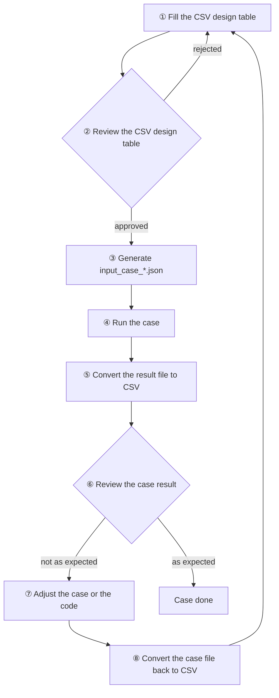

# a2a-t-corpus — A2A-T accuracy verification corpus module

## 1. Module introduction

a2a-t-corpus is the data-driven accuracy verification module of the A2A-T SDK. It calls the real SDK (against a real LLM) following the steps defined by each case, records the complete request and response, latency and tokens of every step, and reports the pass rate, used to judge whether the prompts reach the 95% target.

It currently covers **Task-T**, **Negotiation-T** (RAN energy-saving target / information / feasibility negotiation) and **Notification-T** (service recovery / incident subscription notification). Authorization-T will be added the same way once its reference scenarios stabilize.

Three things to know before use:

- **Test-only**: lives under `a2a-t-corpus/`, is not packaged into the `a2a_t` wheel, and is deselected in CI with `-m 'not live'`.
- **A real LLM is required**: when the three required `A2AT_LLM_*` settings are missing it fails with an actionable error; the `.env` keys match the project-root `env.example`.
- **The case format is shared with the Java repository**: case files, the schemas under `schemas/`, and the tools under `tools/` are kept identical across both repositories.

## 2. Module directory

```
a2a-t-corpus/
├── env.example                      configuration template, with the three required A2AT_LLM_* entries
├── .env                             local configuration (secrets, gitignored; copied from env.example)
├── README.md                        English guide
├── README_zh.md                     Chinese guide
├── schemas/
│   ├── input-case.schema.json       case format definition
│   └── output-result.schema.json    result format definition
├── tools/
│   ├── inputCsvToJson.py            CSV design table <-> input case file
│   ├── outputJsonToCsv.py           result file -> CSV review table
│   └── csv-templates/
│       └── input-case-template.csv  CSV design-table template (one example row)
├── conftest.py                      pytest options, runtime fixture, case parametrization
├── engine/                          framework code: config, case loading, scenario discovery,
│                                    API registry, recording, assertion, engine, assembly, report
└── suites/
    ├── task/
    │   ├── test_task_t_from_text_workflow.py   natural-language case suite
    │   ├── test_task_t_from_data_workflow.py   structured-input case suite
    │   ├── test_task_self_guard.py             structural self-guard (no LLM, runs in CI)
    │   └── resources/
    │       ├── ran-energy-saving-create/          RAN energy-saving task create
    │       │   ├── input_case_from_text.json      natural-language cases, hand-written
    │       │   └── input_case_from_data.json      structured-input cases, hand-written
    │       ├── ran-energy-saving-modify/          RAN energy-saving task modify
    │       │   ├── input_case_from_text.json
    │       │   └── input_case_from_data.json
    │       ├── ran-intelligent-backup-battery-endurance-create/   backup-battery endurance create
    │       │   ├── input_case_from_text.json
    │       │   └── input_case_from_data.json
    │       └── ran-intelligent-backup-battery-endurance-modify/   backup-battery endurance modify
    │           ├── input_case_from_text.json
    │           └── input_case_from_data.json
    ├── negotiation/
    │   ├── test_negotiation_t_from_text_workflow.py   natural-language case suite (propose / accept / reject / abort)
    │   ├── test_negotiation_t_from_data_workflow.py   structured-input case suite
    │   ├── test_negotiation_self_guard.py             structural self-guard (no LLM, runs in CI)
    │   └── resources/
    │       ├── ran-energy-saving-target-negotiation/      target negotiation
    │       │   ├── input_case_from_text.json
    │       │   └── input_case_from_data.json
    │       ├── ran-energy-saving-information-negotiation/ information negotiation
    │       │   ├── input_case_from_text.json
    │       │   └── input_case_from_data.json
    │       └── ran-energy-saving-feasibility-negotiation/ feasibility negotiation
    │           ├── input_case_from_text.json
    │           └── input_case_from_data.json
    └── notification/
        ├── test_notification_t_from_text_workflow.py   natural-language case suite
        ├── test_notification_t_from_data_workflow.py   structured-input case suite
        ├── test_notification_self_guard.py             structural self-guard (no LLM, runs in CI)
        └── resources/
            ├── service-recovery/        service recovery notification
            │   ├── input_case_from_text.json
            │   └── input_case_from_data.json
            └── subscribe-incident/      incident subscription notification
                ├── input_case_from_text.json
                └── input_case_from_data.json
```

Inside each scenario directory, `output_result_from_text.json` / `output_result_from_data.json` are result files written back by a run (gitignored) and need not be authored; the summary report is written to `a2a-t-corpus/.corpus/` (gitignored).

## 3. Tools

Cases are designed in CSV and run as JSON; two scripts convert between the two. All commands run from the repository root.

**Generate the case design-table template** (one example row, opens directly in Excel):

```
python a2a-t-corpus/tools/inputCsvToJson.py --template --out my-cases.csv
```

**Convert a CSV design table into an input case file** (structural validation on by default; the output lands in `input_case_from_text.json` or `input_case_from_data.json`):

```
python a2a-t-corpus/tools/inputCsvToJson.py --csv my-cases.csv --out a2a-t-corpus/suites/task/resources/<scenario>/input_case_from_text.json
```

**Convert an input case file back into a CSV design table** (reverse direction, for review; corresponds to step ⑧):

```
python a2a-t-corpus/tools/inputCsvToJson.py --reverse --csv a2a-t-corpus/suites/task/resources/<scenario>/input_case_from_text.json --out back.csv
```

**Convert a run-result file into a CSV review table** (one row per case, with the complete request / response of every step; corresponds to step ⑤):

```
python a2a-t-corpus/tools/outputJsonToCsv.py --json a2a-t-corpus/suites/task/resources/<scenario>/output_result_from_text.json --out review.csv
```

CSV design-table columns: the fixed columns `id`, `caseDimension`, `caseDesc`, `caseCategory`, `scenario`, then the per-step groups `stepN_api`, `stepN_args`, `stepN_expect_result`, `stepN_expect_data`, `stepN_expect_errCode`, `stepN_expect_errMessageContains`; the number of steps is unbounded.

## 4. Adding a case

The overall flow is below, followed by a walkthrough with a concrete case. All commands below run from the repository root (the project root that contains `pyproject.toml` and `a2a-t-corpus/`).



### 4.1 Example: add a text case to the ran-energy-saving-create scenario

Goal: under the Task-T suite's `ran-energy-saving-create` scenario, add a natural-language case `TC00000001` ("create a RAN energy-saving task in the Dongguan Songshan Lake area").

**① Fill the CSV design table**

Generate the template first:

```
python a2a-t-corpus/tools/inputCsvToJson.py --template --out my-cases.csv
```

Each row of the template is one case. How to fill the columns for this case:

| Column | Meaning | Value for this case |
| --- | --- | --- |
| `id` | case id, `TC` prefix, unique within the file | `TC00000001` |
| `caseDimension` | case dimension, used for statistics | `01-意图清晰参数完整` |
| `caseDesc` | case description | `创建档-标准创建诉求` |
| `caseCategory` | case category: `正常` / `异常` / `边界` | `正常` |
| `scenario` | owning scenario directory name | `ran-energy-saving-create` |
| `step1_api` | API called by step 1 (Java facade name) | `generateTaskPromptFromText` |
| `step1_args` | step 1 arguments (JSON) | `{"text":"在东莞松山湖片区创建无线网络节能任务：节能的小区制式：NR，……","templateUri":"Task-T/network-layer/ran-energy-saving/v1"}` |
| `step1_expect_result` | step 1 expected result: `success` / `error` | `success` |
| `step1_expect_data` | step 1 expected data (subset assertion, may be empty) | `{}` |
| `step1_expect_errCode` | expected error code (required when `error`) | empty |
| `step1_expect_errMessageContains` | expected message substring (optional) | empty |
| `step2_api` | API called by step 2 | `validateTaskPromptAndDataFilling` |
| `step2_args` | step 2 arguments; to pass a field from step 1's response use `{"$fromStep":1,"$field":"promptText"}` | `{"schema":{…},"templateUri":"Task-T/network-layer/ran-energy-saving/v1","promptText":{"$fromStep":1,"$field":"promptText"}}` |
| `step2_expect_result` | step 2 expected result | `success` |
| `step2_expect_data` | fields expected to be extracted at step 2 (response subset) | `{"operationType":"create","region":"东莞松山湖片区","startTime":"16:00:00Z","endTime":"04:00:00Z","energyTarget":"30%","energyTargetDirection":"reduce"}` |
| `step2_expect_errCode` | expected error code (required when `error`) | empty |
| `step2_expect_errMessageContains` | expected message substring (optional) | empty |

For more than two steps, keep adding `step3_*`, `step4_*`, …; the same API may appear multiple times.

**② Review the CSV design table**

Review by hand whether the case covers the target scenario and whether the expectations are reasonable. Once approved, go to ③; otherwise go back to ①.

**③ Generate the input case file**

Convert the design table into a case file:

```
python a2a-t-corpus/tools/inputCsvToJson.py --csv my-cases.csv --out a2a-t-corpus/suites/task/resources/ran-energy-saving-create/input_case_from_text.json
```

The conversion validates the format (unique ids, equal-length expectations and steps, known APIs and error codes, …) and fails on any problem. The generated case file can be run directly.

**④ Run the case**

Run this case through the suite (see "Running cases" for the full command reference):

```
uv run pytest a2a-t-corpus/suites/task/test_task_t_from_text_workflow.py -m live --corpus-scenario=ran-energy-saving-create --case-filter=TC00000001
```

**⑤ Convert the run result to CSV**

Turn the `output_result_from_text.json` written back by the previous step into a review table:

```
python a2a-t-corpus/tools/outputJsonToCsv.py --json a2a-t-corpus/suites/task/resources/ran-energy-saving-create/output_result_from_text.json --out review.csv
```

**⑥ Review the case result**

Open `review.csv` and compare each step's expectation with the actual result (`result`, `response`, error code, …). If it matches, the case is done; otherwise go to ⑦.

**⑦ Adjust the case or the code**

Decide whether the issue is in the case or the implementation: fix the case if the design or expectation is wrong, fix the code if the implementation is wrong.

**⑧ Convert the case file back to CSV**

If the case file was changed, convert it back into the design table to keep the two in sync, then go back to ①:

```
python a2a-t-corpus/tools/inputCsvToJson.py --reverse --csv a2a-t-corpus/suites/task/resources/ran-energy-saving-create/input_case_from_text.json --out my-cases.csv
```

### 4.2 Notes on adding cases

- **Only `input_case_*.json` is committed**: the CSV design table is for human review, `input_case_*.json` is what the code runs; they hold the same content, but only the JSON is committed.
- **Adding a case needs no new code**: just create a scenario directory (`suites/<extension>/resources/<scenario>/`) and put the `input_case_*.json` in it; the suite discovers scenarios at collection time. Afterwards run the matching `test_*_self_guard.py` for a structural check.

### 4.3 Case file format

```json
{
  "id": "TC00000001", "caseDimension": "01-意图清晰参数完整", "caseDesc": "标准专线业务中断投诉",
  "caseCategory": "正常",
  "input": [
    { "api": "generateTaskPromptFromText",
      "args": { "text": "发生专线业务中断，接入端口名称为P781-……", "templateUri": "Task-T/network-layer/private-line-complaint/v1" } },
    { "api": "validateTaskPromptAndDataFilling",
      "args": { "schema": { "…": "JSON Schema" }, "templateUri": "…", "promptText": { "$fromStep": 1, "$field": "promptText" } } }
  ],
  "expected": [
    { "result": "success", "data": {}, "error": { "errCode": "", "errMessage": "" } },
    { "result": "success", "data": { "accessPort": "P781-……" }, "error": { "errCode": "", "errMessage": "" } }
  ]
}
```

- `id` uses a `TC` prefix (e.g. `TC00000001`) and is unique within one case file.
- `input` and `expected` are equal-length; the order is the execution order, the same API may appear multiple times, and the number of steps is unbounded.
- `expected.result` is `success` / `error`; `data` is a subset assertion (the optional `dataExact` tightens it to whole-map equality); `error.errCode` must be a defined SDK error code.
- `{"$fromStep": N, "$field": "promptText"}` references a field of an earlier step's response by step number (1-based); explicit literal values win.
- Loading is strict: unknown fields, missing expectations, length mismatches, unregistered APIs, undefined error codes and illegal `$fromStep` all fail at load time.

## 5. Running cases

All commands run from the repository root. First prepare the LLM configuration (the three required entries `A2AT_LLM_BASE_URL` / `A2AT_LLM_API_KEY` / `A2AT_LLM_MODEL`):

```
cp a2a-t-corpus/env.example a2a-t-corpus/.env
```

**Run every case**:

```
uv run pytest a2a-t-corpus/suites -m live
```

**Run a given scenario** (`--corpus-scenario` is a scenario name, supports the `*` wildcard, and accepts several comma-separated):

```
uv run pytest a2a-t-corpus/suites/task -m live --corpus-scenario=ran-energy-saving-create
```

**Run every text case of a given scenario**:

```
uv run pytest a2a-t-corpus/suites/task/test_task_t_from_text_workflow.py -m live --corpus-scenario=ran-energy-saving-create
```

**Run every data case of a given scenario**:

```
uv run pytest a2a-t-corpus/suites/task/test_task_t_from_data_workflow.py -m live --corpus-scenario=ran-energy-saving-create
```

**Run a given text case id of a given scenario** (`--case-filter` is a case id, supports the `*` wildcard):

```
uv run pytest a2a-t-corpus/suites/task/test_task_t_from_text_workflow.py -m live --corpus-scenario=ran-energy-saving-create --case-filter=TC00000001
```

- A case's test id is `<scenario>/<case id>`; `-k` also reaches a single case directly.
- For Negotiation-T / Notification-T, just replace the suite path with `a2a-t-corpus/suites/negotiation` or `a2a-t-corpus/suites/notification`; the scenario name supports wildcards too.
- Every executed case prints to the console as it completes; failed or crashed cases additionally print their full call record. Result files reflect only the current run, and a filtered run overwrites only the matched cases.
- `--corpus-output-dir=<dir>` redirects the result files and the summary report to a given directory; by default result files write back into each scenario directory and the summary report goes to `a2a-t-corpus/.corpus/`.
- Each scenario produces `output_result_from_text.json` / `output_result_from_data.json`, aggregated into `summary_report_<flow>.json` and a console table (pass rate overall / by scenario / by dimension / by category / by API step, with the 95% target marked, plus latency p50/p95 and token totals).
- Without an LLM, run the structural self-guards first (these run in CI):

```
uv run pytest a2a-t-corpus/suites/task/test_task_self_guard.py a2a-t-corpus/suites/negotiation/test_negotiation_self_guard.py a2a-t-corpus/suites/notification/test_notification_self_guard.py
```
