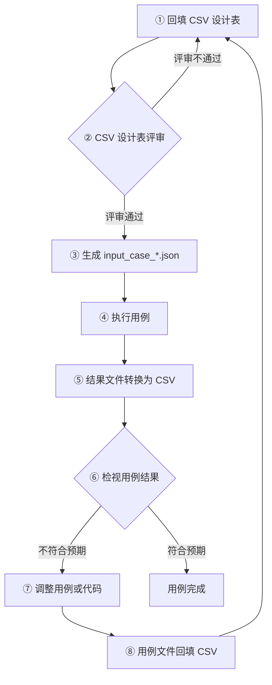

# a2a-t-corpus — A2A-T 准确性验证语料模块

## 1. 模块介绍

a2a-t-corpus 是 A2A-T SDK 的数据驱动准确性验证模块。它按用例定义的步骤调用真实 SDK（对接真实 LLM），记录每一步的完整请求与响应、耗时和 Token，并按用例通过率统计准确率，用来判断提示词效果是否达到 95% 的目标。

当前覆盖 **Task-T**、**Negotiation-T**（无线节能目标 / 信息 / 可行性协商）与 **Notification-T**（业务抢通 / 故障事件订阅通知）。Authorization-T 等待参考场景稳定后按同样方式接入。

使用前需了解三点：

- **仅用于测试**：位于 `a2a-t-corpus/`，不打包进 `a2a_t`，CI 中以 `-m 'not live'` 排除。
- **需要真实 LLM**：三个必填配置 `A2AT_LLM_*` 缺失时会直接报错并给出提示；`.env` 的键名（`A2AT_LANGUAGE`、`A2AT_LLM_*`）与项目根 `env.example` 一致。
- **用例格式与 Java 仓库共用**：用例文件、`schemas/` 下的 Schema、`tools/` 下的工具，在两个仓库中保持一致。

## 2. 模块目录

```
a2a-t-corpus/
├── env.example                      配置模板，含 A2AT_LANGUAGE 与三个必填 A2AT_LLM_* 项
├── .env                             本地配置（密钥，gitignore；由 env.example 复制）
├── README.md                        英文说明
├── README_zh.md                     中文说明
├── schemas/
│   ├── input-case.schema.json       用例格式定义
│   └── output-result.schema.json    结果格式定义
├── tools/
│   ├── inputCsvToJson.py            CSV 设计表 <-> input 用例文件
│   ├── outputJsonToCsv.py           结果文件 -> CSV 检视表
│   └── csv-templates/
│       └── input-case-template.csv  CSV 设计表模板（含一行示例）
├── conftest.py                      pytest 选项、运行时 fixture、用例参数化
├── engine/                          框架代码：配置、用例加载、场景发现、API 注册、
│                                    录制、断言、执行引擎、装配、报表等
└── suites/
    ├── task/
    │   ├── test_task_t_from_text_workflow.py   自然语言用例套件
    │   ├── test_task_t_from_data_workflow.py   结构化输入用例套件
    │   ├── test_task_self_guard.py             结构自检（不调 LLM，进 CI）
    │   └── resources/
    │       ├── ran-energy-saving-create/         无线节能任务创建
    │       │   ├── input_case_from_text.json     自然语言用例，人工编写
    │       │   └── input_case_from_data.json     结构化输入用例，人工编写
    │       ├── ran-energy-saving-modify/         无线节能任务修改
    │       │   ├── input_case_from_text.json
    │       │   └── input_case_from_data.json
    │       ├── ran-intelligent-backup-battery-endurance-create/   智能备电续航任务创建
    │       │   ├── input_case_from_text.json
    │       │   └── input_case_from_data.json
    │       └── ran-intelligent-backup-battery-endurance-modify/   智能备电续航任务修改
    │           ├── input_case_from_text.json
    │           └── input_case_from_data.json
    ├── negotiation/
    │   ├── test_negotiation_t_from_text_workflow.py   自然语言用例套件（propose / accept / reject / abort）
    │   ├── test_negotiation_t_from_data_workflow.py   结构化输入用例套件
    │   ├── test_negotiation_self_guard.py             结构自检（不调 LLM，进 CI）
    │   └── resources/
    │       ├── ran-energy-saving-target-negotiation/      目标协商
    │       │   ├── input_case_from_text.json
    │       │   └── input_case_from_data.json
    │       ├── ran-energy-saving-information-negotiation/ 信息协商
    │       │   ├── input_case_from_text.json
    │       │   └── input_case_from_data.json
    │       └── ran-energy-saving-feasibility-negotiation/ 可行性协商
    │           ├── input_case_from_text.json
    │           └── input_case_from_data.json
    └── notification/
        ├── test_notification_t_from_text_workflow.py   自然语言用例套件
        ├── test_notification_t_from_data_workflow.py   结构化输入用例套件
        ├── test_notification_self_guard.py             结构自检（不调 LLM，进 CI）
        └── resources/
            ├── service-recovery/        业务抢通通知
            │   ├── input_case_from_text.json
            │   └── input_case_from_data.json
            └── subscribe-incident/      故障事件订阅通知
                ├── input_case_from_text.json
                └── input_case_from_data.json
```

各场景目录下的 `output_result_from_text.json` / `output_result_from_data.json` 为运行后写回的结果文件（gitignore），不需要手写；汇总报表写在 `a2a-t-corpus/.corpus/`（gitignore）。

## 3. 工具介绍

用例用 CSV 设计、用 JSON 运行，两个脚本负责两者之间的转换。命令均在仓库根目录下执行。

**生成用例设计表模板**（含一行示例，Excel 可直接打开）：

```
python a2a-t-corpus/tools/inputCsvToJson.py --template --out my-cases.csv
```

**把 CSV 设计表转换为 input 用例文件**（默认做格式校验，产物写入 `input_case_from_text.json` 或 `input_case_from_data.json`）：

```
python a2a-t-corpus/tools/inputCsvToJson.py --csv my-cases.csv --out a2a-t-corpus/suites/task/resources/<场景>/input_case_from_text.json
```

**把 input 用例文件回填为 CSV 设计表**（反向转换，用于对照检视，对应新增用例步骤 ⑧）：

```
python a2a-t-corpus/tools/inputCsvToJson.py --reverse --csv a2a-t-corpus/suites/task/resources/<场景>/input_case_from_text.json --out back.csv
```

**把运行结果文件转换为 CSV 检视表**（一行一个用例，含每一步完整请求 / 响应，对应新增用例步骤 ⑤）：

```
python a2a-t-corpus/tools/outputJsonToCsv.py --json a2a-t-corpus/suites/task/resources/<场景>/output_result_from_text.json --out review.csv
```

CSV 设计表列：固定列 `id`、`caseDimension`、`caseDesc`、`caseCategory`、`scenario`，之后按步骤成组 `stepN_api`、`stepN_args`、`stepN_expect_result`、`stepN_expect_data`、`stepN_expect_errCode`、`stepN_expect_errMessageContains`，步数不限。

## 4. 新增用例步骤

整体流程如下，下面再以一个具体用例逐步展开。以下所有命令均在仓库根目录下执行（即包含 `pyproject.toml` 和 `a2a-t-corpus/` 的项目根目录）。



### 4.1 示例：在 ran-energy-saving-create 场景新增一条 text 用例

目标：在 Task-T 套件的 `ran-energy-saving-create` 场景下，新增一条自然语言用例 `TC00000001`（“在东莞松山湖片区创建无线网络节能任务”）。

**① 回填 CSV 设计表**

先生成模板：

```
python a2a-t-corpus/tools/inputCsvToJson.py --template --out my-cases.csv
```

模板每行是一个用例，本用例各列的填法：

| 列名 | 含义 | 本用例取值 |
| --- | --- | --- |
| `id` | 用例编号，`TC` 前缀，文件内唯一 | `TC00000001` |
| `caseDimension` | 用例维度，用于统计 | `01-意图清晰参数完整` |
| `caseDesc` | 用例描述 | `创建档-标准创建诉求` |
| `caseCategory` | 用例分类：`正常` / `异常` / `边界` | `正常` |
| `scenario` | 所属场景目录名 | `ran-energy-saving-create` |
| `step1_api` | 第 1 步调用的 API（Java 门面名） | `generateTaskPromptFromText` |
| `step1_args` | 第 1 步入参（JSON） | `{"text":"在东莞松山湖片区创建无线网络节能任务：节能的小区制式：NR，……","templateUri":"Task-T/network-layer/ran-energy-saving/v1"}` |
| `step1_expect_result` | 第 1 步期望结果：`success` / `error` | `success` |
| `step1_expect_data` | 第 1 步期望数据（子集断言，可留空） | `{}` |
| `step1_expect_errCode` | 期望错误码（`error` 时必填） | 空 |
| `step1_expect_errMessageContains` | 期望错误信息包含的子串（可选） | 空 |
| `step2_api` | 第 2 步调用的 API | `validateTaskPromptAndDataFilling` |
| `step2_args` | 第 2 步入参：要把第 1 步响应中的字段传进来，用 `{"$fromStep":1,"$field":"promptText"}` | `{"schema":{…},"templateUri":"Task-T/network-layer/ran-energy-saving/v1","promptText":{"$fromStep":1,"$field":"promptText"}}` |
| `step2_expect_result` | 第 2 步期望结果 | `success` |
| `step2_expect_data` | 第 2 步期望抽出的字段（响应子集） | `{"operationType":"create","region":"东莞松山湖片区","startTime":"16:00:00Z","endTime":"04:00:00Z","energyTarget":"30%","energyTargetDirection":"reduce"}` |
| `step2_expect_errCode` | 期望错误码（`error` 时必填） | 空 |
| `step2_expect_errMessageContains` | 期望错误信息包含的子串（可选） | 空 |

步骤多于两步时，继续补 `step3_*`、`step4_*` …即可，同一 API 也可以重复出现。

**② 评审 CSV 设计表**

人工评审这条用例的设计是否覆盖目标场景、期望值是否合理。评审通过后进入 ③；不通过则回到 ① 继续修改。

**③ 生成 input 用例文件**

把设计表转换为用例文件：

```
python a2a-t-corpus/tools/inputCsvToJson.py --csv my-cases.csv --out a2a-t-corpus/suites/task/resources/ran-energy-saving-create/input_case_from_text.json
```

转换时会做格式校验（编号唯一、期望与步骤等长、api 与错误码合法等），不通过会直接报错。生成的用例文件即可直接运行。

**④ 执行用例**

用套件执行这条用例（执行命令详解见「运行用例步骤」）：

```
uv run pytest a2a-t-corpus/suites/task/test_task_t_from_text_workflow.py -m live --corpus-scenario=ran-energy-saving-create --case-filter=TC00000001
```

**⑤ 把运行结果转换为 CSV**

用上一步写回的 `output_result_from_text.json` 生成检视表：

```
python a2a-t-corpus/tools/outputJsonToCsv.py --json a2a-t-corpus/suites/task/resources/ran-energy-saving-create/output_result_from_text.json --out review.csv
```

**⑥ 检视用例结果**

打开 `review.csv`，逐条对照每一步的期望与实际结果（`result`、`response`、错误码等）。符合预期则用例完成；不符合预期进入 ⑦。

**⑦ 调整用例或代码**

判断问题出在用例还是实现：用例设计或期望写错了就改用例，实现有问题就改代码。

**⑧ 用例文件回填 CSV**

如果改了用例文件，用反向转换把它导回设计表，保持两边一致，再回到 ①：

```
python a2a-t-corpus/tools/inputCsvToJson.py --reverse --csv a2a-t-corpus/suites/task/resources/ran-energy-saving-create/input_case_from_text.json --out my-cases.csv
```

### 4.2 新增用例注意

- **代码仓库只提交 `input_case_*.json`**：CSV 设计表供人评审用，`input_case_*.json` 供代码运行用，两者内容一致，但只需要提交 JSON。
- **新增用例不需要新增代码**：只需新建测试场景目录（`suites/<扩展>/resources/<场景>/`）并放入 `input_case_*.json`，套件在收集阶段会自动发现场景。新增后可用对应扩展的 `test_*_self_guard.py` 做一次结构检查。
- **非默认语言**：在 `a2a-t-corpus/.env`（或进程环境变量）中设置 `A2AT_LANGUAGE`，并把翻译后的用例文件与中文文件放在同一场景目录，命名为 `input_case_from_text_<语言>.json` / `input_case_from_data_<语言>.json`，例如 `input_case_from_text_en-US.json`。`caseDimension` / `caseCategory` 建议沿用现有词表（如 `正常` / `异常`），以保持报表统计口径和 self-guard 分类契约一致。若配置语言下没有用例文件，workflow 套件会以明确的 skip 信息提示；补齐文件后无需改代码即可运行。

### 4.3 用例文件格式

```json
{
  "id": "TC00000001", "caseDimension": "01-意图清晰参数完整", "caseDesc": "标准专线业务中断投诉",
  "caseCategory": "正常",
  "input": [
    { "api": "generateTaskPromptFromText",
      "args": { "text": "发生专线业务中断，接入端口名称为P781-……", "templateUri": "Task-T/network-layer/private-line-complaint/v1" } },
    { "api": "validateTaskPromptAndDataFilling",
      "args": { "schema": { "…": "JSON Schema" }, "templateUri": "…", "promptText": { "$fromStep": 1, "$field": "promptText" } } }
  ],
  "expected": [
    { "result": "success", "data": {}, "error": { "errCode": "", "errMessage": "" } },
    { "result": "success", "data": { "accessPort": "P781-……" }, "error": { "errCode": "", "errMessage": "" } }
  ]
}
```

- `id` 使用 `TC` 前缀（如 `TC00000001`），在单个用例文件内唯一。
- `input` 与 `expected` 等长，顺序就是执行顺序，同一 API 可多次出现，步数不限。
- `expected.result` 为 `success` / `error`；`data` 为子集断言（可选 `dataExact` 收紧为全量相等）；`error.errCode` 必须是 SDK 已定义的错误码。
- `{"$fromStep": N, "$field": "promptText"}` 按步骤序号（从 1 开始）引用更早步骤响应中的字段；显式字面值优先。
- 加载时严格校验：未知字段、缺期望、数组不等长、api 未注册、错误码未定义、`$fromStep` 非法都会在加载阶段统一报错。

## 5. 运行用例步骤

以下命令均在仓库根目录下执行。先准备 LLM 配置（三个必填项 `A2AT_LLM_BASE_URL` / `A2AT_LLM_API_KEY` / `A2AT_LLM_MODEL`）：

```
cp a2a-t-corpus/env.example a2a-t-corpus/.env
```

`A2AT_LANGUAGE` 同时决定提示词资源语言和用例文件变体，默认 `zh-CN`；设置为 `en-US` 后使用英文模板。corpus 读取的是 `a2a-t-corpus/.env` 和进程环境变量（不会读取项目根目录的 `.env`）。英文用例与中文用例放在同一场景目录，命名为 `input_case_from_text_en-US.json` / `input_case_from_data_en-US.json`；若配置语言下没有对应用例文件，workflow 套件会以明确的 skip 信息提示。非默认语言的结果文件为 `output_result_<flow>_<语言>.json`、汇总为 `summary_report_<flow>_<语言>.json`，不会覆盖中文运行结果。

**执行全部用例**：

```
uv run pytest a2a-t-corpus/suites -m live
```

**执行指定场景用例**（`--corpus-scenario` 为场景名，支持通配符 `*`，可用逗号分隔多个）：

```
uv run pytest a2a-t-corpus/suites/task -m live --corpus-scenario=ran-energy-saving-create
```

**执行指定场景下的全部 text 用例**：

```
uv run pytest a2a-t-corpus/suites/task/test_task_t_from_text_workflow.py -m live --corpus-scenario=ran-energy-saving-create
```

**执行指定场景下的全部 data 用例**：

```
uv run pytest a2a-t-corpus/suites/task/test_task_t_from_data_workflow.py -m live --corpus-scenario=ran-energy-saving-create
```

**执行指定场景下 text 中指定用例编号的用例**（`--case-filter` 为用例编号，支持通配符 `*`）：

```
uv run pytest a2a-t-corpus/suites/task/test_task_t_from_text_workflow.py -m live --corpus-scenario=ran-energy-saving-create --case-filter=TC00000001
```

- 用例的测试编号形如 `<场景名>/<用例编号>`，也可以用 `-k` 直接定位单条用例。
- Negotiation-T / Notification-T 只需把套件路径换成 `a2a-t-corpus/suites/negotiation` 或 `a2a-t-corpus/suites/notification`，场景名同样支持通配符。
- 每条用例执行完成会立即打印到控制台；失败或崩溃的用例会额外打印完整的调用记录。结果文件只反映本次运行，过滤运行时只覆盖命中的用例。
- `--corpus-output-dir=<目录>` 可把结果文件和汇总报表写到指定目录；默认结果文件写回各场景目录，汇总报表写到 `a2a-t-corpus/.corpus/`。
- 每个场景生成 `output_result_<flow>.json`（非默认语言为 `output_result_<flow>_<语言>.json`），并汇总为 `summary_report_<flow>.json` 与控制台表格（总体 / 按场景 / 按维度 / 按分类 / 按 API 步的通过率，标注 95% 目标，含耗时 p50/p95 与 Token 合计）。
- 未配置 LLM 时，可先运行结构自检（此测试进 CI）：

```
uv run pytest a2a-t-corpus/suites/task/test_task_self_guard.py a2a-t-corpus/suites/negotiation/test_negotiation_self_guard.py
```
