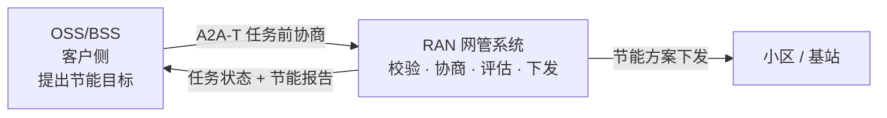
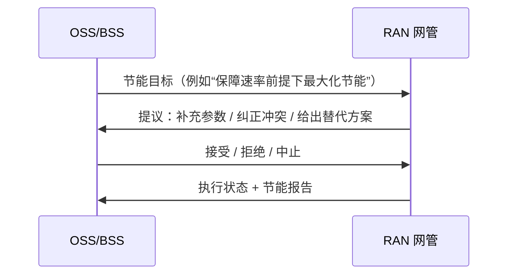
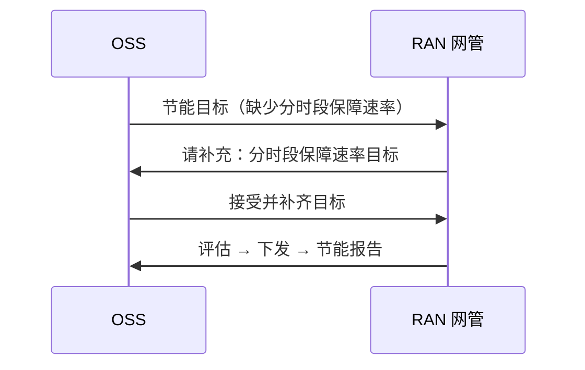
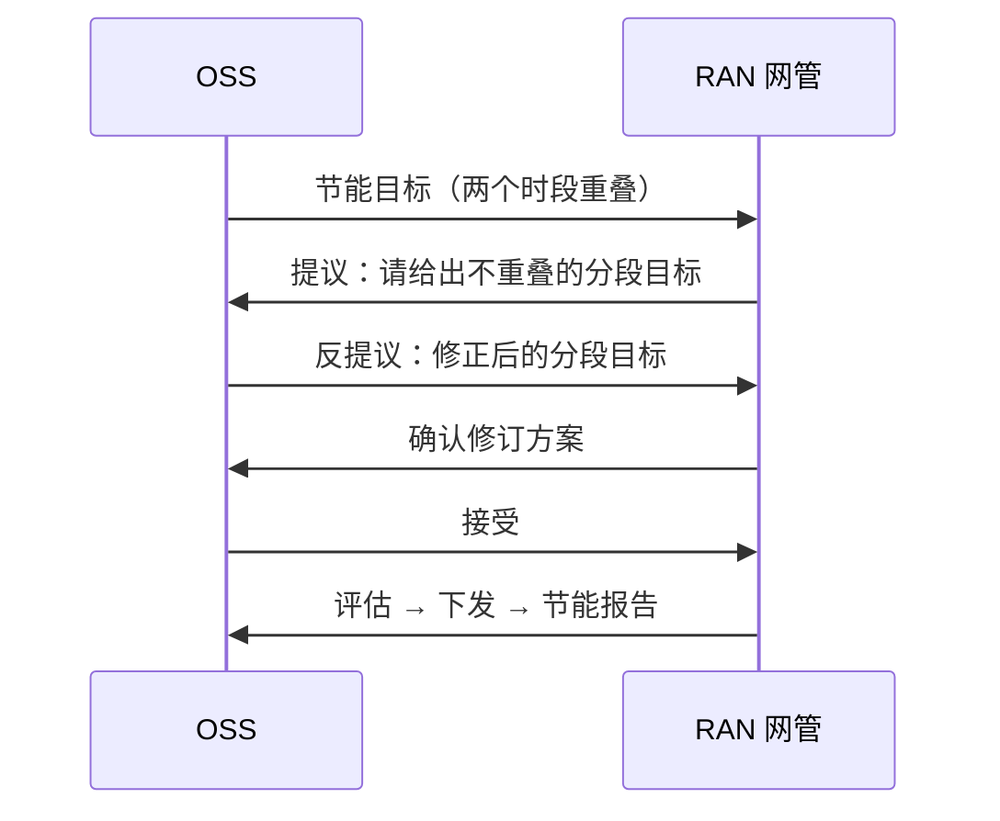
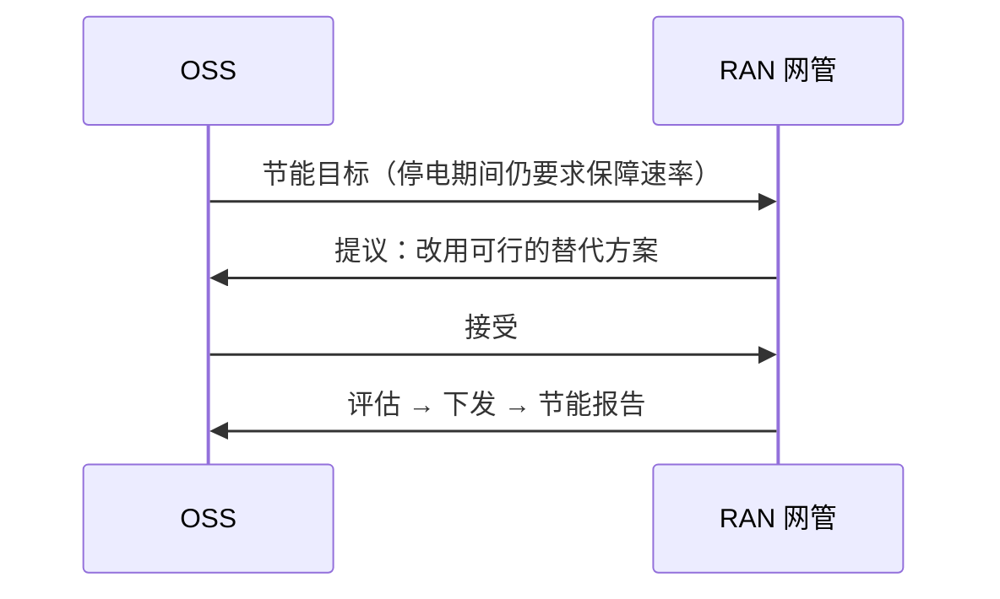

# RAN 节能：OSS 与 RAN 网管的智能协商（A2A-T 客户方案）

> **一句话：** OSS 提出节能目标，RAN 网管先协商补齐或纠偏，再评估、下发并出报告——全程自动、可追溯。



## 1. 系统间交互

OSS 与 RAN 网管之间只做两件事：**先把目标谈清楚，再把方案执行掉**。

| 系统 | 角色 | 在本方案中负责 |
| --- | --- | --- |
| OSS/BSS | 客户侧 | 提出节能目标，做接受 / 拒绝 / 反提议决策 |
| RAN 网管（NMS） | 执行侧 | 校验目标、发起协商、评估并下发方案、生成报告 |



协商可能进行 2–3 轮，但**任务只在双方达成一致后才创建**，因此不会出现“按错误目标下发”的情况。

典型问题正好对应三类协商：

- 目标缺参数；
- 时段重叠；
- 条件不可行（例如停电期间仍要求保障速率）；
- 区域未知：网管按请求中的区域名对其服务的区域做模糊匹配并给出候选，请工程师选择，同时保留原保障速率时段。

## 2. 典型场景

### 2.1 目标缺参数：网管问，OSS 补



**结果：** 任务完成，无需人工工单。

### 2.2 时段冲突：先纠偏再执行



**结果：** 冲突在任务创建前纠正，避免错误下发。

### 2.3 条件不可行：网管给替代方案



**结果：** 不下发不可行方案，直接给出可执行替代。

其余两种终止情形，客户只需要知道结论：

| 场景 | 结论 |
| --- | --- |
| OSS 无法提供必需参数 | 协商结束，不创建任务 |
| 多轮反提议仍不收敛 | 达到轮次上限后主动中止，不创建任务 |

## 3. 客户价值

| 痛点 | 没有任务前协商 | 本方案 |
| --- | --- | --- |
| 参数缺失 | 任务失败或人工追问 | 网管问、OSS 补，自动完成 |
| 目标冲突 | 可能按错误目标下发 | 任务创建前纠正 |
| 条件不可行 | 下发失败、回滚 | 先给替代方案，接受才执行 |
| 审计 | 邮件、工单 | 每次提议、决策、下发都有记录 |

## 4. 演示

```bash
# 命令行（离线、确定性，无需 key）：计划停电，先创建基线再 Modify，无协商
python run_demo.py --scenario outage --mode auto --model-mode offline
# Web UI（演示视图；默认打开完整的用例 1）
python run_demo.py --ui --model-mode offline
# 华为主题演示（页面也可切换，?brand=huawei 可临时覆盖）
python run_demo.py --ui --brand huawei --model-mode offline
# Web UI：审批 1（意图）+ 审批 2（MIE 中的 MML）
python run_demo.py --ui --mode confirm --approval-gate --scenario target --model-mode offline
# 未知区域：由工程师手动选择可用区域
python run_demo.py --ui --mode manual --scenario unknown_area --model-mode offline
# 可选：把 OSS 侧作为 A2A 后端暴露
python run_demo.py --ui --gateway --ui-port 8080 --gateway-port 8001 --model-mode offline
# 在局域网共享 Web UI：显式选择免 token（仅限可信网络）
python run_demo.py --ui --ui-host 0.0.0.0 --allow-insecure-bind --model-mode offline
# 或者保留 token，分享带 token 的链接；页面会把它存进同源 cookie
A2AT_SAMPLE_AUTH_TOKEN=<token> python run_demo.py --ui --ui-host 0.0.0.0 --model-mode offline
# 同事打开 http://<你的局域网 IP>:8080/?token=<token>
```

`--ui-host 0.0.0.0` 只暴露 Web UI；注册中心与网管服务仍在回环地址。未配置
`A2AT_SAMPLE_AUTH_TOKEN` 时，启动器默认拒绝非回环绑定；只有显式加 `--allow-insecure-bind`
才允许。该模式下能访问端口的人都能发起运行，请只在可信网络使用。配置了 token 时，分享
`/?token=…` 链接即可：页面会把 token 写入同源 `a2at_ui_token` cookie，并从地址栏移除，因此
`fetch` 与 SSE 流都能通过认证（浏览器无法给 `EventSource` 设置 `Authorization` 头）。

使用 `--gateway` 时，OSS 侧本身就是一个 A2A Agent：Gemini Enterprise 之类的外部调用方发送一次请求后，
会在最终节能报告之前收到协商与执行里程碑的进度通知——可以走流式连接，也可以注册 webhook。

Web UI 默认打开演示视图：左侧是 16:9 的舞台，依次是网络工程师、OSS Agent、RAN Agent、MIE 与
无线站点，中间是 A2A-T 通道。演示视图支持两套品牌主题：**Orange**（原 Demo 风格，默认）和
**Huawei**（暖灰画布、描边节点、低噪声的 ICT 风格）。顶栏按钮可实时切换并记忆选择；
`--brand huawei` 或 `?brand=huawei` 可指定启动默认值。八个示例覆盖用例 1（夜间节能，含协商与无协商）和用例 2（计划停电）；计划停电是同一 Task 上的两阶段：先 Create 基线，再发送真正的 Modify Task-T。
舞台按人的节奏跟随真实运行，共九步：请求、结构化 Task-T、审批 1（意图）、下发 Task-T、需要时协商、
策略与任务启动、数据采集（第 2–8 天，时间压缩）、审批 2（MIE 中的 MML）、下发与报告。请求框展示网络
工程师会直接输入的自然表述，例如“在松山湖开启节能，保障速率为：…”。OSS Agent 先把请求解析成自己系统所需的
结构化意图，只有下发步骤才把意图映射成 Task-T。**未知区域**示例会列出模糊匹配后的可用区域，请工程师选择；
选择只填充区域，原保障速率时段保持不变。Task-T 被接受后，RAN Agent 依次上报 `SUBMITTED`、策略生成中、
策略就绪、任务已启动，然后才开始数据采集。右侧保留证据层：OSS Agent 理解到的任务（含 24 小时保障速率图）、
协商轮次、**On the wire** 报文检查器，以及合并
后的会话轨迹。On the wire 展示真实的 A2A 请求头、JSON body 和 Task-T metadata；在 A2A-T 模式下切换到
**普通 A2A** 时，同一请求被写成一句自然语言，去掉扩展头和 Task-T 字段（这是同一条消息的格式视图）。点击
会话轨迹的一行会在检查器中选中该消息。轨迹行现在带演示日（第 1 天、第 2–8 天、第 9 天、第 9 天+）和
消息流向（OSS → RAN、RAN → OSS、MIE ⇄ 工程师）；晚到的服务端 span 按事件时间合并，状态与对应 span 只保留一行。

### 纯 A2A 模式（三跳，只用标准 A2A）

页面是单模式的：协议在进程启动时确定，页面不再提供协议切换或对比卡。要对比两种模式，分别启动
A2A-T 演示和纯 A2A 演示即可。

`--protocol pure` 启动真实的三跳 A2A 链路：

```
工程师/UI ──A2A──► OSS Agent (:8001) ──A2A──► RAN Agent (:8000) ──A2A──► MIE Agent (:8002)
```

- OSS Agent 把工程师请求原样转发给 RAN Agent。缺参数或目标冲突时，RAN Agent 返回标准 A2A Task 的
  `INPUT_REQUIRED`；OSS Agent 带 `taskId`/`contextId` 在同一任务上发后续消息作答，最多 3 轮。
  全程不生成、不返回 `Task-T/v1` 或 `Negotiation-T/v1` metadata。
- RAN Agent 在下发方案前通过 A2A 请求 MIE Agent 审批。MIE Agent 通过自己的 SSE 把审批卡推给页面，
  工程师的批准/拒绝通过 `POST /api/mie/approvals/{taskId}` 回到 MIE。
- 演示会展示 OSS、RAN、MIE 三跳、协商轮次、MIE 审批卡，以及每次运行的指标（跳数、协商轮次、
  A2A 消息数）。示例包括 `night`（无协商）、`information`（缺参 1 轮）和 `target`（先反提议再接受）。
- 旧的单轮 `plain` 路径仍保留在代码和测试中作为内部基线，但 CLI 和页面都不再暴露。

```bash
# 纯 A2A：三跳 + MIE 人工审批
uv run python -m demo.run_demo --protocol pure --ui --approval-gate --scenario information

# 现有 A2A-T 模式（Task-T + Negotiation-T），行为不变
uv run python -m demo.run_demo --protocol a2a-t --ui --mode confirm --approval-gate --scenario information
```

审批 1 是真实的：`--mode confirm` 下，Task-T 在离开 OSS Agent 之前停住，工程师确认结构化意图后才
发送。审批 2 是 MIE 的 MML 审核：`--approval-gate` 下，RAN Agent 在下发前发布真实的 A2A
`INPUT_REQUIRED` 状态；页面直接展示 MML 建议，请工程师在 MIE 中审核并确认。审核窗口默认 240 秒；
超时（或运行在卡片打开期间结束）时页面会关闭卡片并显示结局，不会停在“待审核”。驳回则不下发、不出报告。
数据采集阶段由 RAN Agent 的三条真实 `WORKING` 状态驱动（started / in progress / completed）；页面
把第 1–8 天压缩成几秒，不伪造测量值。MML 命令只有在 MIE 确认之后才下发：绿色 `MML commands` 包
从 MIE 直接飞向无线站点，站点执行后把执行结果经 RAN Agent 上报给 OSS Agent。

播放控制（自动 / 单步、速度、暂停、上一步 / 下一步、循环）只影响演示节奏，后端运行是真实的。
传输、模型与语言在进程启动时确定，页面上只保留场景切换和请求编辑。

需要协议级视图（阶段、LLM 与工具调用、原始报文、历史记录）时，在同一条命令后加 `--ui-mode explorer`。
安装、环境变量与完整参数见[技术指南](TECHNICAL-zh.md)。

### 指标与协议对比

每次 run 都会生成一条指标记录：token 消耗、耗时拆分（模型 / 工具 / 人工审批 / 其他）以及
相对场景 ground truth 的准确率（终态、协商轮次、达成目标的吞吐目标、报告是否存在）。记录写入
客户端 SQLite 的 `run_metrics` 表，并追加到 `runs/metrics/run-metrics.jsonl`；Web UI 同时提供
`/api/metrics/runs`、`/api/metrics/summary`、`/api/runs/{runId}/metrics` 和
`/api/metrics/export.csv`。

打开 `http://127.0.0.1:8080/comparison` 可按协议 / 场景查看成功率、平均 token、模型与总耗时、
P95 和审批等待时间。页面读取的就是这些持久化记录。

协议是进程级选择，因此基准脚本会为每种协议分别拉起一套 demo，跑同一组场景，在固定延迟
（默认 0.3 秒）后自动通过人工审批 gate，最后把 `metrics.json`、`metrics.jsonl`、`summary.csv`、
`summary.json` 和 `report.html` 写到 `runs/benchmarks/<timestamp>/`：

```bash
# 用真实模型做 token / 耗时 / 准确率对比
uv run python -m demo.benchmark --model-mode live --scenarios information,target --repeats 3

# 一次快速离线 smoke（脚本模型不上报 token，因此 token 为 N/A）
uv run python -m demo.benchmark --protocols pure --scenarios information --repeats 1
```

离线模式仍可对比耗时和准确率；token 因 scripted 模型没有 usage 而显示为 `N/A`。人工审批时间单独
统计，不计入模型/协议耗时对比。

## 5. 集成边界

| OSS 侧 | 网管侧 |
| --- | --- |
| 接入 A2A-T 客户端，由 SDK 提供协议能力 | 保留现有网管的评估、下发与报告能力 |
| 提供决策智能体：接受 / 拒绝 / 反提议 | 把样例工具替换为真实网管接口 |
| 保留自有策略、审批与审计 | 保留协商策略与任务存储 |

参考实现中，OSS 侧使用 ADK 决策智能体，网管侧使用 LangGraph 执行；它们只是选型，不影响上述系统间交互。

## 6. 关键特性

| 特性 | 说明 |
| --- | --- |
| 可审计 | 每次提议、决策、下发与报告都有记录 |
| 模型无关 | 离线可复现；在线模型只影响决策与规划 |
| 可替换 | 工具与策略可替换为真实网管实现 |

## 7. 技术资料

协议细节、实现结构、配置、测试与生产化注意事项见[技术指南](TECHNICAL-zh.md)。
