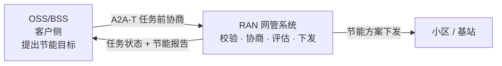
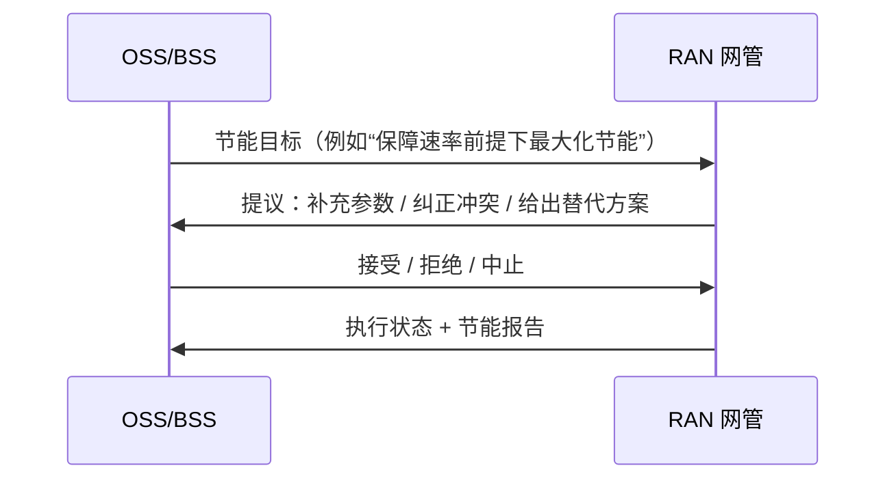
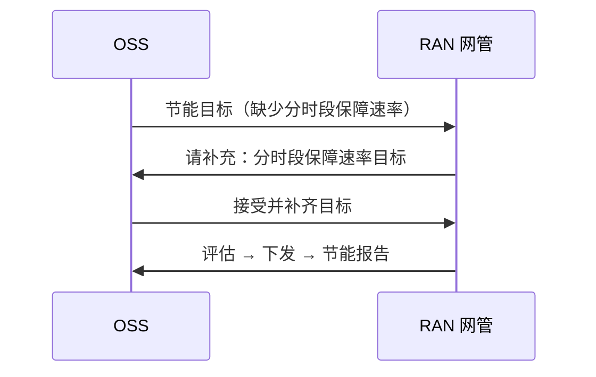
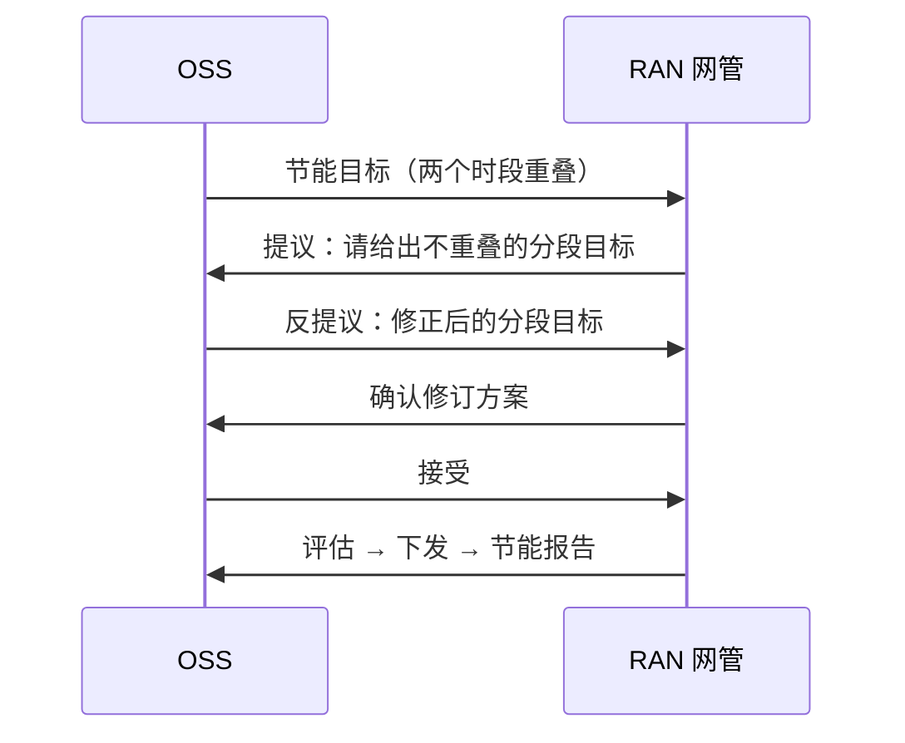
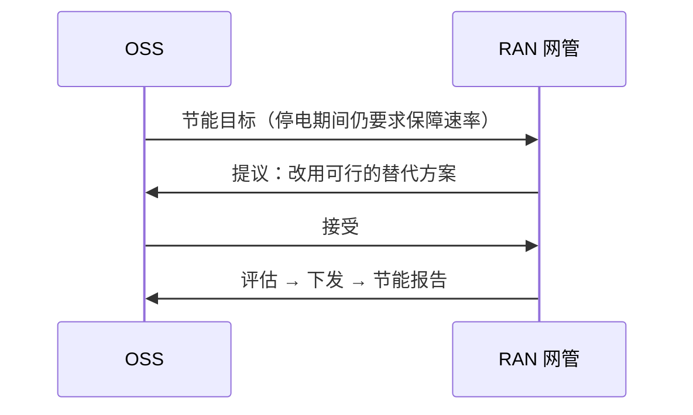

# RAN 节能：OSS 与 RAN 网管的智能协商（A2A-T 客户方案）

> **一句话：** OSS 提出节能目标，RAN 网管先协商补齐或纠偏，再评估、下发并出报告——全程自动、可追溯。



## 1. 系统间交互

OSS 与 RAN 网管之间只做两件事：**先把目标谈清楚，再把方案执行掉**。

| 系统 | 角色 | 在本方案中负责 |
| --- | --- | --- |
| OSS/BSS | 客户侧 | 提出节能目标，做接受 / 拒绝 / 反提议决策 |
| RAN 网管（NMS） | 执行侧 | 校验目标、发起协商、评估并下发方案、生成报告 |



协商可能进行 2–3 轮，但**任务只在双方达成一致后才创建**，因此不会出现“按错误目标下发”的情况。

典型问题正好对应三类协商：

- 目标缺参数；
- 时段重叠；
- 条件不可行（例如停电期间仍要求保障速率）；
- 区域未知：网管按请求中的区域名对其服务的区域做模糊匹配并给出候选，请工程师选择，同时保留原保障速率时段。

## 2. 典型场景

### 2.1 目标缺参数：网管问，OSS 补



**结果：** 任务完成，无需人工工单。

### 2.2 时段冲突：先纠偏再执行



**结果：** 冲突在任务创建前纠正，避免错误下发。

### 2.3 条件不可行：网管给替代方案



**结果：** 不下发不可行方案，直接给出可执行替代。

其余两种终止情形，客户只需要知道结论：

| 场景 | 结论 |
| --- | --- |
| OSS 无法提供必需参数 | 协商结束，不创建任务 |
| 多轮反提议仍不收敛 | 达到轮次上限后主动中止，不创建任务 |

## 3. 客户价值

| 痛点 | 没有任务前协商 | 本方案 |
| --- | --- | --- |
| 参数缺失 | 任务失败或人工追问 | 网管问、OSS 补，自动完成 |
| 目标冲突 | 可能按错误目标下发 | 任务创建前纠正 |
| 条件不可行 | 下发失败、回滚 | 先给替代方案，接受才执行 |
| 审计 | 邮件、工单 | 每次提议、决策、下发都有记录 |

## 4. 演示

```bash
# 用显式配置文件启动：不同启动脚本指向不同 .env，不再依赖启动器猜测
python run_demo.py --env-file configs/yellow-zone.env --nms --ui
# 等价写法：A2AT_SAMPLE_ENV_FILE=configs/yellow-zone.env python run_demo.py ...
# 命令行（离线、确定性，无需 key）：计划停电，先创建基线再 Modify，无协商
python run_demo.py --scenario outage --mode auto --model-mode offline
# Web UI（演示视图；默认打开完整的用例 1）
python run_demo.py --ui --model-mode offline
# 华为主题演示（页面也可切换，?brand=huawei 可临时覆盖）
python run_demo.py --ui --brand huawei --model-mode offline
# Web UI：审批 1（意图）+ 审批 2（MIE 中的 MML）
python run_demo.py --ui --mode confirm --approval-gate --scenario target --model-mode offline
# 未知区域：由工程师手动选择可用区域
python run_demo.py --ui --mode manual --scenario unknown_area --model-mode offline
# 可选：把 OSS 侧作为 A2A 后端暴露
python run_demo.py --ui --gateway --ui-port 8080 --gateway-port 8001 --model-mode offline
# 在局域网共享 Web UI：显式选择免 token（仅限可信网络）
python run_demo.py --ui --ui-host 0.0.0.0 --allow-insecure-bind --model-mode offline
# 或者保留 token，分享带 token 的链接；页面会把它存进同源 cookie
A2AT_SAMPLE_AUTH_TOKEN=<token> python run_demo.py --ui --ui-host 0.0.0.0 --model-mode offline
# 同事打开 http://<你的局域网 IP>:8080/?token=<token>
```

`--ui-host 0.0.0.0` 只暴露 Web UI；注册中心与网管服务仍在回环地址。未配置
`A2AT_SAMPLE_AUTH_TOKEN` 时，启动器默认拒绝非回环绑定；只有显式加 `--allow-insecure-bind`
才允许。该模式下能访问端口的人都能发起运行，请只在可信网络使用。配置了 token 时，分享
`/?token=…` 链接即可：页面会把 token 写入同源 `a2at_ui_token` cookie，并从地址栏移除，因此
`fetch` 与 SSE 流都能通过认证（浏览器无法给 `EventSource` 设置 `Authorization` 头）。

使用 `--gateway` 时，OSS 侧本身就是一个 A2A Agent：Gemini Enterprise 之类的外部调用方发送一次请求后，
会在最终节能报告之前收到协商与执行里程碑的进度通知——可以走流式连接，也可以注册 webhook。

Web UI 默认打开演示视图：左侧是 16:9 的舞台，依次是网络工程师、OSS Agent、RAN Agent、MIE 与
无线站点，中间是 A2A-T 通道。演示视图支持两套品牌主题：**Orange**（原 Demo 风格，默认）和
**Huawei**（暖灰画布、描边节点、低噪声的 ICT 风格）。顶栏按钮可实时切换并记忆选择；
`--brand huawei` 或 `?brand=huawei` 可指定启动默认值。八个示例覆盖用例 1（夜间节能，含协商与无协商）和用例 2（计划停电）；计划停电是同一 Task 上的两阶段：先 Create 基线，再发送真正的 Modify Task-T。Modify 阶段步骤条保持在“Apply & report”，wire 面板分别展示两条 Task-T 的 payload。
舞台按人的节奏跟随真实运行，共九步：请求、结构化 Task-T、审批 1（意图）、下发 Task-T、需要时协商、
策略与任务启动、数据采集（第 2–8 天，时间压缩）、审批 2（MIE 中的 MML）、下发与报告。请求框展示网络
工程师会直接输入的自然表述，例如“在区域 A 开启节能，保障速率为：…”。OSS Agent 先把请求解析成自己系统所需的
结构化意图，只有下发步骤才把意图映射成 Task-T。**未知区域**示例会列出模糊匹配后的可用区域，请工程师选择；
选择只填充区域，原保障速率时段保持不变。Task-T 被接受后，RAN Agent 依次上报 `SUBMITTED`、策略生成中、
策略就绪、任务已启动，然后才开始数据采集。右侧保留证据层：OSS Agent 理解到的任务（含 24 小时保障速率图）、
协商轮次、**On the wire** 报文检查器，以及合并
后的会话轨迹。On the wire 读取本次运行 `wire.jsonl` 中已脱敏的真实报文——请求行、请求头（含真实的
`traceparent`）和 SDK 实际发送的 `SendMessageRequest` JSON body（`{"message": …}`，A2A-T 模式下含
Task-T metadata）。a2a-sdk 的 HTTP 传输同样会被捕获，因此本地 A2A-T 和 A2A 运行也显示真实请求，
而不是从轨迹重建的 message 对象；没有捕获到报文时明确提示，而不是拼一份假的。在 A2A-T 模式下切换到
**普通 A2A** 时，同一请求被写成一句自然语言，去掉扩展头和 Task-T 字段（这是同一条消息的格式视图）。点击
会话轨迹的一行会在检查器中选中该消息。轨迹行现在带演示日（第 1 天、第 2–8 天、第 9 天、第 9 天+）和
消息流向（OSS → RAN、RAN → OSS、MIE ⇄ 工程师）；晚到的服务端 span 按事件时间合并，状态与对应 span 只保留一行。

### 测试控制台（Excel 导入）

同一个 UI 进程的 `/tester` 是给测试人员的独立入口（启动器会打印该地址）：下载 `.xlsx` 模板，
一行填一条用例，导入后即可批量执行。该页面是中方测试团队的内部工具，界面固定使用中文。每行填写协议（`A2A-T` / `A2A`）和可选的用户请求；
场景列可留空，因为客户现场的真实测试通常只有一段业务请求。场景留空时，内部仍使用 `night`
配置模板，但只校验最终状态（默认 `task_completed`）；填写场景时，空的预期单元格继承该场景的
最终状态、协商类型和轮次。批次串行执行，逐条展示通过/失败、实际最终状态、协商类型与轮次、
耗时，以及本次运行的 `wire` / `trace` 链接；结果可导出回 `.xlsx`。审批结果留空时默认
`approve`，无人值守批次不会卡在审批窗口；`reject` 测试拒绝路径；`auto` 交给人工或超时。
批次持久化在 `runs/tester` 下，刷新页面会自动打开最近一批；**重跑失败** 会用失败、错误或
取消的行新建一个草稿批次。连接真实网管时页面会显示警示并在开始前二次确认。每条用例记录墙钟耗时、
模型/工具/审批延迟、LLM 调用次数和 Token 用量（prompt/completion/total，并按客户端/服务端拆分）；
导出的工作簿包含 **测试结果**、**指标** 和 **汇总** 三个 sheet。离线脚本 LLM 的 Token 会明确标记为
不可用，而不是编造数字。传输与发现方式仍由后端按协议决定，不需要在表格里填写。

### 操作员意图处理层

sample 不再把操作员原文直接送进 A2A / A2A-T。默认的 `processed` 模式先插入真实 OSS 会做的业务处理：

```text
操作员请求 → 业务意图（ProcessedIntent） → 规范化文本 → 审批 1
           → A2A-T Task-T / Plain A2A 消息
```

- 已知场景使用确定性的内置意图。自由文本（`--request` 或页面编辑的请求）在 live 模式下走模型抽取；
  offline 模式回退原文并记录 warning。
- 业务层**不修复**缺失或冲突。缺失的保障速率、未知区域、重叠时段都会保留在意图里，
  后续 A2A-T 协商仍然会发生。
- 审批 1 确认的是**规范化文本**，发生在协议映射之前。A2A-T 再从该文本严格抽取 Task-T；
  Plain A2A 直接发送同一份文本。
- A2A 把同样的处理放在 OSS Agent 内：工程师客户端发送原文，OSS Agent 规范化并发布意图，
  再把规范化文本转发给 RAN。
- 展示页并列显示操作员请求、规范化文本和结构化意图；trace 记录 `intent_processed`。
- 默认 `processed`。需要旧行为时使用 `A2AT_SAMPLE_INTENT_MODE=raw`、`--intent-mode raw` 或
  `POST /api/runs {"intentMode":"raw"}`。Gateway 入站文本一律按 raw 处理。

### Langfuse 可观测

live 模式的 client run 可以把 Run Explorer span 导出到 Langfuse，每次 run 一条 trace：

- 设置 `LANGFUSE_PUBLIC_KEY` 和 `LANGFUSE_SECRET_KEY`（可选 `LANGFUSE_BASE_URL`）；
- `LANGFUSE_BASE_URL` 是 SDK 上报端点，可以指向代理；`A2AT_SAMPLE_LANGFUSE_UI_BASE_URL`
  是浏览器打开 trace 链接所用的 UI 地址（默认 `https://us.cloud.langfuse.com`）；
- `A2AT_SAMPLE_LANGFUSE_ENABLED=0` 强制关闭；`A2AT_SAMPLE_LANGFUSE_CAPTURE_CONTENT=0`
  只上报模型、token、状态和耗时元数据；
- offline/scripted 运行不上报。

trace 结构为 `run → phase → 协商轮次`；`llm` span 映射为 generation（带模型和 token 用量），
`tool` span 映射为 tool，其余保持 span。演示页结束卡片和 Run Explorer 的 **Exports** 面板会显示
Langfuse trace 链接。导出是 best-effort：失败只显示 warning，不改变 run 结果。`langfuse` 是
sample 的可选依赖；未安装或未配置 key 时导出器为空操作。

客户端与服务端 span 共用同一条 trace。每次本地 A2A 调用都会携带客户端的 W3C `traceparent`
（以及 `X-A2AT-Run-Id`、conversation、user 头）；RAN、OSS、MIE 服务端在创建 a2a-sdk handler span
之前先附加该上下文，因此服务端的 `SendMessage` / `CancelTask` 会落在同一条 Langfuse trace 里。
如果服务端无法加入，桥接 span 会携带 `langfuse.trace.metadata.runId`，仍可按 run 检索。要导出
服务端 span，需要把 SDK 的 OTLP 导出指向 Langfuse（`OTEL_EXPORTER_OTLP_ENDPOINT` 和
`OTEL_EXPORTER_OTLP_HEADERS`）；所选 `.env` 中的 `OTEL_*`/`LANGFUSE_*` 会被导出给子进程。厂商网管
不使用同一条 trace，因此发往网管的 `traceparent` 仍使用 run id。

### 真实厂商网管模式

sample 也可以作为真实厂商网管的 OSS 客户端。加 `--nms` 后，启动器不再启动本地 registry、RAN
Agent 和 MIE：A2A-T 客户端从网管的令牌接口获取会话，再直接调用网管的 A2A 面。
`--nms --protocol a2a` 仍保留本地 OSS Agent（工程师 UI → OSS Agent → 网管），只去掉 RAN
Agent 和 MIE。

真实 `--nms` run 使用 **`POST /a2a/json/message:send` + webhook**（网管的直连机器模式）；
本地网管仿真器继续使用 SSE `message:stream` 契约。

```bash
# 真实网管：先在 .env 填好 A2AT_SAMPLE_NMS_* 和网管可达的 A2AT_SAMPLE_WEBHOOK_HOST
python run_demo.py --nms --ui --brand huawei

# 本地网管仿真器：同一套客户端路径，不依赖联调网络，也不会改动真实网络
python run_demo.py --nms --nms-sim --ui --brand huawei
```

`.env` 必填项：

```ini
A2AT_SAMPLE_NMS_HOST=<nms-host>
A2AT_SAMPLE_NMS_TOKEN_USER=<northbound-user>
A2AT_SAMPLE_NMS_TOKEN_VALUE=<password>
# NMS 模式默认值；其他部署可覆盖
A2AT_SAMPLE_NMS_REGION=A2ATestRegion
A2AT_SAMPLE_NMS_SITES=NRES_XCS_6102937,LTE_26441_LNR_OCL
A2AT_SAMPLE_NMS_VERIFY_TLS=false
# 真实网管必须能访问这个地址和 webhook 端口
A2AT_SAMPLE_WEBHOOK_HOST=<客户端局域网地址>
A2AT_SAMPLE_WEBHOOK_PORT=9000
# 原始报文日志：NMS 模式默认开启；设为 0 可避免业务数据落盘
A2AT_SAMPLE_NMS_WIRE_LOG=1
```

只需配置主机地址。sample 会按 910 标准面自动推导两个 URL：
`https://<host>:31127/a2a/json` 和
`https://<host>:27417/rest/plat/smapp/v1/sessions`。非标准部署可以覆盖
`A2AT_SAMPLE_NMS_SCHEME`、`A2AT_SAMPLE_NMS_A2A_PORT` / `A2AT_SAMPLE_NMS_TOKEN_PORT`，或直接
设置完整的 `A2AT_SAMPLE_NMS_A2A_BASE` / `A2AT_SAMPLE_NMS_TOKEN_URL`；显式完整 URL 优先。

联调环境使用自签名证书，因此默认关闭 TLS 校验；只有证书链可信时才设为
`A2AT_SAMPLE_NMS_VERIFY_TLS=true`。客户端同时发送两种被接受的认证头（`Authorization: Bearer`
和 `X-Auth-Token`）以及两种扩展头拼写（`A2A-Extensions` 和 `X-A2A-Extensions`）。

NMS 模式下，`A2AT_SAMPLE_NMS_REGION` 与 `A2AT_SAMPLE_NMS_SITES` 会把整个运行的各层统一替换为
网管实际服务的区域和站点：页面预填、工程师看到的请求、意图结果（`rawRequest`、`region`、
`normalizedText`），以及每个发往网管的 Task-T（初始提示词、accept 重填、Modify follow-up）。
二者默认是 `A2ATestRegion` 和上表中的两个 910 站点；其他区域和激活时段会被拒绝。页面与报文之间
不会再出现“左侧中性名、轨迹真机名”的静默替换。本地三跳演示保持中性名称，不受影响。
例如：“在 A2ATestRegion 区域创建无线网络节能任务；激活时段 00:00-06:00，每小区保证 30 Mbps。”

厂商契约说明：

- 只有同时声明 Task-T 和 Negotiation-T 时，网管才返回结构化协商 metadata。客户端在初始请求里
  两者都声明；只声明 Task-T 会得到 metadata 为空的普通 Message。
- 一条消息只能带一个 `-T` metadata 键。NMS 模式的 ACCEPT 只带 Negotiation-T；本地 demo server
  仍保留回填的 Task-T。
- 继续协商的 PROPOSE 可能被包在 `error` 信封里。客户端把它写入 `wire-error.jsonl` 并以明确的
  协议错误结束，而不是静默当作协商结束。
- `negotiationContext.id` 是网管的协商句柄，不是 A2A 的 `contextId`。应答必须携带 PROPOSE 的
  协商 id；继续协商时，网管可能在同一个 context id 上开启**新的**协商 id。
- ACCEPT / COUNTER / REJECT 之后，客户端会继续读响应流直到空闲
  （`A2AT_SAMPLE_NMS_READ_AFTER_SEND`，默认开启），避免丢掉同一流里的下一个 PROPOSE。
- idle 窗口默认 45 秒（`A2AT_SAMPLE_NMS_IDLE_TIMEOUT_SECONDS`）；`: heartbeat` 不算作进展。
- 任务取消返回 HTTP 503；客户端把它当作已知限制，且发送超时后不重试。
- 展示视图工具栏在“编辑请求”旁提供“取消任务”。它会先尽力请求远端网管取消 Task（当前返回
  HTTP 503），然后停止本地运行，因此长周期任务或反复测试时不需要重启页面。
- 网管不发布 AgentCard，因此发现使用静态卡；真实注册中心对接是后续步骤。

原始报文写入 `runs/<runId>/wire.jsonl`（A2A 模式的 OSS Agent 写入同目录的 `wire-oss.jsonl`），
失败帧写入 `wire-error.jsonl`，凭据已脱敏。发送前的
人审用 `--ui --mode confirm`；NMS 模式没有服务端审批 2，因为执行侧由厂商网管负责。

webhook 接收端是**进程级**的：启动时按 `A2AT_SAMPLE_WEBHOOK_PORT` 绑定一次，Web UI 的每次
“开始”复用同一个回调地址，不再为每个 request 重新绑端口。因此同一个进程内一次只跑一个
webhook 任务；第二个会返回明确的冲突提示。没有配置 `A2AT_SAMPLE_WEBHOOK_PUBLIC_URL` 时，
如果配置端口已被占用，会自动改用系统分配的端口；配置了 public URL（网关固定转发）时不会
静默改端口，而是给出“端口被占用、等待/取消或改端口”的明确错误。

A2A + `--nms` 的 OSS Agent 现在会把网管的 token、发送、轮询 span 上报到同一次 run，
会话轨迹里能看到 `NMS session token acquired`、`NMS A2A stream opened` 等真实下游事件，
状态文案也区分 `NMS` 与本地 `RAN Agent`，不再看起来像本地三跳演示。

### 同一台机器并行两个实例

单个实例即可在页面切换请求形态（UI 默认 `--protocol both`）。当两边需要不同的网管凭据、数据目录或
webhook 地址时，仍可并行两个实例。两个实例必须使用不同的启动状态目录、数据目录、UI 端口
和 webhook 端口：

| | A2A-T | A2A |
|---|---|---|
| UI | 8080 | 8081 |
| Webhook | 9000 | 9001 |
| OSS Agent | 不启动 | 8011 |
| `A2AT_SAMPLE_RUN_DIR` | `%TEMP%/a2at-ran-energy-saving-adk` | `%TEMP%/a2at-ran-energy-saving-adk-a2a` |
| `A2AT_SAMPLE_RUNS_DIR` | `runs` | `runs-a2a` |

```bash
# 实例 A（A2A-T）
A2AT_SAMPLE_RUN_DIR=/tmp/a2at-adk \
A2AT_SAMPLE_RUNS_DIR=runs \
A2AT_SAMPLE_UI_PORT=8080 \
A2AT_SAMPLE_WEBHOOK_PORT=9000 \
python run_demo.py --nms --ui --brand huawei

# 实例 B（A2A：UI -> 本地 OSS Agent -> 网管）
A2AT_SAMPLE_RUN_DIR=/tmp/a2at-adk-a2a \
A2AT_SAMPLE_RUNS_DIR=runs-a2a \
A2AT_SAMPLE_UI_PORT=8081 \
A2AT_SAMPLE_WEBHOOK_PORT=9001 \
python run_demo.py --nms --protocol a2a --ui --brand huawei --oss-port 8011
```

`--stop` 只读本实例 `A2AT_SAMPLE_RUN_DIR/pids.json`，停 B 不影响 A。A2A + NMS 中，UI 通过
direct A2A/SSE 访问本地 OSS Agent；OSS Agent 通过标准 A2A 访问网管（webhook，`--nms-sim` 时用
SSE）。OSS Agent 复用与 A2A-T 客户端相同的 ADK 决策 Agent 回答网管的 `INPUT_REQUIRED`，并把
决策渲染成自然语言文本。

如果网管拒绝带 `taskId` 的 A2A follow-up，设置 `A2AT_SAMPLE_PURE_FOLLOWUP=context`
（或 `task` 只带 taskId）后重试；默认是 `both`。

真实网管要求通过网关访问的 https 回调：把 `A2AT_SAMPLE_WEBHOOK_PUBLIC_URL` 设为该 URL，
`A2AT_SAMPLE_WEBHOOK_TLS_CERT` / `A2AT_SAMPLE_WEBHOOK_TLS_KEY` 设为接收端证书对，
`A2AT_SAMPLE_WEBHOOK_AUTH_CREDENTIALS` 设为网管推送时携带的 `user:password`。此时接收器改为校验
Basic 鉴权，不再校验 `A2AT_SAMPLE_WEBHOOK_TOKEN`；同一凭据也会注册到内联 push config。

### 一个 Agent，两种请求形态

A2A-T 是 A2A 的扩展，不是第二套协议。RAN Agent 始终支持标准 A2A；当请求声明或携带 `Task-T` 时，
同一个 Agent 先执行预任务协商，再在结果上写入 A2A-T 元数据。真机网管也是这个模型：一个服务，
由请求本身决定是否使用扩展。

带 `--ui` 启动时，`--protocol` 默认就是 `both`：启动这个单一 Agent，并在页面上提供协议切换。
纯 CLI 运行默认使用 A2A-T。

```bash
uv run python -m demo.run_demo --ui --model-mode offline
```

- **A2A**：标准 Task 生命周期（`INPUT_REQUIRED` 续传）。本地拓扑为三跳：UI → OSS Agent →
  RAN Agent → MIE Agent。
- **A2A + A2A-T**：Task-T 模板校验与预任务协商，由同一个 RAN Agent 处理。

每次 run 都会记录请求形态，因此切换后 session trace、metrics 和历史仍然可区分。
`--protocol a2a-t` 和 `--protocol a2a` 继续保留，供只服务一种形态的部署或确定性 CLI 运行使用。

### A2A 模式（三跳，只用标准 A2A）

`--protocol a2a` 启动真实的三跳 A2A 链路：

```
工程师/UI ──A2A──► OSS Agent (:8001) ──A2A──► RAN Agent (:8000) ──A2A──► MIE Agent (:8002)
```

- OSS Agent 把工程师请求原样转发给 RAN Agent。缺参数或目标冲突时，RAN Agent 返回标准 A2A Task 的
  `INPUT_REQUIRED`；OSS Agent 带 `taskId`/`contextId` 在同一任务上发后续消息作答，最多 3 轮。
  全程不生成、不返回 `Task-T/v1` 或 `Negotiation-T/v1` metadata。
- RAN Agent 在下发方案前通过 A2A 请求 MIE Agent 审批。MIE Agent 通过自己的 SSE 把审批卡推给页面，
  工程师的批准/拒绝通过 `POST /api/mie/approvals/{taskId}` 回到 MIE。
- 演示会展示 OSS、RAN、MIE 三跳、协商轮次、MIE 审批卡，以及每次运行的指标（跳数、协商轮次、
  A2A 消息数）。示例包括 `night`（无协商）、`information`（缺参 1 轮）和 `target`（先反提议再接受）。
- 旧的单轮 `plain` 路径仍保留在代码和测试中作为内部基线，但 CLI 和页面都不再暴露。

```bash
# A2A：三跳 + MIE 人工审批
uv run python -m demo.run_demo --protocol a2a --ui --approval-gate --scenario information

# 现有 A2A-T 模式（Task-T + Negotiation-T），行为不变
uv run python -m demo.run_demo --protocol a2a-t --ui --mode confirm --approval-gate --scenario information
```

审批 1 是真实的：`--mode confirm` 下，Task-T 在离开 OSS Agent 之前停住，工程师确认结构化意图后才
发送。审批 2 是 MIE 的 MML 审核：`--approval-gate` 下，RAN Agent 在下发前发布真实的 A2A
`INPUT_REQUIRED` 状态；页面直接展示 MML 建议，请工程师在 MIE 中审核并确认。审核窗口默认 240 秒；
超时（或运行在卡片打开期间结束）时页面会关闭卡片并显示结局，不会停在“待审核”。驳回则不下发、不出报告。
数据采集阶段由 RAN Agent 的三条真实 `WORKING` 状态驱动（started / in progress / completed）；页面
把第 1–8 天压缩成几秒，不伪造测量值。MML 命令只有在 MIE 确认之后才下发：绿色 `MML commands` 包
从 MIE 直接飞向无线站点，站点执行后把执行结果经 RAN Agent 上报给 OSS Agent。

播放控制（自动 / 单步、速度、暂停、上一步 / 下一步、循环）只影响演示节奏，后端运行是真实的。
传输、模型与语言在进程启动时确定，页面上只保留场景切换和请求编辑。

需要协议级视图（阶段、LLM 与工具调用、原始报文、历史记录）时，在同一条命令后加 `--ui-mode explorer`。
安装、环境变量与完整参数见[技术指南](TECHNICAL-zh.md)。

### 指标与协议对比

每次 run 都会生成一条指标记录：token 消耗、耗时拆分（模型 / 工具 / 人工审批 / 其他）以及
相对场景 ground truth 的准确率（终态、协商轮次、达成目标的吞吐目标、报告是否存在）。记录写入
客户端 SQLite 的 `run_metrics` 表，并追加到 `runs/metrics/run-metrics.jsonl`；Web UI 同时提供
`/api/metrics/runs`、`/api/metrics/summary`、`/api/runs/{runId}/metrics` 和
`/api/metrics/export.csv`。

打开 `http://127.0.0.1:8080/comparison` 可按协议 / 场景查看成功率、平均 token、模型与总耗时、
P95 和审批等待时间。页面读取的就是这些持久化记录。

协议是进程级选择，因此基准脚本会为每种协议分别拉起一套 demo，跑同一组场景，在固定延迟
（默认 0.3 秒）后自动通过人工审批 gate，最后把 `metrics.json`、`metrics.jsonl`、`summary.csv`、
`summary.json` 和 `report.html` 写到 `runs/benchmarks/<timestamp>/`：

```bash
# 用真实模型做 token / 耗时 / 准确率对比
uv run python -m demo.benchmark --model-mode live --scenarios information,target --repeats 3

# 一次快速离线 smoke（脚本模型不上报 token，因此 token 为 N/A）
uv run python -m demo.benchmark --protocols a2a --scenarios information --repeats 1
```

离线模式仍可对比耗时和准确率；token 因 scripted 模型没有 usage 而显示为 `N/A`。人工审批时间单独
统计，不计入模型/协议耗时对比。

## 5. 集成边界

| OSS 侧 | 网管侧 |
| --- | --- |
| 接入 A2A-T 客户端，由 SDK 提供协议能力 | 保留现有网管的评估、下发与报告能力 |
| 提供决策智能体：接受 / 拒绝 / 反提议 | 把样例工具替换为真实网管接口 |
| 保留自有策略、审批与审计 | 保留协商策略与任务存储 |

参考实现中，OSS 侧使用 ADK 决策智能体，网管侧使用 LangGraph 执行；它们只是选型，不影响上述系统间交互。

## 6. 关键特性

| 特性 | 说明 |
| --- | --- |
| 可审计 | 每次提议、决策、下发与报告都有记录 |
| 模型无关 | 离线可复现；在线模型只影响决策与规划 |
| 可替换 | 工具与策略可替换为真实网管实现 |

## 7. 技术资料

协议细节、实现结构、配置、测试与生产化注意事项见[技术指南](TECHNICAL-zh.md)。
