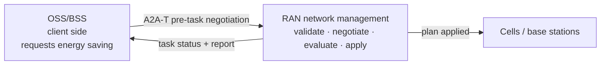
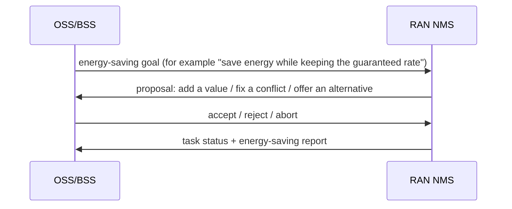
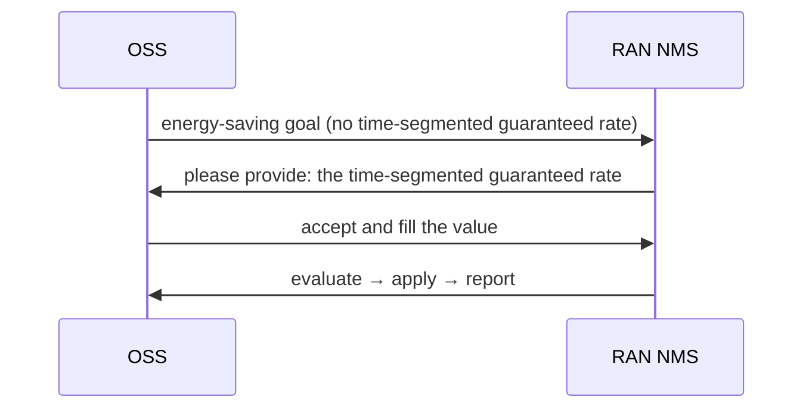
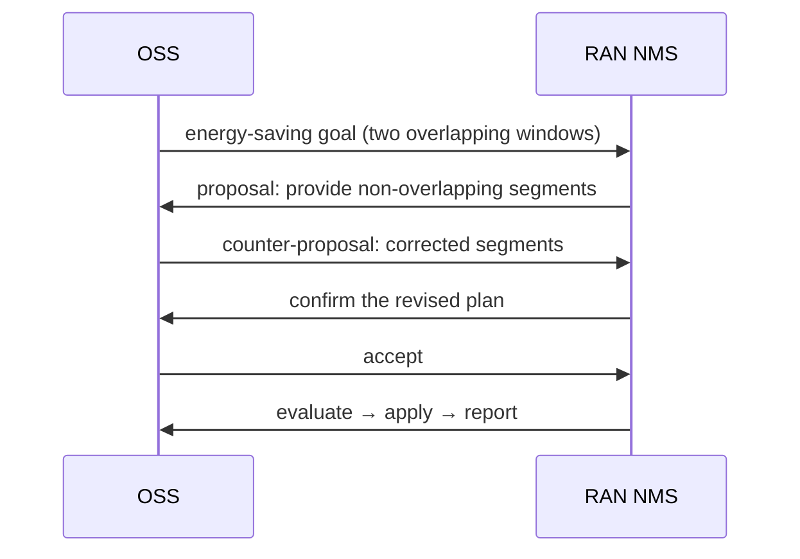
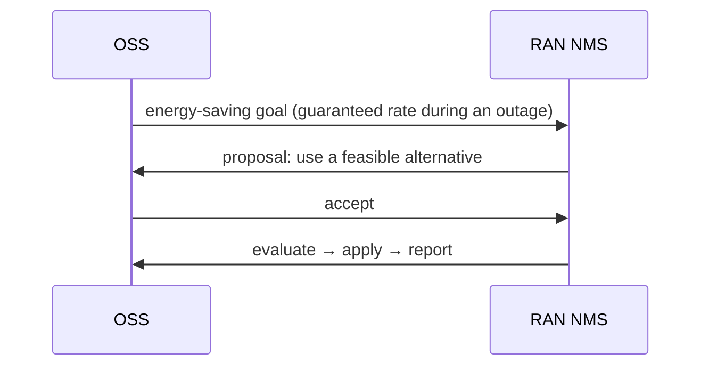

# RAN energy saving: OSS and RAN NMS negotiate, then execute (A2A-T solution)

> **In one sentence:** the OSS asks for an energy-saving goal; the RAN network management system
> negotiates to fill or correct it, then evaluates, applies and reports — automatically, with a
> full audit trail.



## 1. System-to-system interaction

The OSS and the RAN NMS do two things: **agree on the goal, then execute the plan**.

| System | Role | Responsibility |
| --- | --- | --- |
| OSS/BSS | client side | requests the energy-saving goal and decides accept / reject / counter |
| RAN NMS | execution side | validates the goal, negotiates, evaluates and applies the plan, writes the report |



Negotiation may take two or three rounds, but **the task is created only after both sides agree**,
so a wrong goal is never applied.

Typical problems map to three kinds of negotiation:

- missing parameters;
- overlapping time segments;
- infeasible conditions (for example a guaranteed rate during an outage);
- an unknown area: the NMS ranks its served areas against the requested name and asks the engineer
  to choose one, keeping the requested throughput windows.

## 2. Typical scenarios

### 2.1 Missing value: the NMS asks, the OSS fills it



**Outcome:** the task completes; no manual ticket is needed.

### 2.2 Overlapping segments: correct before executing



**Outcome:** the conflict is fixed before any task exists, so nothing wrong is applied.

### 2.3 Infeasible condition: the NMS proposes an alternative



**Outcome:** the infeasible plan is never applied; the alternative is executable.

The other two outcomes are simple conclusions:

| Scenario | Outcome |
| --- | --- |
| the OSS cannot provide a required value | negotiation ends; no task is created |
| counter-proposals never converge | the NMS aborts at the round limit; no task is created |

## 3. Customer value

| Pain | Without pre-task negotiation | With this solution |
| --- | --- | --- |
| Missing parameters | the task fails, or someone asks by ticket | the NMS asks; the OSS fills the value automatically |
| Conflicting targets | a wrong plan may be applied | the conflict is fixed before the task exists |
| Infeasible conditions | the apply fails and has to be rolled back | an alternative is proposed; nothing runs until accepted |
| Audit | emails and tickets | every proposal, decision and apply is recorded |

## 4. Demo

```bash
# CLI (offline, deterministic, no key): planned outage, no negotiation
python run_demo.py --scenario outage --mode auto --model-mode offline
# Web UI (presentation view; opens on the complete use case 1)
python run_demo.py --ui --model-mode offline
# Huawei-themed presentation (the page can also switch it, and ?brand=huawei overrides)
python run_demo.py --ui --brand huawei --model-mode offline
# Web UI with approval 1 (intent) and approval 2 (MML in MIE)
python run_demo.py --ui --mode confirm --approval-gate --scenario target --model-mode offline
# Unknown area: choose the served area manually
python run_demo.py --ui --mode manual --scenario unknown_area --model-mode offline
# Optional: expose the OSS side as an A2A backend
python run_demo.py --ui --gateway --ui-port 8080 --gateway-port 8001 --model-mode offline
# Share the Web UI on the LAN: explicit tokenless opt-in (trusted network only)
python run_demo.py --ui --ui-host 0.0.0.0 --allow-insecure-bind --model-mode offline
# Or keep a token and share a link; the page stores it in a same-origin cookie
A2AT_SAMPLE_AUTH_TOKEN=<token> python run_demo.py --ui --ui-host 0.0.0.0 --model-mode offline
# colleagues open http://<your-lan-ip>:8080/?token=<token>
```

`--ui-host 0.0.0.0` exposes only the Web UI; the registry and the NMS server stay on loopback.
Without `A2AT_SAMPLE_AUTH_TOKEN` the launcher refuses a non-loopback bind unless
`--allow-insecure-bind` is passed explicitly; in that mode anyone who can reach the port can start
runs, so use it only on a trusted network. With a token, share the `/?token=…` link: the page copies
the token into a same-origin `a2at_ui_token` cookie and removes it from the address bar, so both
`fetch` and the SSE stream authenticate (a browser cannot set an `Authorization` header on an
`EventSource`).

With `--gateway`, the OSS side is itself an A2A agent: an external caller such as Gemini Enterprise
sends one request and receives progress notifications (negotiation and execution milestones) before
the final energy-saving report, either on a stream or through a registered webhook.

The Web UI opens on the presentation view: a 16:9 stage with the engineer, the OSS Agent, the RAN
Agent, the MIE and the radio sites, plus the A2A-T channel between them. The presentation supports
two brand palettes: **Orange** (the reference demo, default) and **Huawei** (the warm-canvas,
outlined-node ICT style). The top-bar button switches them at runtime and remembers the choice;
`--brand huawei` or `?brand=huawei` selects the start-up default. Eight examples cover use
case 1 (night-time energy saving, with and without negotiation) and use case 2 (planned power
outage). The stage follows the live run at a human pace through nine steps: request, structured
Task-T, approval 1 (intent), Task-T sent, negotiation when needed, strategy and task start, data
collection (days 2 to 8, compressed), approval 2 (MML in MIE) and apply and report. The request box
shows the concise wording a network engineer would type, for example “Start energy saving in the
Songshanhu area with these guaranteed throughputs: …”; the OSS Agent first turns it into its own
structured intent, and only the send step maps that intent onto the Task-T. The **Unknown area**
example lists the served areas after a fuzzy match and lets the engineer choose one; selecting an
area only fills the region, so the requested throughput windows are kept. After the Task-T is
accepted the RAN Agent reports `SUBMITTED`, strategy working, strategy ready and task started before
data collection begins. The right column keeps the evidence: what the OSS Agent understood (with
the 24-hour throughput chart), the
negotiation turns, an **On the wire** inspector, and the merged session trace. On the wire shows the
real A2A request headers and JSON body with the Task-T metadata; its **Plain A2A** toggle shows the
same request as one natural-language sentence without the extension header or Task-T fields (a
format view of the same message). Clicking a trace row selects that message in the inspector. The
trace labels each row with its demo day (Day 1, Days 2–8, Day 9, Day 9+) and message direction
(OSS → RAN, RAN → OSS, MIE ⇄ Engineer); late server spans are merged by event time and a status and
its matching span collapse to one row.

### Pure A2A mode (three hops, standard A2A only)

The page is single-mode: the protocol is fixed when the process starts, and the page has no
protocol switch or comparison card. Run the A2A-T demo and the pure A2A demo separately to compare
them.

`--protocol pure` starts a real three-hop A2A chain:

```
Engineer/UI ──A2A──► OSS Agent (:8001) ──A2A──► RAN Agent (:8000) ──A2A──► MIE Agent (:8002)
```

- The OSS Agent forwards the engineer request to the RAN Agent. When the request needs a value or
  has a conflicting target, the RAN Agent returns a standard A2A Task in `INPUT_REQUIRED`; the OSS
  Agent answers on the same Task with a follow-up message carrying `taskId`/`contextId`. Up to three
  rounds. No `Task-T/v1` or `Negotiation-T/v1` metadata is generated or returned.
- Before applying a plan, the RAN Agent asks the MIE Agent over A2A. The MIE Agent pushes the
  approval card to the page over its own SSE stream and receives the engineer's decision on
  `POST /api/mie/approvals/{taskId}`.
- The presentation shows the OSS, RAN and MIE hops, the negotiation turns, the MIE approval card and
  a per-run metrics block (hops, negotiation rounds, A2A messages). The examples are `night`
  (no negotiation), `information` (one missing-parameter round) and `target` (a counter-proposal
  then an accept).
- The old single-turn `plain` path remains in the code and tests as an internal baseline, but it is
  not exposed by the CLI or the page.

```bash
# Pure A2A, three hops and human approval in MIE
uv run python -m demo.run_demo --protocol pure --ui --approval-gate --scenario information

# Existing A2A-T mode (Task-T + Negotiation-T), unchanged
uv run python -m demo.run_demo --protocol a2a-t --ui --mode confirm --approval-gate --scenario information
```

Approval 1 is real: in `--mode confirm`, the Task-T is held before it leaves the OSS Agent until the
engineer confirms the structured intent. Approval 2 is the MIE MML review: with `--approval-gate`,
the RAN Agent publishes the real A2A `INPUT_REQUIRED` state before applying a plan; the page shows the
MML suggestion and asks the engineer to approve it in MIE. The review window defaults to 240 s;
if it expires (or the run ends while the card is open), the page closes the card and shows the
ending instead of staying on "review needed". A rejection applies nothing and ends the run without
a report. The data-collection phase is driven by three real `WORKING` status
updates (started, in progress, completed); the page animates days 1–8 and never invents measurements.
No MML command reaches the network before the MIE approval: after it, the green `MML commands`
packet leaves MIE directly for the radio sites, the sites execute it, and the execution results
travel back through the RAN Agent to the OSS Agent.

The playback controls (auto / step by step, speed, pause, previous / next, loop) only pace the
presentation; the backend run is real. Transport, model and language are fixed when the process
starts, so the page itself offers only the scenario switcher and the request text.

For the protocol-level view (phases, LLM and tool calls, raw payloads, run history), start the same
command with `--ui-mode explorer`. Installation, environment variables and the full command
reference are in the [technical guide](TECHNICAL.md).

### Metrics and protocol comparison

Every run writes one metrics record: token usage, a latency split (model / tool / human approval /
other) and accuracy against the scenario's ground truth (terminal state, negotiation rounds, agreed
throughput target and report presence). The record is stored in the client SQLite database
(`run_metrics`) and appended to `runs/metrics/run-metrics.jsonl`; the Web UI also serves
`/api/metrics/runs`, `/api/metrics/summary`, `/api/runs/{runId}/metrics` and
`/api/metrics/export.csv`.

Open `http://127.0.0.1:8080/comparison` to compare protocols and scenarios: success rate, token
averages, model/total latency, P95 and approval wait. The page reads the same persisted records.

Because the protocol is process-level, the benchmark starts one demo stack per protocol. It drives
the same scenarios, approves the human gate after a fixed delay (0.3 s by default), and writes
`metrics.json`, `metrics.jsonl`, `summary.csv`, `summary.json` and `report.html` under
`runs/benchmarks/<timestamp>/`:

```bash
# Token/latency/accuracy comparison with the live model
uv run python -m demo.benchmark --model-mode live --scenarios information,target --repeats 3

# One quick offline smoke (tokens are N/A because the scripted model reports no usage)
uv run python -m demo.benchmark --protocols pure --scenarios information --repeats 1
```

Offline runs still measure latency and accuracy; token fields are reported as `N/A` because the
scripted model produces no usage. Human approval time is recorded separately and excluded from the
model/protocol latency comparison.

## 5. Integration boundary

| OSS side | NMS side |
| --- | --- |
| Integrate the A2A-T client; the SDK carries the protocol | Keep the existing NMS evaluation, apply and reporting capability |
| Provide a decision agent: accept / reject / counter | Replace the sample tools with real NMS interfaces |
| Keep your own policy, approval and audit | Keep the negotiation policy and task store |

In the reference implementation the OSS side uses an ADK decision agent and the NMS side uses
LangGraph; those are implementation choices and do not change the interaction above.

## 6. Key characteristics

| Characteristic | What it means |
| --- | --- |
| Auditable | every proposal, decision, apply and report is recorded |
| Model-independent | offline runs are reproducible; a live model only affects decisions and planning |
| Replaceable | tools and policy can be replaced with the real NMS implementation |

## 7. Technical guide

Protocol details, implementation structure, configuration, tests and production notes are in the
[technical guide](TECHNICAL.md).
