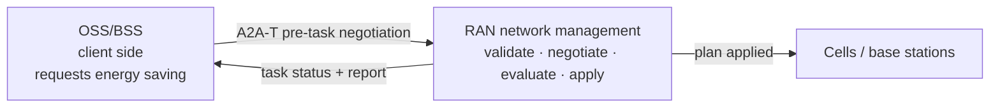
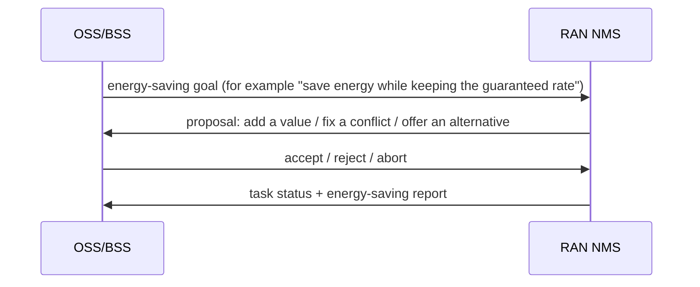
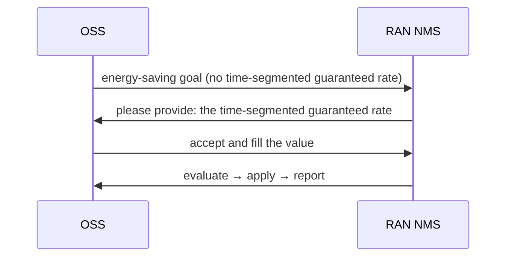
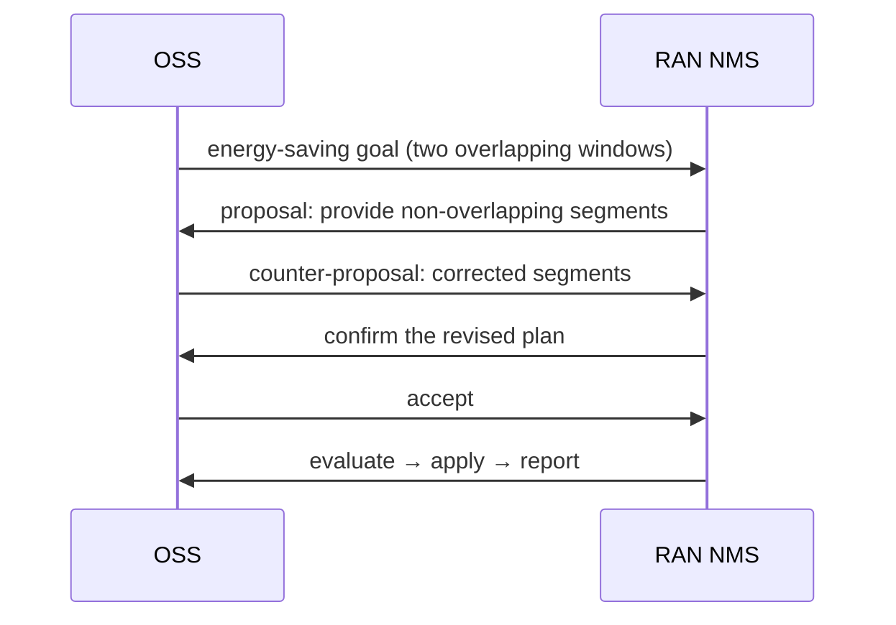
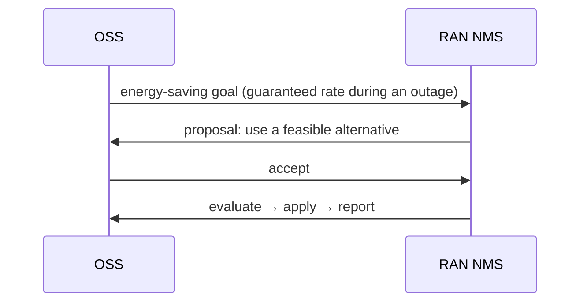

# RAN energy saving: OSS and RAN NMS negotiate, then execute (A2A-T solution)

> **In one sentence:** the OSS asks for an energy-saving goal; the RAN network management system
> negotiates to fill or correct it, then evaluates, applies and reports — automatically, with a
> full audit trail.



## 1. System-to-system interaction

The OSS and the RAN NMS do two things: **agree on the goal, then execute the plan**.

| System | Role | Responsibility |
| --- | --- | --- |
| OSS/BSS | client side | requests the energy-saving goal and decides accept / reject / counter |
| RAN NMS | execution side | validates the goal, negotiates, evaluates and applies the plan, writes the report |



Negotiation may take two or three rounds, but **the task is created only after both sides agree**,
so a wrong goal is never applied.

Typical problems map to three kinds of negotiation:

- missing parameters;
- overlapping time segments;
- infeasible conditions (for example a guaranteed rate during an outage);
- an unknown area: the NMS ranks its served areas against the requested name and asks the engineer
  to choose one, keeping the requested throughput windows.

## 2. Typical scenarios

### 2.1 Missing value: the NMS asks, the OSS fills it



**Outcome:** the task completes; no manual ticket is needed.

### 2.2 Overlapping segments: correct before executing



**Outcome:** the conflict is fixed before any task exists, so nothing wrong is applied.

### 2.3 Infeasible condition: the NMS proposes an alternative



**Outcome:** the infeasible plan is never applied; the alternative is executable.

The other two outcomes are simple conclusions:

| Scenario | Outcome |
| --- | --- |
| the OSS cannot provide a required value | negotiation ends; no task is created |
| counter-proposals never converge | the NMS aborts at the round limit; no task is created |

## 3. Customer value

| Pain | Without pre-task negotiation | With this solution |
| --- | --- | --- |
| Missing parameters | the task fails, or someone asks by ticket | the NMS asks; the OSS fills the value automatically |
| Conflicting targets | a wrong plan may be applied | the conflict is fixed before the task exists |
| Infeasible conditions | the apply fails and has to be rolled back | an alternative is proposed; nothing runs until accepted |
| Audit | emails and tickets | every proposal, decision and apply is recorded |

## 4. Demo

```bash
# One explicit configuration file per launch script; the launcher no longer guesses
python run_demo.py --env-file configs/yellow-zone.env --nms --ui
# equivalent: A2AT_SAMPLE_ENV_FILE=configs/yellow-zone.env python run_demo.py ...
# CLI (offline, deterministic, no key): planned outage, Create baseline then Modify, no negotiation
python run_demo.py --scenario outage --mode auto --model-mode offline
# Web UI (presentation view; opens on the complete use case 1)
python run_demo.py --ui --model-mode offline
# Huawei-themed presentation (the page can also switch it, and ?brand=huawei overrides)
python run_demo.py --ui --brand huawei --model-mode offline
# Web UI with approval 1 (intent) and approval 2 (MML in MIE)
python run_demo.py --ui --mode confirm --approval-gate --scenario target --model-mode offline
# Unknown area: choose the served area manually
python run_demo.py --ui --mode manual --scenario unknown_area --model-mode offline
# Optional: expose the OSS side as an A2A backend
python run_demo.py --ui --gateway --ui-port 8080 --gateway-port 8001 --model-mode offline
# Share the Web UI on the LAN: explicit tokenless opt-in (trusted network only)
python run_demo.py --ui --ui-host 0.0.0.0 --allow-insecure-bind --model-mode offline
# Or keep a token and share a link; the page stores it in a same-origin cookie
A2AT_SAMPLE_AUTH_TOKEN=<token> python run_demo.py --ui --ui-host 0.0.0.0 --model-mode offline
# colleagues open http://<your-lan-ip>:8080/?token=<token>
```

`--ui-host 0.0.0.0` exposes only the Web UI; the registry and the NMS server stay on loopback.
Without `A2AT_SAMPLE_AUTH_TOKEN` the launcher refuses a non-loopback bind unless
`--allow-insecure-bind` is passed explicitly; in that mode anyone who can reach the port can start
runs, so use it only on a trusted network. With a token, share the `/?token=…` link: the page copies
the token into a same-origin `a2at_ui_token` cookie and removes it from the address bar, so both
`fetch` and the SSE stream authenticate (a browser cannot set an `Authorization` header on an
`EventSource`).

With `--gateway`, the OSS side is itself an A2A agent: an external caller such as Gemini Enterprise
sends one request and receives progress notifications (negotiation and execution milestones) before
the final energy-saving report, either on a stream or through a registered webhook.

The Web UI opens on the presentation view: a 16:9 stage with the engineer, the OSS Agent, the RAN
Agent, the MIE and the radio sites, plus the A2A-T channel between them. The presentation supports
two brand palettes: **Orange** (the reference demo, default) and **Huawei** (the warm-canvas,
outlined-node ICT style). The top-bar button switches them at runtime and remembers the choice;
`--brand huawei` or `?brand=huawei` selects the start-up default. Eight examples cover use
case 1 (night-time energy saving, with and without negotiation) and use case 2 (planned power
outage). The outage run is two-phase on one Task: a Create baseline, then a real Modify Task-T on
the same Task; the presentation keeps the step bar at Apply & report for the Modify phase and
shows each Task-T's own wire payload. The stage follows the live run at a human pace through nine
steps: request, structured
Task-T, approval 1 (intent), Task-T sent, negotiation when needed, strategy and task start, data
collection (days 2 to 8, compressed), approval 2 (MML in MIE) and apply and report. The request box
shows the concise wording a network engineer would type, for example “Start energy saving in
Region A with these guaranteed throughputs: …”; the OSS Agent first turns it into its own
structured intent, and only the send step maps that intent onto the Task-T. The **Unknown area**
example lists the served areas after a fuzzy match and lets the engineer choose one; selecting an
area only fills the region, so the requested throughput windows are kept. After the Task-T is
accepted the RAN Agent reports `SUBMITTED`, strategy working, strategy ready and task started before
data collection begins. The right column keeps the evidence: what the OSS Agent understood (with
the 24-hour throughput chart), the
negotiation turns, an **On the wire** inspector, and the merged session trace. On the wire shows the
captured redacted exchange from the run's `wire.jsonl` — request line, headers (including the real
`traceparent`) and the exact `SendMessageRequest` JSON body the SDK sent (`{"message": …}`, with the
Task-T metadata in A2A-T mode). The a2a-sdk HTTP transport is captured too, so local A2A-T and pure
A2A runs show the real request instead of a message object rebuilt from the trace; when a run
captured none, the panel says so instead of inventing one. Its **Plain A2A** toggle shows the
same request as one natural-language sentence without the extension header or Task-T fields (a
format view of the same message). Clicking a trace row selects that message in the inspector. The
trace labels each row with its demo day (Day 1, Days 2–8, Day 9, Day 9+) and message direction
(OSS → RAN, RAN → OSS, MIE ⇄ Engineer); late server spans are merged by event time and a status and
its matching span collapse to one row.

### Operator intent layer

The sample no longer sends the operator's text straight to A2A or A2A-T. The default
`processed` mode inserts the business step a real OSS performs first:

```text
operator request → business intent (ProcessedIntent) → normalized text → approval 1
                 → A2A-T Task-T / Plain A2A message
```

- Known scenarios use a deterministic built-in intent. A free-text request (`--request` or an
  edited Web UI request) uses the live model; in offline mode it falls back to the raw text and
  records a warning.
- The business layer never repairs a gap or conflict. A missing throughput target, an unknown
  area and overlapping windows stay in the intent, so the A2A-T negotiation still happens.
- Approval 1 confirms the **normalized text** before the protocol mapping. In A2A-T the Task-T is
  then extracted strictly from that text; Plain A2A sends the same text.
- Pure A2A keeps the same story inside the OSS Agent: the engineer client sends the raw request,
  the OSS Agent normalizes it, publishes the intent, and forwards the normalized text to RAN.
- The presentation page shows the operator request, the normalized text and the structured intent
  fields side by side; the trace records `intent_processed`.
- `processed` is the default. Use `A2AT_SAMPLE_INTENT_MODE=raw`, `--intent-mode raw` or
  `POST /api/runs {"intentMode":"raw"}` for the old direct-text behavior. Gateway input is always
  treated as raw.

### Langfuse observability

A live client run can export its Run Explorer spans to Langfuse as one trace per run:

- set `LANGFUSE_PUBLIC_KEY` and `LANGFUSE_SECRET_KEY` (optionally `LANGFUSE_BASE_URL`);
- `LANGFUSE_BASE_URL` is the SDK reporting endpoint and may point at a proxy;
  `A2AT_SAMPLE_LANGFUSE_UI_BASE_URL` is the browser-facing UI base used only for the trace link
  (default `https://us.cloud.langfuse.com`);
- `A2AT_SAMPLE_LANGFUSE_ENABLED=0` forces the export off, and
  `A2AT_SAMPLE_LANGFUSE_CAPTURE_CONTENT=0` sends only model, token, status and timing metadata;
- offline/scripted runs are not exported.

The trace follows `run → phase → negotiation round`; `llm` spans become generations with model and
token usage, `tool` spans become tools, and every other span stays a span. The presentation ending
card and the Run Explorer **Exports** panel link to the trace. Export is best effort: a failure is
shown as a warning and never changes the run result. `langfuse` is an optional sample dependency;
without it, or without keys, the exporter is a no-op.

Client and server spans share one trace. Every local A2A call carries the client trace id as a W3C
`traceparent` (plus `X-A2AT-Run-Id`, conversation and user headers); the RAN, OSS and MIE servers
attach that context before the a2a-sdk handler spans are created, so the server-side `SendMessage` /
`CancelTask` spans land in the same Langfuse trace. If a server cannot join, its bridge span carries
`langfuse.trace.metadata.runId` so the trace is still searchable by run. To export the server spans,
point the SDK's OTLP exporter at Langfuse (`OTEL_EXPORTER_OTLP_ENDPOINT` and
`OTEL_EXPORTER_OTLP_HEADERS`); `OTEL_*`/`LANGFUSE_*` keys from the selected `.env` are exported to
the child processes. The vendor NMS keeps the run id as its `traceparent` because it does not report
to the same project.

### Real vendor NMS mode

The sample can also act as the OSS client of a real vendor NMS. With `--nms`, the launcher starts
no local registry, RAN Agent or MIE: the A2A-T client obtains a session token from the NMS token
endpoint and calls its A2A surface directly. `--nms --protocol pure` keeps the local OSS Agent
(engineer UI → OSS Agent → NMS) and drops only the RAN Agent and MIE.

A real `--nms` run uses **`POST /a2a/json/message:send` plus a webhook** (the vendor's direct
machine-to-machine mode). The local NMS simulator keeps the SSE `message:stream` contract.

```bash
# Real NMS: fill A2AT_SAMPLE_NMS_* and a reachable A2AT_SAMPLE_WEBHOOK_HOST in .env first
python run_demo.py --nms --ui --brand huawei

# Local NMS simulator: same client path, no lab network, no real network change
python run_demo.py --nms --nms-sim --ui --brand huawei
```

Required `.env` keys:

```ini
A2AT_SAMPLE_NMS_HOST=<nms-host>
A2AT_SAMPLE_NMS_TOKEN_USER=<northbound-user>
A2AT_SAMPLE_NMS_TOKEN_VALUE=<password>
# NMS-mode defaults; override them for another deployment.
A2AT_SAMPLE_NMS_REGION=A2ATestRegion
A2AT_SAMPLE_NMS_SITES=NRES_XCS_6102937,LTE_26441_LNR_OCL
A2AT_SAMPLE_NMS_VERIFY_TLS=false
# The real NMS must be able to reach this address and the webhook port.
A2AT_SAMPLE_WEBHOOK_HOST=<client-lan-address>
A2AT_SAMPLE_WEBHOOK_PORT=9000
# Raw exchange log (default on in NMS mode; set 0 to keep business payloads off disk)
A2AT_SAMPLE_NMS_WIRE_LOG=1
```

Only the host is required. The sample derives the standard 910 surface from it:
`https://<host>:31127/a2a/json` and
`https://<host>:27417/rest/plat/smapp/v1/sessions`. For a non-standard deployment, override
`A2AT_SAMPLE_NMS_SCHEME`, `A2AT_SAMPLE_NMS_A2A_PORT` / `A2AT_SAMPLE_NMS_TOKEN_PORT`, or set the
full `A2AT_SAMPLE_NMS_A2A_BASE` / `A2AT_SAMPLE_NMS_TOKEN_URL`; an explicit full URL wins.

The test environment uses a self-signed certificate, so TLS verification is off by default; set
`A2AT_SAMPLE_NMS_VERIFY_TLS=true` only for a trusted chain. The client sends both accepted auth
headers (`Authorization: Bearer` and `X-Auth-Token`) and both extension-header spellings
(`A2A-Extensions` and `X-A2A-Extensions`).

In NMS mode `A2AT_SAMPLE_NMS_REGION` and `A2AT_SAMPLE_NMS_SITES` replace the neutral demo region
(`Region A` / `Region B`) and the scenario site list in every layer of the run: the request the page
pre-fills and the operator sees, the captured intent (`rawRequest`, `region`, `normalizedText`), and
every Task-T sent to the vendor — the initial prompt, the accept refill and the Modify follow-up.
They default to `A2ATestRegion` and the two 910 sites above; other regions and activation windows are
rejected. Nothing silently swaps the region between the stage and the wire. The local three-hop demo
keeps the neutral names and is unaffected. For example: “Create a RAN energy saving task in the
A2ATestRegion region; activation 00:00-06:00 with 30 Mbps for each cell.”

Vendor contract notes:

- The NMS returns structured negotiation metadata only when the request declares **both** Task-T
  and Negotiation-T. The client does that on the initial request; declaring Task-T alone produces a
  bare Message with empty metadata.
- One message may carry only one `-T` metadata key. In NMS mode an accept therefore carries
  Negotiation-T only; the local demo server keeps the refilled Task-T on the accept.
- A continuing PROPOSE can arrive inside an `error` envelope. The client records it in
  `wire-error.jsonl` and stops with a clear protocol error instead of silently ending.
- `negotiationContext.id` is the server's negotiation handle, not the A2A `contextId`. A reply
  carries the proposal's negotiation id; a continuing negotiation may open a **new** negotiation id
  on the same context id.
- After an accept/counter/reject, the client keeps reading the response stream until it idles
  (`A2AT_SAMPLE_NMS_READ_AFTER_SEND`, on by default) so a new proposal on that stream is not lost.
- The idle window is 45 s by default (`A2AT_SAMPLE_NMS_IDLE_TIMEOUT_SECONDS`); `: heartbeat`
  frames do not count as progress.
- Task cancellation returns HTTP 503; the client treats it as a known limitation and never retries
  the send.
- The presentation toolbar has **Cancel task** next to **Edit request**. It asks the remote NMS to
  cancel its Task first (best effort, currently HTTP 503) and then stops the local run, so a
  long-running or repeatedly tested task can be stopped without restarting the page.
- The NMS publishes no AgentCard, so discovery uses a static card; a real registry integration is
  a later step.

The raw exchange is recorded in `runs/<runId>/wire.jsonl` (the pure OSS Agent writes
`wire-oss.jsonl` in the same directory) and failed frames in `wire-error.jsonl`, with credentials
redacted.

The webhook receiver is **process-level**: it binds `A2AT_SAMPLE_WEBHOOK_PORT` once at startup and
every Web UI "Start" reuses the same callback; a new receiver is never started per request. One
webhook run runs at a time in a process and a second one gets an explicit conflict message. Without
`A2AT_SAMPLE_WEBHOOK_PUBLIC_URL`, a busy configured port falls back to an OS-assigned one; with a
public URL (a gateway forwards a fixed address) it never silently moves and instead explains that
the port is in use.

In pure + `--nms` the OSS Agent posts its NMS token/send/poll spans into the same run, so the session
trace shows `NMS session token acquired`, `NMS A2A stream opened` and the rest of the real
downstream hop, and status text distinguishes `NMS` from the local `RAN Agent`. Use `--ui --mode confirm` for the send-time intent
review; server-side approval 2 does not exist in NMS mode because the vendor owns execution.

### Two instances on one machine

One instance can switch request forms in the page (`--protocol both`). Running two instances is
still useful when each side needs its own NMS credentials, data directory or webhook endpoint. Each
instance needs its own launcher state, data directory, UI port and webhook port:

| | A2A-T | pure A2A |
|---|---|---|
| UI | 8080 | 8081 |
| Webhook | 9000 | 9001 |
| OSS Agent | not started | 8011 |
| `A2AT_SAMPLE_RUN_DIR` | `%TEMP%/a2at-ran-energy-saving-adk` | `%TEMP%/a2at-ran-energy-saving-adk-pure` |
| `A2AT_SAMPLE_RUNS_DIR` | `runs` | `runs-pure` |

```bash
# Instance A (A2A-T)
A2AT_SAMPLE_RUN_DIR=/tmp/a2at-adk \
A2AT_SAMPLE_RUNS_DIR=runs \
A2AT_SAMPLE_UI_PORT=8080 \
A2AT_SAMPLE_WEBHOOK_PORT=9000 \
python run_demo.py --nms --ui --brand huawei

# Instance B (pure A2A: UI -> local OSS Agent -> NMS)
A2AT_SAMPLE_RUN_DIR=/tmp/a2at-adk-pure \
A2AT_SAMPLE_RUNS_DIR=runs-pure \
A2AT_SAMPLE_UI_PORT=8081 \
A2AT_SAMPLE_WEBHOOK_PORT=9001 \
python run_demo.py --nms --protocol pure --ui --brand huawei --oss-port 8011
```

`--stop` reads only that instance's `A2AT_SAMPLE_RUN_DIR/pids.json`, so stopping B leaves A
running. In pure + NMS the UI talks to the local OSS Agent over direct A2A/SSE; the OSS Agent talks
to the NMS over plain A2A (webhook, or SSE for `--nms-sim`). The OSS Agent answers the NMS's
`INPUT_REQUIRED` with the same ADK decision agent used by the A2A-T client and renders the decision
as natural-language text.

If the NMS rejects a pure follow-up that carries `taskId`, set
`A2AT_SAMPLE_PURE_FOLLOWUP=context` (or `task` for `taskId` only) and retry; the default is `both`.

A real NMS requires an https callback reachable through a gateway. Set
`A2AT_SAMPLE_WEBHOOK_PUBLIC_URL` to that URL, `A2AT_SAMPLE_WEBHOOK_TLS_CERT` /
`A2AT_SAMPLE_WEBHOOK_TLS_KEY` to the receiver's certificate pair, and
`A2AT_SAMPLE_WEBHOOK_AUTH_CREDENTIALS` to the `user:password` the NMS pushes with. The receiver then
checks Basic auth instead of `A2AT_SAMPLE_WEBHOOK_TOKEN`, and the same credentials are registered in
the inline push config.

### One agent, two request forms

A2A-T is an extension of A2A, not a second protocol. The RAN Agent always speaks standard A2A;
when a request declares or carries `Task-T`, the same agent runs the pre-task negotiation and
stamps A2A-T metadata on the result. The vendor NMS works the same way: one service, and the
request says whether the extension is used.

`--protocol both` starts that single agent and a page with a protocol switch:

```bash
uv run python -m demo.run_demo --protocol both --ui --model-mode offline
```

- **A2A** — standard Task lifecycle (`INPUT_REQUIRED` continuation). In the local topology the
  request takes three hops: UI → OSS Agent → RAN Agent → MIE Agent.
- **A2A + A2A-T** — Task-T template validation and pre-task negotiation, served by the same RAN
  Agent.

Every run records its request form, so the session trace, metrics and history stay consistent when
the page switches. `--protocol a2a-t` and `--protocol pure` remain available for a deployment that
serves only one form or for a deterministic CLI run.

### Pure A2A mode (three hops, standard A2A only)

`--protocol pure` starts a real three-hop A2A chain:

```
Engineer/UI ──A2A──► OSS Agent (:8001) ──A2A──► RAN Agent (:8000) ──A2A──► MIE Agent (:8002)
```

- The OSS Agent forwards the engineer request to the RAN Agent. When the request needs a value or
  has a conflicting target, the RAN Agent returns a standard A2A Task in `INPUT_REQUIRED`; the OSS
  Agent answers on the same Task with a follow-up message carrying `taskId`/`contextId`. Up to three
  rounds. No `Task-T/v1` or `Negotiation-T/v1` metadata is generated or returned.
- Before applying a plan, the RAN Agent asks the MIE Agent over A2A. The MIE Agent pushes the
  approval card to the page over its own SSE stream and receives the engineer's decision on
  `POST /api/mie/approvals/{taskId}`.
- The presentation shows the OSS, RAN and MIE hops, the negotiation turns, the MIE approval card and
  a per-run metrics block (hops, negotiation rounds, A2A messages). The examples are `night`
  (no negotiation), `information` (one missing-parameter round) and `target` (a counter-proposal
  then an accept).
- The old single-turn `plain` path remains in the code and tests as an internal baseline, but it is
  not exposed by the CLI or the page.

```bash
# Pure A2A, three hops and human approval in MIE
uv run python -m demo.run_demo --protocol pure --ui --approval-gate --scenario information

# Existing A2A-T mode (Task-T + Negotiation-T), unchanged
uv run python -m demo.run_demo --protocol a2a-t --ui --mode confirm --approval-gate --scenario information
```

Approval 1 is real: in `--mode confirm`, the Task-T is held before it leaves the OSS Agent until the
engineer confirms the structured intent. Approval 2 is the MIE MML review: with `--approval-gate`,
the RAN Agent publishes the real A2A `INPUT_REQUIRED` state before applying a plan; the page shows the
MML suggestion and asks the engineer to approve it in MIE. The review window defaults to 240 s;
if it expires (or the run ends while the card is open), the page closes the card and shows the
ending instead of staying on "review needed". A rejection applies nothing and ends the run without
a report. The data-collection phase is driven by three real `WORKING` status
updates (started, in progress, completed); the page animates days 1–8 and never invents measurements.
No MML command reaches the network before the MIE approval: after it, the green `MML commands`
packet leaves MIE directly for the radio sites, the sites execute it, and the execution results
travel back through the RAN Agent to the OSS Agent.

The playback controls (auto / step by step, speed, pause, previous / next, loop) only pace the
presentation; the backend run is real. Transport, model and language are fixed when the process
starts, so the page itself offers only the scenario switcher and the request text.

For the protocol-level view (phases, LLM and tool calls, raw payloads, run history), start the same
command with `--ui-mode explorer`. Installation, environment variables and the full command
reference are in the [technical guide](TECHNICAL.md).

### Metrics and protocol comparison

Every run writes one metrics record: token usage, a latency split (model / tool / human approval /
other) and accuracy against the scenario's ground truth (terminal state, negotiation rounds, agreed
throughput target and report presence). The record is stored in the client SQLite database
(`run_metrics`) and appended to `runs/metrics/run-metrics.jsonl`; the Web UI also serves
`/api/metrics/runs`, `/api/metrics/summary`, `/api/runs/{runId}/metrics` and
`/api/metrics/export.csv`.

Open `http://127.0.0.1:8080/comparison` to compare protocols and scenarios: success rate, token
averages, model/total latency, P95 and approval wait. The page reads the same persisted records.

Because the protocol is process-level, the benchmark starts one demo stack per protocol. It drives
the same scenarios, approves the human gate after a fixed delay (0.3 s by default), and writes
`metrics.json`, `metrics.jsonl`, `summary.csv`, `summary.json` and `report.html` under
`runs/benchmarks/<timestamp>/`:

```bash
# Token/latency/accuracy comparison with the live model
uv run python -m demo.benchmark --model-mode live --scenarios information,target --repeats 3

# One quick offline smoke (tokens are N/A because the scripted model reports no usage)
uv run python -m demo.benchmark --protocols pure --scenarios information --repeats 1
```

Offline runs still measure latency and accuracy; token fields are reported as `N/A` because the
scripted model produces no usage. Human approval time is recorded separately and excluded from the
model/protocol latency comparison.

## 5. Integration boundary

| OSS side | NMS side |
| --- | --- |
| Integrate the A2A-T client; the SDK carries the protocol | Keep the existing NMS evaluation, apply and reporting capability |
| Provide a decision agent: accept / reject / counter | Replace the sample tools with real NMS interfaces |
| Keep your own policy, approval and audit | Keep the negotiation policy and task store |

In the reference implementation the OSS side uses an ADK decision agent and the NMS side uses
LangGraph; those are implementation choices and do not change the interaction above.

## 6. Key characteristics

| Characteristic | What it means |
| --- | --- |
| Auditable | every proposal, decision, apply and report is recorded |
| Model-independent | offline runs are reproducible; a live model only affects decisions and planning |
| Replaceable | tools and policy can be replaced with the real NMS implementation |

## 7. Technical guide

Protocol details, implementation structure, configuration, tests and production notes are in the
[technical guide](TECHNICAL.md).
