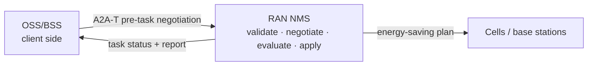
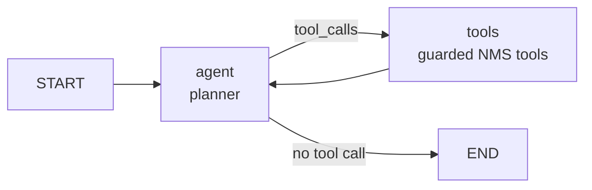

# RAN energy-saving sample: developer guide

> For developers who need to **integrate or change** this interaction. The customer-facing solution
> (business view, system interaction, scenarios, value) is in [README.md](README.md).

## 0. How to read this guide

Pick the path that matches your role. Every path starts by running the sample; none of them requires
reading the protocol first.

| You are | Read | When you finish you can |
| --- | --- | --- |
| just evaluating | 1 | run an offline negotiation and read the interaction in the UI |
| an OSS developer | 1 → 2 → 3 | connect the A2A-T client and plug in your own decision logic |
| an NMS developer | 1 → 2 → 4 | connect the pre-task negotiation handler, executor and tools to the real NMS |
| looking up a field or setting | 5 / 6 | find message fields, configuration keys and defaults |

Six terms you will meet immediately (the full glossary is [Appendix A](#appendix-a-glossary)):

| Term | In one line |
| --- | --- |
| A2A | protocol that carries messages and Tasks between agents |
| A2A-T | extension that adds pre-task negotiation and structured task prompts on top of A2A |
| OSS | client-side system: requests the energy-saving goal and decides the answer |
| NMS | execution-side system: validates, negotiates, evaluates, applies and reports |
| Task-T | structured task prompt |
| Negotiation-T | pre-task negotiation message |

## 1. Ten-minute walkthrough (tutorial)

**Goal:** run one offline negotiation without writing code and see what happens between the OSS and
the NMS.
**Before you start:** Python 3.12+, [`uv`](https://docs.astral.sh/uv/), and a checked-out repository.

### 1.1 Install

```bash
# 1. repository root: SDK and development dependencies
uv sync --dev

# 2. a2a-t-sample: sample dependencies (same .venv)
cd a2a-t-sample
uv pip install -r requirements.txt

# 3. activate (run from a2a-t-sample/)
source ../.venv/Scripts/activate        # Git Bash / Windows
# source ../.venv/bin/activate          # Linux / macOS
```

Every `python` below means this interpreter. Without activation, use
`../../.venv/Scripts/python.exe` on Windows or `../../.venv/bin/python` on Linux/macOS.

**Verify:** `python -c "import a2a_t; print(a2a_t.__name__)"` prints without error.

### 1.2 Run one offline negotiation

```bash
cd ran-energy-saving
python run_demo.py --scenario information --mode auto --model-mode offline
# complete use case 2, no negotiation
python run_demo.py --scenario outage --mode auto --model-mode offline
```

Offline mode needs no `.env` and no API key: `run_demo.py` falls back to `env.example`.

**Verify:** the run ends with:

```text
[client] final_state=task_completed task_id=<uuid>
[client] report={"ok": true, "summary": "Plan plan-cell-001-001 applied ..."}
[run_demo] stopped 2 background process(es)
```

**Common problems:**

| Symptom | Cause | Fix |
| --- | --- | --- |
| a port is already in use | a previous `--keep-alive` process is still running | `python run_demo.py --stop` |
| `ModuleNotFoundError: a2a_t` | the environment is not active | use the absolute venv Python, or run `uv sync --dev` again |
| startup rejects the language or model mode | an existing process runs with other settings | `--stop` first, then start with the new settings |
| a live run waits a long time at the first Task-T step | the OpenAI-compatible endpoint was cold | the launcher sends one warm-up completion; retry once if the endpoint was still starting |

### 1.3 Read the interaction in the UI

```bash
python run_demo.py --ui --scenario information --model-mode offline
# open http://127.0.0.1:8080
```

The page opens on the presentation view: a 16:9 stage (engineer, OSS Agent, RAN Agent, MIE and radio
sites, with the A2A-T channel between them) and three evidence panels. Eight examples cover use case
1 (night-time energy saving, complete and negotiated) and use case 2 (planned power outage, a
Create baseline followed by a real Modify continuation on the same Task). The presentation keeps
the step bar on Apply & report for the Modify phase, shows each Task-T's own payload in the wire
inspector, and renders the modified report as the final card.

The presentation supports two brand palettes. `--brand orange|huawei` (or
`A2AT_SAMPLE_UI_BRAND`) sets the start-up default; the top-bar button switches at runtime and stores
the choice in `localStorage`; `?brand=` overrides both for one page load. The CSS keeps a semantic
token layer: **orange** maps to the reference-demo values, while **huawei** remaps the canvas,
cards, text and role colors and adds the low-noise outlined stage (warm canvas, 1px translucent
borders, core/aggregation/leaf node strokes). Hovering an actor or lane in the Huawei stage dims
unrelated elements to 15% and thickens the adjacent links.

Pick a scenario, edit the network operations engineer's request if needed, and start it. The stage
follows the real run through nine steps: request → structured Task-T → approval 1 (intent) → Task-T
sent → negotiation when needed → strategy and task start → data collection (days 2–8, compressed) →
approval 2 (MML in MIE) → apply and report. The request box uses the concise wording a network
engineer would type; the OSS Agent first builds its own structured intent, and the Task-T is only the
wire mapping at the send step. After task creation the RAN Agent publishes `SUBMITTED`, strategy
working, strategy ready and task started before the collection notifications. The right column shows what the OSS Agent understood
(with the 24-hour throughput chart), the negotiation turns, an **On the wire** inspector, and the
merged session trace. The right column stays fixed to the viewport and each panel scrolls on its
own; drag the grip above the session trace to make the trace taller (double-click resets it and the
height is remembered). The inspector shows the real A2A request headers and JSON body with the
Task-T metadata; its **Plain A2A** toggle replaces the Task-T fields with one natural-language
sentence and drops the extension header. It is a format comparison only, not a second run. Every
trace row is clickable: a message row opens it in the inspector, a span row shows its fields, and a
decision row without a message opens a readable summary. The clicked row stays highlighted and the
list stops following the newest row until you scroll back to the bottom. Rows are grouped by the
demo day (Day 1, Days 2–8, Day 9, Day 9+) and show the message direction (OSS → RAN, RAN → OSS,
MIE ⇄ Engineer). Rows follow the reference demo's two-line shape: a short event title, a second
line with the demo day and direction, and a short A2A state chip (`SUBMITTED`, `WORKING`,
`INPUT_REQUIRED`, …) on the right; the full status sentence stays in the wire inspector. Server
spans arrive in batches with earlier timestamps, so the trace inserts them by event time instead of
arrival order; a status and its matching approval/decision span share one dedupe key and render as
one row.

Two human approvals can be enabled at startup:

- `--mode confirm`: approval 1 holds the Task-T before it leaves the OSS Agent; the engineer confirms
  the structured intent (or edits the request). The same mode also makes the OSS Agent recommend a
  negotiation decision before the engineer confirms, overrides, accepts the RAN Agent proposal or
  rejects it;
- `--approval-gate`: approval 2 is the MIE MML review. The RAN Agent publishes `INPUT_REQUIRED`
  before applying a plan; the page shows the MML suggestion and asks the engineer to approve it in
  MIE. The review window defaults to 240 s; a timeout (or a run that ends while the card is open)
  closes the card and shows the ending. A rejection applies nothing and ends the run without a
  report. The Web UI forwards the decision to the A2A server it started; `--server-url`
  (`A2AT_SAMPLE_SERVER_URL`) points it at an external server.

The data-collection step is driven by three real `WORKING` status updates (started, in progress,
completed); the page animates days 1–8, says "No MML applied yet" once while the baseline is being
measured, and keeps the RAN Agent at "Data collection completed" until the MIE review starts. After
the engineer approves the suggestion in MIE, the green `MML commands` packet goes from the MIE box
directly to the radio sites; the sites execute it and the execution results travel back to the RAN
Agent, which reports them over A2A-T. The stage shows six radio sites: the two dataset cells
(`cell-001`, `cell-002`) plus four illustrative sites of the same test cluster.

The playback controls (auto / step, speed, pause, previous / next, loop) pace the presentation only;
the backend run is real. Transport, model and language come from the CLI. The stage follows the
client's A2A events (status updates and artifacts); server-side trace spans are evidence for the
right-hand panels and never replay a stage beat, because they are posted in batches and can arrive
after the events they explain. Artifacts are classified by the tool that produced them, so a live
planner that reads several cells and evaluates several candidates still shows MML only after the
MIE approval, and reads the apply artifact as the sites' execution report rather than a dispatch.

For phases, LLM and tool spans, raw payloads and run history, start with `--ui-mode explorer` and
use the Run Explorer's left rail, timeline and inspector.

**Verify:** the presentation view ends with the energy-saving report; the reject and abort scenarios
end with "no task created"; cancelling approval 1 ends with "intent not confirmed"; rejecting
approval 2 ends with "MML not approved · nothing was applied".

## 2. Architecture at a glance (explanation)

**Goal:** after this section you can draw the two systems and one run, and you know which file to
open for each change.

### 2.1 Two systems, one negotiation chain



Keep the three layers apart:

| Layer | Owns | Does not own |
| --- | --- | --- |
| A2A (a2a-sdk) | AgentCard discovery, messages, Task events | the meaning of a negotiation |
| A2A-T (a2a_t) | Task-T / Negotiation-T generation, validation, metadata | HTTP connections or agents |
| business | OSS decisions; NMS evaluation and apply | hand-built protocol fields |

In one line: **A2A delivers it, A2A-T makes it meaningful, your business logic decides.**

### 2.2 Lifecycle of one run

| # | Phase | What happens | Main code |
| --- | --- | --- | --- |
| 1 | Dispatch | the client assembles its runtime and discovers the AgentCard | `protocol/client_runtime.py` |
| 2 | Task generation | the natural-language request becomes a Task-T | `protocol/client_flow.py` |
| 3 | Validation | the NMS validates Task-T; a failure opens a negotiation | `protocol/pre_task_negotiation.py` |
| 4 | Negotiation | propose, decide, counter (at most three rounds) | `pre_task_negotiation.py`, `decision_provider.py` |
| 5 | Resolution | accept/reject/abort; an accept refills Task-T | `client_flow.py`, `pre_task_negotiation.py` |
| 6 | NMS execution | evaluate and apply the plan | `server_executor.py`, `demo/agents/server_agent/` |
| 7 | Report | publish the report artifact; the Task completes | `server_executor.py` |
| 8 | Done | write the transcript; the UI replays it | `protocol/client_service/`, `demo/web/` |

### 2.3 Code map: start from the change you need

| You want to change | Start here |
| --- | --- |
| OSS decision logic | `demo/agents/client_agent/` + `protocol/decision_provider.py` |
| OSS protocol loop | `protocol/client_flow.py` |
| OSS conversations and run history | `protocol/client_service/`, `protocol/client_store/` |
| expose the OSS as an A2A backend | `protocol/client_gateway.py` |
| NMS negotiation rules | `protocol/pre_task_negotiation.py`, `protocol/negotiation_policy.py`, `demo/task_t_precheck.py` |
| NMS execution flow | `protocol/server_executor.py`, `demo/agents/server_agent/` |
| connect the real NMS interfaces | `demo/agents/server_agent/tools.py` |
| Task persistence | `protocol/sqlite_task_store.py` |
| Web UI | `demo/web/` |
| the runs a deployment exposes | implement `protocol/run_spec.py` `RunCatalog` |
| values filled into an accepted Task-T | implement `protocol/run_spec.py` `ClientPolicy` |
| the planner graph and tools | implement `protocol/server_agent_spec.py` `ServerAgentFactory` |
| plan feasibility of a counter proposal | implement `protocol/negotiation_policy.py` `PlanEvaluator` |
| whether a valid Task-T still needs negotiation | implement `protocol/pre_task_negotiation.py` `TaskTPrecheck` |

### 2.4 What is sample code, what you replace

- **Reuse as is:** the pre-task negotiation handler, the deterministic client flow, the client service and store, the
  NMS execution shell, the TaskStore shape, the logging/trace plumbing and the run-spec interfaces.
- **Replace:** the client decision agent and its tools, the four NMS tool bodies, the planner
  prompt/model, the conversation/turn schema, and the demo plan evaluator.
- **Demo only (`demo/`):** the scenario catalog, the dataset, the fake/scripted models, the mock
  registry, the Web UI, the launcher and the sample agents.

### 2.5 The demo package and the composition seams

`protocol/` and `shared/` are the reusable core; `demo/` holds everything that exists to make the
interaction reproducible offline. The core never imports the demo package at module import time; a
composition root (the launcher, the Web UI, the gateway CLI or the NMS server entry point) wires the
demo in explicitly:

| Seam | Interface | Demo implementation |
| --- | --- | --- |
| named runs | `RunCatalog` / `RunSpec` (`protocol/run_spec.py`) | `demo/catalog.py` |
| accept values | `ClientPolicy` (`protocol/run_spec.py`) | `DEMO_CLIENT_POLICY` |
| offline model and providers | `offline_model_factory` / `install_offline_provider` | `demo/composition.py` |
| client decision agent | `agent_factory` | `demo/agents/client_agent/` |
| NMS planner | `ServerAgentFactory` (`protocol/server_agent_spec.py`) | `demo/agents/server_agent/factory.py` |
| plan feasibility | `PlanEvaluator` (`protocol/negotiation_policy.py`) | `demo/plan_evaluator.py` |
| initial Task-T precheck | `TaskTPrecheck` (`protocol/pre_task_negotiation.py`) | `demo/task_t_precheck.py` |

`tests/test_demo_boundary.py` imports every core module in a fresh interpreter and asserts that no
`demo.*` module is loaded. The demo entry points are `run_demo.py` (a shim over `demo/run_demo.py`),
`demo/web/`, `demo/registry/` and the lazy imports inside `protocol.server_app.main`.

## 3. OSS-side developer guide (how-to)

**Goal:** replace the sample client with your own OSS decision logic without breaking the protocol.
**Before you start:** sections 1 and 2; you know `protocol/client_flow.py` is the protocol loop.

### 3.1 What you implement

| Required | Notes |
| --- | --- |
| AgentCard discovery | registry or direct; see `protocol/discovery.py` |
| Task-T generation and send | generated by the A2A-T SDK, sent by the flow |
| a decision for every proposal | implement `respond(propose, session) -> NegotiationDecision` |
| refill Task-T on accept | fill the values the proposal asked for |
| terminal handling | after reject/abort, stop waiting for a Task |

Optional: conversation memory, manual decisions, an inbound A2A gateway, a UI.

### 3.2 Connect the A2A-T client

One run does three things: build the SDK environment, discover the NMS, assemble the runtime.

```python
# protocol/client_runtime.py (excerpt)
sdk_env = prepare_client_sdk_env(config, env_path)      # per-run SDK .env
discovered = await discover_agent(                       # registry or direct
    discovery=config.discovery,
    organization=AGENT_CARD_ORGANIZATION,
    name=AGENT_CARD_NAME,
    registry_center_url=config.registry_url,
)
runtime = await build_client_runtime(
    config,
    scenario,
    mode,
    transport,
    catalog=catalog,                  # RunCatalog supplied by the composition root
    client_agent_factory=agent_factory,  # optional: build the ADK decision agent
)
```

**Why a per-run `.env`:** the A2A-T SDK reads model and endpoint settings from the environment; a
temporary file per run keeps runs from contaminating each other.

**Verify:** the client logs `agent-discovered: url=... discovery=...`.

### 3.3 Plug in your decision logic

A decision answers one question: **accept, reject, abort, or counter**. The flow renders the protocol
content.

```python
class NegotiationDecisionProvider(Protocol):
    async def respond(
        self, propose: NegotiationProposeView, session: NegotiationContext
    ) -> NegotiationDecision: ...
```

The sample ships four implementations:

| Provider | Used by | Behaviour |
| --- | --- | --- |
| `AdkDecisionProvider` | default `--mode auto` | Runs the client ADK agent; returns its structured `NegotiationDecision`. |
| `ManualDecisionProvider` | `--ui --mode manual` | Waits for the Web UI decision; 300 s timeout becomes `Abort`. |
| `ConfirmingDecisionProvider` | `--ui --mode confirm` | Wraps the ADK provider: publishes the recommendation, then waits for the engineer's confirmed or overridden decision. |
| `ScriptedDecisionProvider` | tests (`MODE_SCRIPTED`; not exposed by `run_demo.py`) | Replays the scenario decisions in order. Offline `auto` mode instead keeps the ADK agent in the loop with the fake model. |

Every provider implements `respond(propose, session) -> NegotiationDecision`. Providers decide
**intent only**; the flow turns it into protocol content and never changes the round.

**Approval 1 is not a decision provider.** In confirm mode, `run_client_flow` calls its async
`on_intent_ready(prompt_text)` hook after `task_prompt_rendered` and before the initial Task-T is
sent. The Web UI's `POST /api/runs/{id}/intent` resolves the hook; `False` returns the terminal
`intent_not_confirmed` state without sending any message or creating a Task.

`AdkDecisionProvider` needs the decision agent: pass `agent=` directly, or `agent_factory=` (the
demo composition passes `demo.agents.client_agent.agent.build_client_agent`). The provider no longer
imports the sample agent itself, so a deployment can plug its own ADK graph.

**Where the ADK session lives.** `AdkDecisionProvider` keeps one ADK session per negotiation, so the
agent still sees the earlier rounds. With `A2AT_SAMPLE_CLIENT_DB` set those sessions are stored in
that same SQLite file and survive a restart; unset (tests, ephemeral runs) keeps them in memory. A
durable session is the audit record of that negotiation — the prompts the agent received, its
answers and the tool results it saw — and is kept for
`A2AT_SAMPLE_ADK_SESSION_RETENTION_DAYS` (default 7). The sweep runs at client startup and, at most
hourly, before a run, so a long-lived process stays bounded. If the database cannot be opened the
provider logs a warning and falls back to memory: a decision never depends on the audit store.

The most common failure when connecting your own model is prose instead of JSON. The sample's
`AdkDecisionProvider` first extracts a JSON object from a fence or surrounding text, then sends one
corrective turn; only then does it raise. Your implementation should at least:

1. produce output that parses into `NegotiationDecision`;
2. include `counter_params` (`cellId`, `window`, `targetRate`) on a counter;
3. put the values the proposal asked for into `filled_params` on accept.

**Verify:** the client logs `decision-made action=... round=...`; the offline eight-scenario
`final_state` matches [§5.3](#53-protocol-sequences-of-the-eight-scenarios).

### 3.4 Optional: expose the OSS as an A2A backend

If the OSS side must also be callable by Gemini Enterprise or another A2A client, use
`protocol/client_gateway.py`:

```bash
python run_demo.py --ui --gateway --ui-port 8080 --gateway-port 8001 --model-mode offline
```

One inbound `message:send` starts one client run and returns the final report artifact; the inbound
`contextId` becomes the client conversation. The gateway does not replace the outbound A2A-T flow.

#### Progress notifications

The inbound Task is not silent while the client negotiates with the RAN server. The gateway maps a
small, stable set of internal milestones to outer `WORKING` status updates:

| Milestone | Status text | Metadata |
| --- | --- | --- |
| request accepted | Request accepted. Negotiating with the RAN server. | `phase=dispatch` |
| negotiation proposal | Negotiation round N: the RAN server proposed an `<kind>` negotiation. | `phase=negotiation`, `round`, `performative`, `kind` |
| client decision | Negotiation round N: the client chose `<action>`. | `phase=negotiation`, `round`, `action` |
| RAN task started | The RAN server accepted the task and started execution. | `phase=execution`, `state` |
| plan applied | The RAN server applied the energy-saving plan. | `phase=execution`, `state=applied` |
| report published | The RAN server published the energy-saving report. | `phase=report` |

Both delivery paths carry the same events: `message:stream` forwards them on the open stream, and a
`message:send` caller receives them through a webhook registered inline
(`configuration.taskPushNotificationConfig`) or with `POST /tasks/{id}/pushNotificationConfigs`.
The final report artifact and the terminal status are unchanged.

Limits: at most 10 progress updates per Task, deduplicated by milestone. Trace spans, prompts, tool
results and raw proposal content are never forwarded; only the apply and report artifacts are
mapped, so profiles and evaluations stay internal.

The webhook URL is validated (absolute http(s), no embedded credentials; plain HTTP only on
loopback). Registrations live in the gateway Task database table `push_notification_configs`
(schema version 2) and survive a restart; without `A2AT_SAMPLE_GATEWAY_TASK_DB` they are in memory.
The SDK sender attempts one POST per event and logs failures; production should add retry/queueing
and an egress allowlist (SSRF).

### 3.5 Self-check

- [ ] can discover the NMS AgentCard (registry or direct)
- [ ] can generate and send a Task-T
- [ ] produces a valid decision for every proposal
- [ ] refills Task-T parameters on accept
- [ ] reject/abort creates no Task
- [ ] the run record replays and the conversation can continue

**Common problems:**

| Symptom | Cause | Fix |
| --- | --- | --- |
| `DecisionProviderError: ... no parseable NegotiationDecision` | the model did not return JSON | tighten the prompt; keep one corrective retry; offline uses a fallback |
| the pre-task handler rejects an accept | Task-T was not refilled from the negotiation | pass `filled_params` through `generate_task_prompt_from_data_with_schema` |
| HTTP 409 `run_conflict` | the conversation already has an active run | wait for it, or use another conversation; the claim is enforced by a partial unique index in the client database, so it also holds across processes |

### 3.6 Real vendor NMS mode (`--nms`)

`--nms` keeps the client flow, the Task-T rendering, the send-time intent review and the trace,
but replaces discovery and transport:

| Layer | Local demo | `--nms` |
| --- | --- | --- |
| Discovery | registry or direct AgentCard | static card derived from `A2AT_SAMPLE_NMS_HOST` |
| Auth | static `A2AT_SAMPLE_SERVER_AUTH_TOKEN` | session token from the derived `/rest/plat/smapp/v1/sessions` |
| Transport | a2a-sdk SSE/webhook | real NMS: `message:send` + webhook; simulator: raw SSE + task polling |
| Execution | local RAN Agent | vendor NMS |
| Approval 2 | local MIE gate | not present; the vendor owns execution |

A real `--nms` run defaults to `--transport webhook`: the client posts
`POST <base>/message:send` with an inline `taskPushNotificationConfig` and consumes task events
from the embedded webhook. `A2AT_SAMPLE_WEBHOOK_HOST` must be an address the vendor NMS can reach,
and `A2AT_SAMPLE_WEBHOOK_PORT` must be open. The local `--nms-sim` run keeps the SSE
`message:stream` contract and defaults to `--transport sse`. An explicit `--nms --transport sse`
is rejected; the simulator rejects `--transport webhook`.

The same request/response objects and normalization are shared by both NMS transports:

- `NmsWebhookTransport` sends non-streaming `message:send`, registers
  `configuration.taskPushNotificationConfig`, inspects the synchronous reply first, then waits for
  pushed `statusUpdate` / `artifactUpdate` / `message` frames.
- `NmsSseTransport` remains the simulator/contract path.

`A2AT_SAMPLE_NMS_HOST` is the single required address. The configuration layer derives
`https://<host>:31127/a2a/json` and `https://<host>:27417/rest/plat/smapp/v1/sessions`; the scheme,
ports and full URLs are optional overrides for non-standard deployments.

Implementation details:

- `protocol/nms_client.py` caches the `accessSession` token and refreshes it 60 s before expiry.
  It sends both `Authorization: Bearer` and `X-Auth-Token`, and both `A2A-Extensions` and
  `X-A2A-Extensions` for A2A-T.
- The initial request declares **both** Task-T and Negotiation-T. The vendor only returns a
  structured negotiation (Negotiation-T metadata plus `negotiationContext`) when both are declared.
- One message may carry only one `-T` metadata key. In NMS mode the accept carries Negotiation-T
  only; the local demo server keeps the refilled Task-T. The flow parameter is
  `single_extension_per_message`.
- `A2AT_SAMPLE_NMS_REGION` overrides the scenario region and the region a decision model fills on an
  accept (`forced_region`), so an operator can point the demo at the served region without editing
  the scenario.
- The SSE reader skips `: heartbeat` comments and leaves the stream after
  `A2AT_SAMPLE_NMS_IDLE_TIMEOUT_SECONDS` (default 45 s) without a `data:` frame. Heartbeats do not
  reset that window. It then polls `GET <base>/tasks/{id}` to a terminal state; a send timeout is
  never retried.
- `negotiationContext.id` is the vendor's negotiation handle, not the A2A `contextId`. The client
  replies with `session.id` (falling back to the context id only when the server sent none).
  `build_negotiation_metadata()` follows the same rule, which is a no-op for the local server
  because it uses the context id as its negotiation id.
- After an accept/counter/reject, `NmsSseTransport.send()` keeps reading because the vendor answers
  on a new stream and may open a new negotiation id on the same context id;
  `A2AT_SAMPLE_NMS_READ_AFTER_SEND` (default on) controls that behavior.
- An accept batch that carries another PROPOSE loops back into the negotiation instead of finishing
  the flow.
- The `abort` scenario now counters inside the information negotiation (the vendor opens it before
  any target check) and reaches the server's max-round abort.
- Raw frames are parsed back into `StreamResponse` and normalized by the existing
  `shared.sse_event_consumer.normalize_event`, so the negotiation/trace code is unchanged.
- A `message` frame with Negotiation-T metadata is returned to the flow, which asks the decision
  provider. Only a metadata-less message raises
  `NmsNegotiationRequiredError(context_id, text)`: the client cannot tell it apart from a
  negotiation-ended message.
- A `data: {"error": ...}` envelope is recorded in `wire-error.jsonl` and raises
  `NmsProtocolError`; the run stops with the vendor's reason instead of silently continuing.
- Every exchange is appended to `runs/<runId>/wire.jsonl` (when
  `A2AT_SAMPLE_NMS_WIRE_LOG` is on) with `Authorization`, `X-Auth-Token`, `accessSession` and
  cookies redacted. Frames the reader cannot parse go to `wire-error.jsonl`.

`demo/nms_sim/` is the offline contract simulator. It implements the token endpoint,
`POST /a2a/json/message:stream`, `GET /a2a/json/tasks[/{id}]` and the known cancel 503. The
`strict` profile (default) never closes the SSE stream and emits heartbeats every 15 s; the `fast`
profile removes the delays for tests. It reuses `demo/ran_data.py` and the sample tools for the
business result.

Tests: `tests/test_nms_client.py` (token, headers, heartbeat, idle, negotiation, wire redaction),
`tests/test_nms_sim.py` (422 pairing, static region/window/rate rules, task lifecycle, strict
stream), and the raw-client integration test against the simulator. A real lab run requires the
910 network and either `A2AT_SAMPLE_NMS_REGION=A2ATestRegion` or a request that names that region.

### 3.7 Operator intent layer

A real OSS does not send the operator's text verbatim: it understands the request, may show it to
an engineer, and may route it to more than one downstream. The sample models that step explicitly.

```text
OperatorRequest → IntentProcessor → ProcessedIntent → normalized text
                → approval 1 → A2A-T Task-T / Plain A2A message
```

- `protocol/intent.py` owns the protocol-neutral `OperatorRequest`, `ProcessedIntent` and
  `IntentProcessor` seam. It never repairs a missing or conflicting value.
- `demo/intent.py` supplies the deterministic built-in intent of the eight scenarios and the live
  model extractor for free text. An offline free-text request falls back to raw text with a warning.
- `RunSpec.intent` carries the scenario's built-in intent. `build_demo_intent_processor` is injected
  from `demo/composition.py` through `build_client_runtime(intent_processor_factory=...)`.
- In `processed` mode `ClientRuntime.run` emits an `intent_processed` trace, then calls approval 1
  with the **normalized text**. `run_client_flow` no longer receives the approval hook in processed
  mode; the Task-T is generated strictly from the normalized text (the structured `initial_data`
  shortcut is disabled).
- Plain A2A sends the normalized text. Pure A2A sends the raw request to the OSS Agent, which runs
  its own processor, publishes the intent on the outer Task
  (`metadata.intentProcessed`) and forwards the normalized text to RAN.
- The Gateway treats every inbound A2A text as raw input to the same layer.
- `A2AT_SAMPLE_INTENT_MODE` (`processed` / `raw`), `--intent-mode` and the `intentMode` field of
  `POST /api/runs` select the mode. `raw` bypasses the layer and preserves the previous behavior.
- The presentation reducer stores `rawRequest`, `normalizedRequest`, the structured intent, its
  source and its warnings; the intent panel renders the operator request next to the normalized
  text, and the trace records `intent_processed`.
- `RunState` snapshots and the transcript carry `intentMode`, `rawRequest`, `normalizedRequest` and
  the intent document. Conversation persistence uses the normalized text for a canned request.

Third-party NMS routing is intentionally not implemented in this sample. The business intent layer
is the seam where a real deployment dispatches the same intent to additional downstream systems.

## 4. NMS-side developer guide (how-to)

**Goal:** connect the pre-task negotiation handler, executor and tools to the real network
management system.
**Before you start:** sections 1 and 2; you know `protocol/server_app.py` assembles the application.

### 4.1 What you implement

| Required | Notes |
| --- | --- |
| AgentCard | name, description, A2A-T extension declarations; see `shared/agent_card.py` |
| pre-task negotiation | validate Task-T; propose instead of rejecting outright |
| full Task lifecycle | SUBMITTED / WORKING / artifacts / COMPLETED |
| evaluation and apply | replace the sample tools with real NMS interfaces |
| report | final report artifact with A2A-T metadata |

### 4.2 Pre-task negotiation handler and policy

[`protocol/pre_task_negotiation.py`](protocol/pre_task_negotiation.py) is the server's single
protocol entry. It handles only **pre-task** requests (`context.current_task is None`;
`context.task_id` is not a reliable signal because `RequestContext` generates one in its
constructor):

1. An initial Task-T request is validated with
   `validate_task_prompt_and_data_filling(prompt, TASK_PARAM_SCHEMA, TASK_TEMPLATE_URI)`.
2. A validation failure whose error codes map to a negotiation type becomes the initial
   `Propose`; an unmappable failure becomes a terminal `REJECTED` Task with structured errors.
   Concrete codes (a missing value, a disallowed value, a rule violation) outrank the
   model-judged `content.semantic_conflict`, so a model that reports an overlap before the
   missing target still opens the information negotiation.
3. An `Accept` is validated with `validate_accept_prompt_and_data_filling`; the agreed Task-T
   prompt is then validated again and handed to the LangGraph NMS execution.
4. A `Reject` or `Abort` is terminal: the handler answers with a plain message and creates no Task.
5. A client counter-`Propose` is validated with `validate_propose_prompt_and_data_filling`, then
   answered by the policy.

The handler contains protocol flow only. Two hooks keep business rules out of it:

- `TaskTPrecheck` runs after the SDK accepts a Task-T and may still open a negotiation (missing
  required fields, an infeasible target combination). The demo implementation is
  `demo/task_t_precheck.py`; without a check the handler trusts the SDK verdict. The same check
  also cross-checks a failed verdict: when a live model reports a target or feasibility conflict
  but the rendered Task-T prompt does not contain one, the request (or the accepted Task-T) is
  valid and proceeds. The prompt is the source of truth here because a failed validation nulls the
  rejected slot in its extracted parameters. The demo also keeps a served-area catalog in
  `demo/served_areas.py`: an unknown region is matched against canonical names and aliases, the
  proposal lists every served area (and recommends the closest match when the score is high
  enough), and the proposal carries a sample-only `sampleNegotiationOptions` metadata map that the
  Web UI renders as selectable areas.
- the negotiation policy (see below) decides the next step of an open negotiation.

Every SDK call is synchronous, so the handler runs it with `asyncio.to_thread` to keep the server
event loop responsive.

[`protocol/negotiation_policy.py`](protocol/negotiation_policy.py) is a pure function: state in,
`PolicyDecision` out. It never calls an LLM and never sends anything.

| Input | Decision |
| --- | --- |
| Initial validation failure | `propose` (round 1), or `abort` if already at the round budget. |
| Client `Accept` | `execute`. |
| Client `Reject` / `Abort` | `end`. |
| Client counter-`Propose` before `maxRounds` | `propose` at the next round, accepting the counter plan when feasible or revising it otherwise. |
| Client counter-`Propose` at `maxRounds` | `abort`, keeping the current round. |

The server never emits `Accept`: agreement is expressed by publishing a final acceptable
`Propose` that the client can accept. Without a `sampleProposal` (see below), the policy advances
through a preset revision sequence.

### 4.3 Executor and tools: connect the real NMS

NMS execution is a small LangGraph ReAct graph: the model picks a tool, the tool returns structured
output, and the loop continues until the report is generated.



| Tool | Precondition | Purpose |
| --- | --- | --- |
| `get_cell_energy_profile` | none | read the 24-hour load/energy, capacity and available windows |
| `evaluate_energy_saving_plan` | profile read for the same cell | validate window, saving rate and SLA; estimate impact |
| `apply_energy_saving_plan` | the same plan was evaluated successfully | apply the plan (the sample writes an in-process store) |
| `generate_energy_saving_report` | the plan was applied | produce the final report |

`PlanGuard` enforces the order; an out-of-order call returns `tool_order_violation`, and the planner
may correct itself within its step budget. The guard keeps state per cell and per plan (profiles
and successful evaluations), not just the last one: the demo cluster has several cells, and a live
planner reads both profiles and evaluates several candidates before applying one. A single-slot
guard rejected the plan the planner had just evaluated and drove it into the step limit. Replacing
`demo/agents/server_agent/tools.py` with real NMS calls keeps the graph shell and the order guard.

The executor shell takes the graph from outside:

```python
# protocol/server_app.py (excerpt)
executor = build_negotiation_executor(
    handler=PreTaskNegotiationHandler(
        prompt_server,
        policy=negotiation_policy,
        precheck=task_t_precheck,
    ),
    agent_factory=server_agent_factory,   # builds the graph, tools and prompt of one task
    config=config,
)
```

`ServerAgentFactory` returns a `ServerAgentSpec` (graph, model, system prompt, report tool name,
initial messages, tool-result parser). The demo implementation is
`demo/agents/server_agent/factory.py`; a real NMS returns its own graph. The demo binds the policy
to `RanDataPlanEvaluator` in `demo/plan_evaluator.py` and the precheck to
`RanDataTaskTPrecheck` in `demo/task_t_precheck.py`.

The executor reports execution through A2A, not only through tool artifacts: after a successful
`apply_energy_saving_plan` it publishes a `WORKING` status message with the applied plan, cell,
window, rate and saving, and after `generate_energy_saving_report` it publishes a `WORKING` status
message with the report summary. The report artifact keeps the structured Task-T report text (basic
information, details, energy saving, KPI impact) and the terminal status follows unchanged. The
executor stops consuming the graph as soon as a successful report tool result arrives, and
`PlanGuard` rejects a second apply in the same task. A live planner that keeps exploring therefore
cannot hit the recursion limit after a valid report (which used to turn a finished run into a failed
Task with no report artifact) or open a second approval gate.

**Verify:** the server trace shows four tool spans; the Task carries an apply-result notification, a
report-ready notification, the report artifact, and ends `COMPLETED`.

### 4.4 Task store and state

`protocol/sqlite_task_store.py` is a minimal A2A `TaskStore`: `save/get/list/delete`, WAL plus a busy
timeout, and persistence errors are logged rather than breaking protocol execution. With
`A2AT_SAMPLE_TASK_DB` set, the Web UI opens the same file read-only to render the task table. The
inbound gateway uses the same store with `A2AT_SAMPLE_GATEWAY_TASK_DB`, so an inbound Task also
survives a restart.

Both databases share `shared/sqlite.py`: one connection setup and an ordered migration list recorded
in `PRAGMA user_version`. A database from an older build is upgraded on open; a database from a newer
build fails loudly. Add a migration by appending one function to the store's `_MIGRATIONS`; never
edit an existing one.

### 4.5 Self-check

- [ ] AgentCard is reachable and declares the A2A-T extensions
- [ ] a Task-T validation failure opens a negotiation instead of rejecting
- [ ] proposals and revisions respect `maxRounds`
- [ ] tools are order-guarded and return structured errors
- [ ] the Task lifecycle is complete and the report carries metadata
- [ ] Task state can be persisted and queried

**Common problems:**

| Symptom | Cause | Fix |
| --- | --- | --- |
| a tool returns `tool_order_violation` | profile/evaluate was skipped | call in order; let the planner retry |
| the planner exceeds its step budget | the model keeps retrying | raise `A2AT_SAMPLE_PLANNER_MAX_STEPS` or tighten the prompt |
| the UI task table is empty | `A2AT_SAMPLE_TASK_DB` is unset | set an absolute path and restart the server |

### 4.6 Pure A2A three-hop mode

`--protocol pure` is a separate process topology from A2A-T:

```
Engineer/UI ──A2A──► OSS Agent ──A2A──► RAN Agent ──A2A──► MIE Agent
```

The A2A-T path is untouched: `--protocol a2a-t` still installs the
`ProtocolDispatchHandler(PreTaskNegotiationHandler, PlainTaskHandler)` build. Pure mode installs
`PureTaskHandler` only in the RAN process (`build_server_runtime(protocol_mode="pure")`), so the
two modes can run side by side without changing each other's wiring.

**RAN negotiation (`protocol/pure_a2a.py`).** `PureTaskHandler` inspects the inbound message:

- a complete, non-overlapping `{HH:MM~HH:MM,<rate>Mbps}` target is handed to the planner directly;
- a missing target creates a ticked Task in `INPUT_REQUIRED` and asks for the value;
- overlapping targets create the same state and propose the corrected non-overlapping target;
- the client continues the Task with `taskId`/`contextId`; the handler merges the answer, accepts a
  non-overlapping target (the `target` scenario rejects a different valid target as a counter and
  re-proposes), and resumes the planner with the negotiated target. The budget is three rounds.

The status update carries sample-local `pure` metadata (`kind`, `phase`, `round`, `proposal`,
`plan`). It is not an A2A-T extension. Final report/status metadata is pure-aware
(`_report_metadata(..., pure=True)`) and contains no `Task-T/v1`, `templateUri` or
`negotiationContext`.

**OSS hop (`protocol/oss_agent.py`).** `OSSPureExecutor` forwards the engineer request, answers each
RAN `INPUT_REQUIRED(kind=negotiation)` with an injected decision function, publishes an OSS-answer
status, and maps every RAN status/artifact onto its own Task with a `hop` tag. RAN's approval
`INPUT_REQUIRED` is relayed as `WORKING` (`hop=ran->mie`, `pure.kind=approval`) so the engineer
client keeps one stream and does not try to answer the approval.

**MIE hop (`protocol/mie_agent.py`, `protocol/mie_client.py`).** RAN calls the MIE Agent through a
standard A2A client (`MIEApprovalClient`). MIE creates a Task, publishes its approval request on
`GET /approvals/events`, and waits for `POST /approvals/{taskId}`. The human decision is returned as
an `approval decision` artifact and final status metadata; RAN resumes or rejects. The default
timeout is 240 s, the same as the A2A-T gate.

**Client and UI.** `protocol/pure_client_flow.py` sends text-only messages and answers
`INPUT_REQUIRED(kind=negotiation)` with a follow-up carrying `taskId`/`contextId`. The presentation
process is single-mode: `--protocol pure` exposes the pure scenarios and `mieEnabled`, removes the
protocol switch and comparison card, proxies `/api/mie/events` and `/api/mie/approvals/{taskId}`,
and shows the per-run metrics from the OSS final status. The engineer client discovers the OSS card
directly (`A2AT_SAMPLE_DIRECT_SERVER_URL`); the OSS discovers RAN (`A2AT_SAMPLE_RAN_URL`) and RAN
discovers MIE (`A2AT_SAMPLE_MIE_URL`).

The legacy single-turn `plain` path (`protocol/plain_a2a.py`, `run_plain_client_flow`) remains as an
internal baseline for tests. `POST /api/runs` still validates it, but the CLI and the page no longer
expose it.

### 4.7 Per-run metrics and the protocol benchmark

`protocol/run_metrics.py` builds one record per finished run. It reads the already-emitted trace
spans, so the protocol layers do not need a second instrumentation path:

- **Tokens** are normalized across the three producer shapes (`prompt/completion/total` from ADK and
  the A2A-T SDK, `input_tokens/output_tokens/total_tokens` from the LangGraph planner) and grouped by
  side and by `stage` (for example `client:negotiation_accept_extraction` and
  `server:server_planner`). Scripted runs are marked `available=false, scripted=true`.
- **Latency** splits total wall time into model, tool, human approval wait and the remaining
  orchestration time. Approval wait is paired from the `requested`/`approved|rejected` spans, so the
  benchmark never compares human click time with model time.
- **Accuracy** compares the run with `RunSpec.expected_final_state`, the expected round count and
  `RunSpec.expected_negotiation_target`, plus report presence. A2A-T also compares the exact
  performative sequence; pure A2A has no Negotiation-T performatives, so its answer rounds and final
  target are the comparable checks. The expected target comes from the scenario's accepted/corrected
  target in `demo/scenario.py`.

`RunManager` persists the record after a short trace-flush window (`metrics_grace_seconds`, 2 s in
`run_demo.py`), because the server trace emitter batches spans. The record is upserted into the
client database table `run_metrics` (schema version 3) and appended to
`runs/metrics/run-metrics.jsonl`. Live runs are also computed on demand by
`GET /api/runs/{runId}/metrics` while the process still holds them; a persisted fallback survives a
restart.

The comparison surface is `GET /comparison` plus:

- `GET /api/metrics/runs?protocol=&scenario=&limit=`
- `GET /api/metrics/summary` (protocol × scenario groups and the per-protocol headline)
- `GET /api/metrics/export.csv`

`demo/benchmark.py` is a process-level matrix runner. It starts one demo stack per protocol, drives
`scenario × repeats` through the Web UI API, auto-approves the gate after `--approval-delay`
seconds, polls `/api/runs/{id}/metrics` until `traceFinal`, and writes a JSON/CSV/HTML report under
`runs/benchmarks/<timestamp>/`. `summary.csv` contains success rate, token averages, model/total
latency, P95 and approval wait per protocol × scenario.

## 5. Protocol reference

### 5.1 Message shape

Every negotiation message carries:

- `A2A-Extensions: Task-T/v1,Negotiation-T/v1`;
- the rendered Negotiation-T text under the Negotiation-T extension URI;
- `templateUri` — the template the text was rendered from;
- `negotiationContext = {id, round, maxRounds, performative}`.

`protocol/messages.py` is the only place that builds or reads these keys. The negotiation session
id is forced to the A2A `contextId` (sample convention).

### 5.2 Four performatives and round ownership

| Performative | Generated with | Meaning |
| --- | --- | --- |
| `Propose` | `generate_negotiation_propose_prompt_from_text` | Missing information, an ambiguity, an alternative, or a revision. |
| `Accept` | `generate_negotiation_accept_prompt_from_text` | Client accepts; the flow refills the Task-T prompt with `generate_task_prompt_from_data_with_schema`. |
| `Reject` | `generate_negotiation_reject_prompt_from_text` | Client declines; terminal. |
| `Abort` | `generate_negotiation_abort_prompt_from_text` | Server (at `maxRounds`) or client ends the session; terminal. |

Round rules:

- The **server** initiates and is the only side that advances the round (`round = 1` for its first
  `Propose`, then `round + 1` for each revision).
- The **client** always uses `session.with_performative(...)`, keeping the inbound round; it never
  calls `next_round()`.
- `maxRounds = 3`. At round 3 a counter-proposal cannot be followed by a server confirmation, so
  the server aborts at round 3 instead of advancing past the budget.

Negotiation content uses **`fromText` only**. (`fromData` for Negotiation-T is out of scope for
this sample; the Task-T accept refill uses the separate `fromDataWithSchema` API.)

### 5.3 Protocol sequences of the eight scenarios

All sequences are initiated by the server. `S` = server, `C` = client; parentheses show the round.
The expected sequences are asserted by `tests/test_scenarios.py` and `tests/test_client_flow.py`.

| Scenario | Business reading | Trigger | Negotiation sequence | Final state |
| --- | --- | --- | --- | --- |
| `night` | Complete use case 1: create the night-time task directly | The request carries every required slot (`operationType`, `region`, description, guaranteed-throughput target). | none | Task `COMPLETED` + report (`task_completed`) |
| `information` | Missing value: the NMS asks, the OSS fills it | The Task-T request omits the time-segmented guaranteed throughput target (`content.param_missing`). | `S:Propose(1)` → `C:Accept(1)` | Task `COMPLETED` + report (`task_completed`) |
| `unknown_area` | Unknown area: rank and choose a served area | The request names `Region Z`/`未知区域`; the sample precheck ranks the served areas (Songshanhu Administration Committee, Dalingshan) and opens an information negotiation with every choice and its fuzzy-match score. | `S:Propose(1)` → `C:Accept(1)` (the chosen area fills `region`; the requested windows are kept) | Task `COMPLETED` + report (`task_completed`) |
| `target` | Conflicting segments: correct the overlap before executing | The guaranteed-throughput target has overlapping time segments (`content.value_not_allowed`). | `S:Propose(1)` → `C:Propose(1)` (counter) → `S:Propose(2)` (revision) → `C:Accept(2)` | Task `COMPLETED` + report (`task_completed`) |
| `feasibility` | Infeasible conditions: the NMS proposes an alternative | A guaranteed rate conflicts with an 18-hour power outage (`content.rule_violation`). | `S:Propose(1)` (alternative plan) → `C:Accept(1)` | Task `COMPLETED` + report (`task_completed`) |
| `reject` | The OSS cannot provide the value: the negotiation ends | The client cannot provide the missing throughput target. | `S:Propose(1)` → `C:Reject(1)` → `S:Message("协商已结束")` | No Task (`no_task_negotiation_ended`) |
| `abort` | No convergence: the NMS aborts after the round budget | The information negotiation asks for the missing target; the client keeps countering with the requested region instead. | `S:Propose(1)` → `C:Propose(1)` → `S:Propose(2)` → `C:Propose(2)` → `S:Propose(3)` → `C:Propose(3)` → `S:Abort(3)` | No Task (`no_task_negotiation_aborted`) |
| `outage` | Two-phase use case 2: a Create baseline, then a real Modify continuation on the same Task | Phase 1 creates the two-site baseline (`cell-002` 01:00–05:00 at 10%) and leaves the Task `WORKING`; phase 2 sends a Modify Task-T for the 03:00–05:00 outage, updates the same plan to 20%, replaces the report artifact and completes the Task. | none | Task `COMPLETED` + modified report (`task_completed`, `cell-002` 01:00–05:00 at 20%) |

Notes:

- For `outage`, the follow-up is recognized from the rendered Task-T's `Operation Type`
  (`Modify`), not from the sample-only `samplePhase` metadata. `samplePhase` is still used to hold
  the baseline Task open and to label the wire/presentation. The baseline plan is restored from
  the Task artifact before the modification tool runs, so the process-local plan store is a cache,
  not a correctness dependency.
- `target` keeps the client counter-proposal in round 1; only the server's revised plan advances
  to round 2, and the client's `Accept` stays in round 2.
- `reject` and `abort` never create a Task. `reject` ends with a plain A2A `Message` that carries
  no Negotiation-T metadata; `abort` is generated with the common abort template at
  `round = maxRounds = 3`.
- The mapping from Task-T validation error codes to a negotiation type
  (`content.param_missing` → information, `content.value_not_allowed` → target,
  `content.rule_violation` → feasibility) is a **sample convention**, not an A2A-T contract. It is
  implemented in `NEGOTIATION_KIND_BY_ERROR_CODE` in
  [`protocol/negotiation_policy.py`](protocol/negotiation_policy.py). `content.semantic_conflict`
  is classified last (its facts split target from feasibility) and never hides a concrete code.
- The accepted Task-T prompt is checked before sending: when the refill model drops a segment of
  the agreed throughput target, the client writes the target into the task-context section so the
  server cannot reject the value the OSS just supplied.

### 5.4 `sampleProposal`: a sample-only convention

A client counter-proposal may carry:

```json
"metadata": {"sampleProposal": {"cellId": "cell-001", "window": "00:00~06:00", "targetRate": "30"}}
```

`sampleProposal` is **not an A2A-T protocol field**. It lets the deterministic policy evaluate the
counter-proposal with `shared.ran_data.evaluate_plan`, so the offline demo behaves reproducibly. If
it is absent, the protocol still works: the policy advances through its preset revision sequence.
The key is defined in [`protocol/messages.py`](protocol/messages.py) and parsed in
[`protocol/negotiation_policy.py`](protocol/negotiation_policy.py).

## 6. Configuration reference

All sample keys are read by [`shared/config.py`](shared/config.py), `run_demo.py`, or the A2A-T
SDK. `run_demo.py` reads `A2AT_SAMPLE_UI_PORT` only as the default of `--ui-port`; passing
`--ui-port` overrides it. Full template: [`env.example`](env.example) (also
[`../env.example`](../env.example)).

| Key | Values | Effect |
| --- | --- | --- |
| `A2AT_SAMPLE_MODEL_MODE` | `offline` (default), `live` | `offline` = scripted SDK provider + deterministic client ADK fake model + scripted LangGraph planner; `live` = SDK on both sides, client ADK model and server LangGraph planner use the OpenAI-compatible endpoint. |
| `A2AT_LANGUAGE` | `en-US`, `zh-CN` (default `zh-CN` when unset; `run_demo.py` defaults to `en-US`) | Process-level language for templates, canned responses, registry/server/client. Not switchable per run; the Web UI only displays it. |
| `A2AT_SAMPLE_HOST` / `A2AT_SAMPLE_PORT` | default `127.0.0.1` / `8000` | Server bind and advertised AgentCard interface. |
| `REGISTRY_CENTER_HOST` / `REGISTRY_CENTER_PORT` | default `127.0.0.1` / `5001` | Mock registry bind and lookup URL. |
| `A2AT_SAMPLE_DISCOVERY` | `registry` (default), `direct` | Discovery mode. |
| `A2AT_SAMPLE_DIRECT_SERVER_URL` | default `http://127.0.0.1:8000` | Base URL read by `direct` discovery. |
| `A2AT_SAMPLE_TRANSPORT` | `sse` (default), `webhook` | Client event transport. A real `--nms` run defaults to webhook (`message:send` + pushes); `--nms-sim` keeps sse. |
| `A2AT_SAMPLE_WEBHOOK_HOST` / `A2AT_SAMPLE_WEBHOOK_PORT` | default `127.0.0.1` / `9000` | Webhook receiver address; the real NMS must be able to reach this host and port. |
| `A2AT_SAMPLE_INTENT_MODE` | `processed` (default), `raw` | Run the business intent layer before the A2A/A2A-T mapping, or send the operator text directly. `--intent-mode` and `POST /api/runs.intentMode` override it per run. |
| `A2AT_SAMPLE_WEBHOOK_PORT` | default `9000` (`0` = ephemeral) | Embedded webhook receiver port. |
| `A2AT_SAMPLE_WEBHOOK_TOKEN` | default `demo-webhook-token` | Static push token checked against `X-A2A-Notification-Token`. |
| `A2AT_SAMPLE_WEBHOOK_IDLE_TIMEOUT` | default `300` (the HTTP budget) | Seconds without a push before a webhook phase ends; a phase must not end before the client gives up. |
| `A2AT_SAMPLE_HTTP_TIMEOUT_SECONDS` | default `300` (> 0) | Client HTTP budget of one A2A request: the `httpx` client timeout and `ClientCallContext.timeout` of every send. |
| `A2AT_SAMPLE_LLM_TIMEOUT_SECONDS` | default `120` (> 0) | Live LLM budget of one call (SDK structured call or ADK `LiteLlm` turn), written into the per-run SDK `.env`. |
| `A2AT_SAMPLE_LLM_MAX_ATTEMPTS` | default `1` (`1`..`10`) | Live SDK protocol retry limit per retryable step, written into the per-run SDK `.env`; OpenAI transport retries are disabled separately. |
| `A2AT_SAMPLE_UI_HOST` | default `127.0.0.1` | Default bind host of the Web UI; read by `run_demo.py` as the default of `--ui-host`. Use `0.0.0.0` to expose it on all interfaces (trusted networks only). |
| `A2AT_SAMPLE_UI_PORT` | default `8080` | Default bind port of the Web UI; read by `run_demo.py` as the default of `--ui-port`. |
| `A2AT_SAMPLE_UI_BRAND` | `orange` or `huawei` (default `orange`) | Presentation brand default; `--brand` overrides it and `?brand=` overrides both for one page load. The page button also switches at runtime. |
| `A2AT_SAMPLE_TRACE_URL` | unset; `--ui` sets `http://127.0.0.1:<ui_port>` | Server trace endpoint (Web UI). Local demo only; the server POSTs spans there. |
| `A2AT_SAMPLE_TRACE_TOKEN` | unset; `--ui` mints a random token | Local token the server presents and the UI requires; unset disables ingestion (fails closed). |
| `A2AT_SAMPLE_TRACE_DIR` | unset; CLI sets `<sample>/runs` | Directory of the CLI server trace (`<dir>/<runId>/server-trace.jsonl`). |
| `A2AT_SAMPLE_TASK_DB` | unset = in-memory; `run_demo.py` writes `<sample>/runs/task-status.sqlite3` | Absolute SQLite path of the server's persisted A2A Task store, also read by `GET /api/tasks`. |
| `A2AT_SAMPLE_CLIENT_DB` | unset = in-memory; `run_demo.py` writes `<sample>/runs/client-state.sqlite3` | Absolute SQLite path of the client's conversation/run/negotiation store and of the ADK decision-agent sessions. |
| `A2AT_SAMPLE_CLIENT_MEMORY_TURNS` | default `6` (>= 0) | Number of recent conversation turns injected into the next decision prompt and Task-T generation. |
| `A2AT_SAMPLE_ADK_SESSION_RETENTION_DAYS` | default `7` (>= 1) | Days a decision-agent session is kept as audit data before the startup/periodic sweep removes it. |
| `A2AT_SAMPLE_GATEWAY_HOST` / `A2AT_SAMPLE_GATEWAY_PORT` | default `127.0.0.1` / `8001` | Optional inbound A2A gateway bind and advertised AgentCard interface. |
| `A2AT_SAMPLE_GATEWAY_TASK_DB` | unset = in-memory; `run_demo.py` writes `<sample>/runs/gateway-task-status.sqlite3` | Absolute SQLite path of the inbound gateway Task store. |
| `A2AT_SAMPLE_AUTH_TOKEN` | unset = open (loopback only) | Bearer token for the Web UI `/api/*` routes and the inbound gateway A2A routes. A non-loopback bind without it fails at startup unless the Web UI is started with `--allow-insecure-bind` (trusted-LAN demo). The presentation page copies a `?token=…` value into the same-origin `a2at_ui_token` cookie, so fetch and SSE carry it without an `Authorization` header. The trace ingest route is exempt because it carries the run-scoped `A2AT_SAMPLE_TRACE_TOKEN` instead. |
| `A2AT_SAMPLE_SERVER_AUTH_TOKEN` | unset = open (loopback only) | Service bearer token of the A2A server. The client sends it on every A2A call; the server requires it on every route except the AgentCard and health endpoints, and declares the scheme on the card. A non-loopback server bind without it fails at startup. |
| `A2AT_SAMPLE_GATEWAY_REGISTER` | `0` (default), `1` | Register the gateway AgentCard with the registry center. |
| `A2AT_SAMPLE_GATEWAY_SCENARIO` | default `information` | Scenario used for an inbound gateway request. |
| `A2AT_SAMPLE_PLANNER_MODEL` | default: the ADK model without its `openai/` prefix | LangChain model id of the server planner. |
| `A2AT_SAMPLE_PLANNER_API_BASE` / `A2AT_SAMPLE_PLANNER_API_KEY` | default: the ADK endpoint/key | Server planner endpoint. |
| `A2AT_SAMPLE_PLANNER_TIMEOUT_SECONDS` | default `120` (> 0) | Per-call server planner budget. |
| `A2AT_SAMPLE_PLANNER_MAX_STEPS` | default `12` (> 0) | LangGraph recursion limit of one accepted Task. |
| `ADK_MODEL_PROVIDER` | `litellm` | Client ADK model provider (only LiteLlm is implemented by this sample). |
| `ADK_MODEL_NAME` | default `openai/mass/volcengine/deepseek-v4.1-flash` | LiteLlm model id (provider prefix required). |
| `ADK_MODEL_API_BASE` | default `http://127.0.0.1:31943/v1` | OpenAI-compatible endpoint. |
| `ADK_MODEL_API_KEY` | default `not-needed` | Endpoint key. |
| `A2AT_LLM_PROVIDER` | `openai_traced` in live mode; overridden to `scripted_traced` offline | SDK provider (traced wrappers of `openai` / `scripted`; the trace capture never changes behavior). |
| `A2AT_LLM_MODEL` | default `mass/volcengine/deepseek-v4.1-flash` | SDK model id (no LiteLlm prefix). |
| `A2AT_LLM_API_KEY` | default `not-needed`; overridden offline | SDK endpoint key. |
| `A2AT_LLM_BASE_URL` | default `http://127.0.0.1:31943/v1` | SDK endpoint base URL. |
| `A2AT_LLM_MAX_TOKENS`, `A2AT_LLM_TEMPERATURE`, `A2AT_LLM_TIMEOUT_SECONDS` | SDK defaults (`A2AT_LLM_TIMEOUT_SECONDS` is overridden per run) | Structured-call limits. The per-run SDK `.env` always uses `A2AT_SAMPLE_LLM_TIMEOUT_SECONDS` / `A2AT_SAMPLE_LLM_MAX_ATTEMPTS`. |
| `A2AT_LLM_DETAIL_LOG_ENABLED` | `false` (default) | Print full LLM payloads (debug; may expose sensitive content). |
| `A2AT_SAMPLE_LOG_LEVEL` | `INFO` (default) | Root log level: `DEBUG` / `INFO` / `WARNING` / `ERROR` / `CRITICAL`. |
| `A2AT_SAMPLE_LOG_FORMAT` | `text` (default) or `json` | One line per record; `json` carries `runId` / `conversationId` / `taskId` / `contextId` / `negotiationId` / `round` as top-level fields. |

**Offline mode.** Before constructing `A2ATClient` / `A2ATServer`, the runtimes register the traced
wrappers (`scripted_traced`, live `openai_traced`) and build a temporary SDK `.env` with
`A2AT_LLM_PROVIDER=scripted_traced`, `A2AT_LLM_MODEL=scripted`, `A2AT_LLM_API_KEY=not-needed`. The
source `.env` is never modified. The client ADK agent uses `demo/adk_fake_model.py`; the server
planner uses `ScriptedChatModel`, which emits the four sample tool calls in order. Logs and the Web
UI label the run `offline (scripted)`.

**Live mode.** The SDK on both sides, the client ADK agent and the server LangGraph planner use the
configured endpoint. The tools remain deterministic and guarded; only the planner's tool choice and
parameters are model-driven. On Windows, keep `PYTHONUTF8=1` (`run_demo.py` sets it for its
children). Live output depends on the model's extraction, semantic validation and planning; see §1.1.

**Timeout budgets.** The client sends every A2A request with `A2AT_SAMPLE_HTTP_TIMEOUT_SECONDS`
(300s default) in `ClientCallContext.timeout`, and the `httpx` client uses the same budget. In live
mode the server pre-task handler performs several LLM calls before it emits any event, so the client budget must
outlast that worst case; the old fixed 60s made the client give up while the server was still
working (`A2AClientTimeoutError`). Live LLM calls have a **120s per-call budget** (shared by SDK
structured calls and client ADK `LiteLlm` turns; raise it for slower endpoints). The per-run SDK `.env`
carries `A2AT_LLM_TIMEOUT_SECONDS=120` and `A2AT_LLM_MAX_ATTEMPTS=1`. The OpenAI SDK's own transport
retries are disabled by the traced provider, and LiteLLM is built with `num_retries=0`, so one call
cannot silently become three attempts; a stuck call fails within the configured budget and the pre-task handler
answers with a structured protocol error message the client can display. Offline mode is unaffected
(the scripted provider makes no network call). The webhook idle backstop follows the same rule and
defaults to the 300s HTTP budget, so it cannot end a phase while the client is still waiting.

Existing `.env` files that set `A2AT_SAMPLE_WEBHOOK_IDLE_TIMEOUT=30` or `A2AT_LLM_TIMEOUT_SECONDS=60`
should be updated or removed: the new sample keys are `A2AT_SAMPLE_HTTP_TIMEOUT_SECONDS=300`,
`A2AT_SAMPLE_LLM_TIMEOUT_SECONDS=120`, and `A2AT_SAMPLE_LLM_MAX_ATTEMPTS=1`.

**Ports.** Defaults are server `8000`, registry `5001`, webhook `9000`, Web UI `8080` and the
optional A2A gateway `8001`, all on `127.0.0.1`. `run_demo.py` writes these into the per-run `.env`
it hands to the child processes. The UI binds loopback by default; `--ui-host 0.0.0.0` (or
`A2AT_SAMPLE_UI_HOST=0.0.0.0`) exposes it on all interfaces. The server-to-UI trace POST still
targets `127.0.0.1`, which is correct when the UI and server run on the same host. The UI, the
gateway and the server stay open only on loopback: binding a non-loopback address requires the
matching token (`A2AT_SAMPLE_AUTH_TOKEN` or `A2AT_SAMPLE_SERVER_AUTH_TOKEN`). The Web UI has one
explicit exception, `--allow-insecure-bind`, for a trusted-LAN demo without a token; it never
applies to the A2A server. A token-protected UI can be shared as `http://<lan-ip>:<port>/?token=…`;
the page stores the token in an `a2at_ui_token` cookie (same-origin, `SameSite=Strict`) and strips
it from the address bar, so `fetch` and `EventSource` both authenticate.

## 7. Testing and acceptance

Run from `a2a-t-sample/ran-energy-saving`, with the sample dependencies installed:

```bash
PYTHONPATH=. python -m pytest tests -q
python -m ruff check shared protocol demo tests run_demo.py
uvx --from ty==0.0.92 ty check .
```

(`python` must be the environment activated in §1.1; without activation use
`../../.venv/Scripts/python.exe` on Windows or `../../.venv/bin/python` on Linux/macOS.)

The suite is fully offline and deterministic (485 tests). What it covers:

| Test module | Coverage |
| --- | --- |
| `test_policy.py` | Every policy decision and round rule, including the abort at `maxRounds` and the error-code mapping. |
| `test_pre_task_negotiation.py` | Message classification, Task-T/Negotiation-T validation calls, round advance, terminal handling, precheck injection, and the real offline server. |
| `test_task_t_precheck.py` | The demo precheck: missing required fields, overlapping targets, impossible outage guarantees, unknown/near-miss areas, and a valid Task-T. |
| `test_served_areas.py` | The served-area catalog: aliases, normalization, unknown-area candidate lists and fuzzy recommendations. |
| `test_client_flow.py` | Seven scenario flows, accept/counter/reject/abort message construction, the intent approval gate, the `sampleProposal` convention, and both transports. |
| `test_decision_provider.py` | Contract of the ADK, manual, scripted and confirming providers, including manual timeout, recommendation publication, durable session storage, the in-memory fallback and the retention sweep. |
| `test_approval_gate.py` | Approval registry resolve/timeout and the apply tool's write-nothing-on-rejection contract. |
| `test_scenarios.py` | End-to-end acceptance: a real server + real client + client ADK fake model, asserting the exact performative/round sequence and final state, plus a secured server with the real SDK client. |
| `test_transports.py` | SSE and webhook produce the same performative sequence. |
| `test_web_ui.py` | `/api/meta`, `/api/tasks`, `/api/client/runs`, `/api/client/conversations`, run lifecycle, SSE events, manual decisions, downloads, error statuses, plus a real offline information run (8 phases, monotonic `seq`, a decision before the task events it causes, client LLM spans, server planner/tool spans, `trace.json`) and a real manual decision flow. |
| `test_web_static.py` | Static contract: served assets and module graph, no `innerHTML`, inspector tabs and CSS tokens, every element id used by `main.js` exists in the shell; runs `node --check` on every JS module and the in-repo `tests/js` store, i18n and real-frame harnesses (skipped without Node). |
| `test_server_executor.py` | LangGraph Task lifecycle, report metadata, planner failure path, the approval gate (approve/reject), pre-task handler delegation, AgentCard extensions, registry payload. |
| `test_server_planner.py` | Scripted planner sequence, guarded tool order, offline/live model selection, prompt content. |
| `test_client_store.py` | Conversation/turn sequencing, run idempotency, negotiation audit, Task snapshots, stale-run sweep, atomic claim conflicts, the v1→v2 migration, read-only helpers. |
| `test_client_service.py` | Run persistence, conversation memory, one active run per conversation across two managers, dead-owner reclaim, failure/interrupt handling, run metrics. |
| `test_client_gateway.py` | Inbound A2A message -> one run -> report artifact, progress statuses, `message:stream` delivery, inline push config to a webhook, conflict handling, cancellation, gateway card. |
| `test_gateway_progress.py` | Milestone mapping, deduplication, progress cap, and ignoring traces/artifacts. |
| `test_sqlite_push_config_store.py` | Push registration CRUD, owner scoping, dispatch across owners, restart survival, schema version 2. |
| `test_sqlite_task_store.py` | Task save/get/delete, list filters/pagination, summaries/run ids, concurrent saves, read-only missing DB. |
| `test_server_tools.py`, `test_ran_data.py` | The four tools and the in-memory dataset. |
| `test_scripted_llm.py`, `test_adk_fake_model.py` | Schema routing and the deterministic client ADK model. |
| `test_config.py`, `test_scenario.py`, `test_transcript.py`, `test_client_runtime.py` | Configuration (including both databases, gateway and planner keys), scenario definitions, transcripts, runtime assembly, and the server import that must not load ADK. |
| `test_logging_setup.py` | Text/JSON format, context propagation into child tasks, credential redaction, and the environment-driven configuration. |
| `test_demo_boundary.py` | A fresh interpreter imports every core module and must not load `demo.*`; the runtime rejects a call without a run catalog. |
| `test_sqlite.py` | Shared connection settings, ordered migrations, newer-version rejection, read-only access that never creates the file. |
| `test_http_security.py` | Loopback bind policy, bearer middleware, public path patterns, `/health` and `/ready`, and the Web UI token wiring. |
| `test_server_auth.py` | Client→server bearer: default-deny on message/task and `/{tenant}` routes, public AgentCard and health, card security scheme, client header. |
| `test_metrics.py` | Counter/gauge/summary rendering, label escaping, reset semantics, and the `/metrics` text exposition. |
| `test_run_demo.py` | Launcher defaults and PID reuse: compatible metadata reuses, a model-mode/language/token mismatch restarts, both SQLite paths are written, a foreign listener is refused. |

The JS harnesses live in [`tests/js`](tests/js): `store.test.mjs` replays synthetic frames and
`frames.test.mjs` replays the real SSE frames of the offline integration run. Both run from
`pytest` and skip cleanly when `node` is not installed.

### Seven-scenario offline smoke

```bash
for s in information target feasibility reject abort; do
  python run_demo.py --scenario "$s" --mode auto --model-mode offline
done
```

Expected `[client] final_state` values:

| Scenario | `final_state` |
| --- | --- |
| `information` | `task_completed` |
| `target` | `task_completed` |
| `feasibility` | `task_completed` |
| `reject` | `no_task_negotiation_ended` |
| `abort` | `no_task_negotiation_aborted` |

### Transport and UI smoke

```bash
python run_demo.py --scenario information --mode auto --model-mode offline --transport webhook
python run_demo.py --scenario target --mode auto --model-mode offline --transport webhook
```

Both reach `task_completed`; the client logs
`[client] webhook-mode: push_url=http://127.0.0.1:9000/webhook`.

```bash
python run_demo.py --ui --ui-port 8080 --scenario information --model-mode offline
curl http://127.0.0.1:8080/api/meta
# Human-in-the-loop: confirm the OSS decision and approve the change before apply
python run_demo.py --ui --ui-port 8081 --scenario target --mode confirm --approval-gate \
  --approval-timeout 240 --model-mode offline
# approval 1 + approval 2 with the complete night scenario
python run_demo.py --ui --ui-port 8082 --scenario night --mode confirm --approval-gate \
  --approval-timeout 240 --model-mode offline
```

The UI smoke is confirmed when `/api/meta` returns the language, model mode, scenarios, modes,
transports, and defaults shown in §1.1, and `/api/client/runs` returns the run with its turns.

### Gateway smoke

```bash
python run_demo.py --ui --gateway --ui-port 8080 --gateway-port 8001 --model-mode offline
curl -X POST http://127.0.0.1:8001/message:send \
  -H 'Content-Type: application/json' -H 'A2A-Version: 1.0' \
  -d '{"message":{"messageId":"m1","role":"ROLE_USER","contextId":"conv-gw",
       "parts":[{"text":"Maximize energy saving while keeping the throughput target."}]}}'
curl 'http://127.0.0.1:8080/api/client/runs?limit=5'
```

The gateway response is a `TASK_STATE_COMPLETED` Task with an `energy saving intent report`
artifact; `/api/client/runs` shows the corresponding client run and conversation. The sample was
verified end to end with this exact sequence in offline mode.

### Live smoke

```bash
python run_demo.py --scenario target --mode auto --model-mode live
```

Requires a reachable OpenAI-compatible endpoint. The command is exercised manually; it is not part
of the automated suite because output depends on the model. The client negotiation is model-driven
and the server planner chooses the NMS tool calls; the tools and their order guards are
deterministic. Offline mode remains the authoritative, reproducible demonstration.

Each run writes `runs/<timestamp>-<scenario>.json` and `.md` (gitignored). The Markdown file
contains the two-way timeline and the decisions table.

## 8. Production checklist

The sample is deliberately a prototype. Before production:

- **Persistence.** The SQLite stores are the demo persistence layer: server Tasks
  (`protocol/sqlite_task_store.py`), inbound gateway Tasks (same store, its own file) and client
  conversations/runs/negotiations (`protocol/client_store/`). `shared/sqlite.py` applies ordered
  schema migrations through `PRAGMA user_version`; production should still move to your database
  and migration tooling. Plans still
  live in a process-local store (`demo/ran_data._PLANS`). Inbound push registrations are persisted
  in the gateway Task database; without that database they fall back to the SDK's in-memory store.
  Client ADK decision sessions are kept as audit data for
  `A2AT_SAMPLE_ADK_SESSION_RETENTION_DAYS` (default 7) and then swept; they contain prompts and tool
  results, so set the window from your audit and data-protection requirements, and size the client
  database for it. The LangGraph NMS execution uses no persistent checkpointer; add one only if you
  need resume-after-restart semantics. The server has no ADK session.
- **Logging.** One stdlib stream serves the client, the NMS and the gateway. Set
  `A2AT_SAMPLE_LOG_FORMAT=json` for a collector; each record carries `runId` / `conversationId` /
  `taskId` / `contextId` / `negotiationId` / `round`, so one negotiation can be followed across
  processes. Credentials are redacted, and prompts or tool results are summarized rather than
  dumped at `info`.
- **Registry.** `registry/` is a mock. Use the deployment's real registry center or configure
  `direct` discovery with a stable AgentCard endpoint.
- **Webhook security.** `A2AT_SAMPLE_WEBHOOK_TOKEN` is a static demo token. Use per-client secrets,
  rotation, replay protection, and TLS; treat the receiver as an exposed HTTP endpoint.
- **Authentication and TLS.** Two independent boundaries: `A2AT_SAMPLE_AUTH_TOKEN` guards the
  inbound Web UI `/api/*` and gateway routes, and `A2AT_SAMPLE_SERVER_AUTH_TOKEN` guards the A2A
  server (the client presents it, the card declares the scheme). Both fail a non-loopback bind when
  unset, except the Web UI's explicit `--allow-insecure-bind` demo opt-in (never the A2A server).
  The trace ingest route keeps its run-scoped token instead of the user bearer. The mock
  registry remains open. Terminate TLS at the deployment gateway; `A2A-Version: 1.0` and the
  AgentCard are not security controls.
- **Health and readiness.** The Web UI, the gateway and the server expose `/health` (liveness) and
  `/ready` (SQLite reachable). Wire them into the platform probe instead of probing a business
  route.
- **Push delivery.** The gateway validates a caller-supplied webhook (absolute http(s), no embedded
  credentials; plain HTTP only on loopback) and sends the A2A notification token. The SDK sender
  makes one POST per event and logs failures; production needs retry/queueing, a dead-letter path and
  an egress allowlist to prevent SSRF. Push registrations are stored in the gateway Task database, so
  protect that file accordingly. The sample's bearer middleware authenticates the caller but does
  not populate `ServerCallContext.user`, so every registration shares the empty owner partition; a
  multi-tenant deployment must supply an authenticated user in the call context.
- **Metrics.** `/metrics` serves Prometheus text on all three processes: client runs by status and
  final state, in-flight runs, run duration, negotiation rounds by side, and server task outcomes.
  The registry is per process, so scrape every process (or aggregate in your collector). The route
  is bearer-protected whenever a token is configured.
- **Model governance.** Live mode sends prompts and extracted parameters to the configured model
  endpoint, and the server LangGraph planner sends the accepted Task-T plus tool results. Apply data
  classification, redaction, rate limits, and provider agreements. Keep
  `A2AT_LLM_DETAIL_LOG_ENABLED=false` outside debugging.
- **Deterministic code owns protocol correctness.** Keep rounds, performatives, terminal states,
  and Task lifecycle in deterministic code; let the LLM produce intent, text, and tool calls only.
- **Offline machinery is test-only.** `demo/scripted_llm.py`, `demo/adk_fake_model.py`,
  `resources/mock_llm/`, and `demo/scenario.py` exist to make demos and tests reproducible; do
  not ship them as production paths.
- **Run concurrency.** The client service allows one active run per conversation and independent
  conversations concurrently. A partial unique index in the client database makes the claim atomic
  across processes sharing that database (the Web UI and the gateway). Liveness of the owning
  process is checked through its PID, so this guarantee is same-host only; for multiple hosts use an
  external lease (for example a database row with a heartbeat) and do not reuse PIDs as identity.
  The Web UI is still a developer tool, not a multi-tenant console.
- **SDK scope.** This sample does not modify `src/a2a_t/`. SDK defects should be handled as
  separate SDK changes, not patched inside the sample.
- **Gemini Enterprise.** Gemini Enterprise consumes an A2A AgentCard registered in Google Cloud
  Agent Registry; the card advertises the service URL and interfaces, while conversation continuity
  remains the agent's responsibility (`contextId`/`taskId` + a durable conversation/session store).
  This sample's optional gateway is that inbound surface; its client `conversations`/`turns` store is
  the memory seam. See the official registration guide:
  <https://docs.cloud.google.com/gemini/enterprise/docs/register-and-manage-an-adk-agent>.

## Appendix A. Glossary

| Term | Meaning |
| --- | --- |
| A2A | Agent2Agent protocol: transports messages and Tasks between agents. |
| A2A-T | The A2A-T SDK extension used here: `Task-T` (structured task prompts) and `Negotiation-T` (pre-task negotiation messages). |
| ADK | Google Agent Development Kit: builds the client `LlmAgent`, its tools, `Runner`, and sessions. The server does not use ADK. |
| RAN | Radio Access Network: the radio cells and their energy/load behaviour. |
| SLA | Service Level Agreement: the guaranteed throughput floor a cell must keep. |
| OSS / BSS | Operations / Business Support Systems: the **client side** of this sample — the operator system that requests energy saving and decides the negotiation answer. |
| NMS | Network Management System: the **execution side** of this sample — the RAN network management agent that validates and negotiates the task, then evaluates and applies the energy-saving plan on the cells. |
| OCS | Online Charging System: a production charging integration target, not part of this sample. |

## Appendix B. File map and replace checklist

### B.1 Directory

| Path | Responsibility |
| --- | --- |
| [`run_demo.py`](run_demo.py) | Multi-process launcher: starts registry, server, the Web UI (`--ui`) and (with `--gateway`) the inbound A2A gateway as background children, runs the CLI client in the foreground otherwise, and stops the recorded PIDs afterwards. Because the UI is a child, `--stop` also reclaims it (including legacy UIs by port). |
| [`env.example`](env.example) | Unified offline-ready configuration template. |
| [`demo/agents/server_agent/`](demo/agents/server_agent) | Server-side LangGraph execution: `planner.py` (scripted/live model + prompt), `langgraph_tools.py` (guarded tools + `PlanGuard`), `graph.py` (ReAct state graph), `tools.py` (pure NMS tools). No ADK. |
| [`demo/agents/client_agent/`](demo/agents/client_agent) | Client ADK decision agent: `agent.py` exports `root_agent`; `tools.py` holds the SLA and impact tools; `prompts/request_instruction.md` is the instruction. |
| [`protocol/pre_task_negotiation.py`](protocol/pre_task_negotiation.py) | The server's only protocol entry: identifies pre-task requests, validates Task-T / Negotiation-T messages, and forwards accepted requests. Declares the `TaskTPrecheck` seam. |
| [`demo/task_t_precheck.py`](demo/task_t_precheck.py) | Demo `TaskTPrecheck`: missing required fields, overlapping target segments and impossible outage guarantees. |
| [`demo/served_areas.py`](demo/served_areas.py) | Served-area catalog and fuzzy matcher: canonical names, aliases, candidate ranking and the sample option payload of the unknown-area proposal. |
| [`protocol/negotiation_policy.py`](protocol/negotiation_policy.py) | Pure deterministic server policy: `propose`, `abort`, `execute`, or `end`. Never calls an LLM. |
| [`protocol/server_executor.py`](protocol/server_executor.py) | Outer negotiation executor plus `LangGraphTaskExecutor`: runs the ReAct planner and publishes the A2A Task lifecycle, including the optional `INPUT_REQUIRED` approval gate. No ADK. |
| [`protocol/sqlite_task_store.py`](protocol/sqlite_task_store.py) | SQLite `TaskStore` for persisted A2A Task state and the UI task summaries; schema v2 also owns the gateway push-configuration table. |
| [`protocol/server_app.py`](protocol/server_app.py) | Server assembly: AgentCard (declares `Task-T/v1` and `Negotiation-T/v1`), request handler, Starlette app, registry registration. |
| [`protocol/client_flow.py`](protocol/client_flow.py) | Client protocol flow: initial Task-T, multi-round negotiation, accept refill, and terminal handling over SSE or webhook. |
| [`protocol/client_runtime.py`](protocol/client_runtime.py) | Client per-run assembly: per-run SDK `.env`, discovery, SDK client, transport, and decision provider. |
| [`protocol/intent.py`](protocol/intent.py) | Protocol-neutral operator request, processed intent and intent-processor seam. |
| [`demo/intent.py`](demo/intent.py) | Demo built-in scenario intents, normalized-text renderer, live extractor and offline fallback. |
| [`protocol/client_service/`](protocol/client_service) | Client application service split into `run_state.py` (run state, spans, decisions) and `run_manager.py` (lifecycle, conversations, persistence hooks). |
| [`protocol/client_store/`](protocol/client_store) | Client persistence split into `store.py` (writes) and `reader.py` (read-only UI queries). |
| [`protocol/client_gateway.py`](protocol/client_gateway.py) | Optional inbound A2A gateway: one inbound message -> one client run -> progress statuses and the final report artifact. |
| [`protocol/gateway_progress.py`](protocol/gateway_progress.py) | Maps run milestones to outer `WORKING` status updates (deduplicated, capped, no raw payloads). |
| [`protocol/gateway_push.py`](protocol/gateway_push.py) | Webhook URL validation and the validating push-config store wrapper. |
| [`protocol/sqlite_push_config_store.py`](protocol/sqlite_push_config_store.py) | SQLite push registrations in the gateway Task database, owner-scoped reads and dispatch across owners. |
| [`protocol/decision_provider.py`](protocol/decision_provider.py) | Decision-provider protocol and the ADK, manual, scripted and confirming implementations. |
| [`protocol/approval_gate.py`](protocol/approval_gate.py) | Process-local human approval registry in front of a network change, with a timeout that becomes a rejection. |
| [`protocol/discovery.py`](protocol/discovery.py) | AgentCard discovery through the registry center or `/.well-known/agent-card.json`. |
| [`protocol/messages.py`](protocol/messages.py) | A2A-T metadata helpers: extension URIs, `templateUri`, `negotiationContext`, end message, sample-only metadata. |
| [`protocol/transcript.py`](protocol/transcript.py) | Structured run transcript written to `runs/<timestamp>-<scenario>.json` and `.md`. |
| [`shared/config.py`](shared/config.py) | Reads `.env`, resolves both database paths, gateway and planner settings; a pure value object with no model construction. |
| [`shared/model_factory.py`](shared/model_factory.py) | Builds the ADK model: `LiteLlm` live, an injected deterministic model offline. |
| [`shared/logging_setup.py`](shared/logging_setup.py) | Root logging, run-correlation context, text/JSON formats and credential redaction. |
| [`protocol/run_spec.py`](protocol/run_spec.py) | `RunSpec`, `RunCatalog` and `ClientPolicy`: what a run is and which values an accept fills. |
| [`protocol/server_agent_spec.py`](protocol/server_agent_spec.py) | `ServerAgentSpec` / `ServerAgentFactory`: the planner graph a deployment plugs into the executor. |
| [`demo/catalog.py`](demo/catalog.py) | Demo `RunCatalog` and `ClientPolicy` over the eight scenarios. |
| [`demo/composition.py`](demo/composition.py) | Composition root: offline model/provider, demo runtime and negotiation policy. |
| [`demo/plan_evaluator.py`](demo/plan_evaluator.py) | `RanDataPlanEvaluator`: feasibility and revision of a counter-proposed plan. |
| [`shared/agent_card.py`](shared/agent_card.py) | AgentCard identity constants shared by the client (discovery) and the server (card build). |
| [`shared/sdk_env.py`](shared/sdk_env.py) | Per-run SDK `.env` builder shared by both runtimes (no client↔server import). |
| [`shared/models.py`](shared/models.py) | `NegotiationDecision` (client `output_schema`) and the provider-facing proposal view. |
| [`demo/scenario.py`](demo/scenario.py) | Eight scenario definitions: requests, expected performative/round sequence, terminal state, offline decisions; `night` and `outage` are complete requests with no negotiation. `outage` is two-phase: a Create baseline followed by a real Modify continuation on the same Task. |
| [`shared/task_schema.py`](shared/task_schema.py) | Caller parameter schema used by server validation and client accept refill. |
| [`shared/sqlite.py`](shared/sqlite.py) | Shared connection settings, read-only access, `user_version` and the ordered migration runner. |
| [`shared/http_security.py`](shared/http_security.py) | Loopback bind policy, bearer middleware, `/health`, `/ready` and `/metrics` helpers. |
| [`shared/metrics.py`](shared/metrics.py) | Dependency-free counter/gauge/summary registry and the Prometheus text renderer. |
| [`demo/ran_data.py`](demo/ran_data.py) + [`resources/ran_data/cells.json`](resources/ran_data/cells.json) | In-memory RAN dataset, plan evaluation, and process-local plan store. |
| [`demo/scripted_llm.py`](demo/scripted_llm.py) + [`resources/mock_llm/`](resources/mock_llm) | Scripted SDK `LLMClient` registered with the official factory; schema-routed canned responses. |
| [`demo/adk_fake_model.py`](demo/adk_fake_model.py) | Deterministic client ADK `BaseLlm` used offline and in tests. |
| [`shared/registry_client.py`](shared/registry_client.py) | Registry center register/query HTTP calls. |
| [`shared/webhook_receiver.py`](shared/webhook_receiver.py) | Embedded webhook push receiver with token validation. |
| [`shared/sse_event_consumer.py`](shared/sse_event_consumer.py) | Normalizes A2A stream events into one event shape. |
| [`demo/registry/`](demo/registry) | Mock registry center (AgentCard register/query, port 5001). |
| [`demo/web/`](demo/web) | Starlette Web UI (`app.py`, served as a managed child through `serve.py`), the presentation front end (`presentation/`, `--ui-mode presentation`, default) and the Run Explorer (`static/`, `--ui-mode explorer`). The presentation page consumes the same SSE stream; the Web UI resolves approval 1 (`POST /api/runs/{id}/intent`) and proxies approval 2 to the RAN Agent. |
| [`tests/`](tests) | Unit, integration, transport, Web UI, and eight-scenario offline acceptance tests; `tests/js/` holds the Node harnesses run by pytest. |

### B.2 Replace checklist

`KEEP` means the file is protocol/plumbing you can reuse as-is; `REPLACE` means it contains
sample business content or demo-only machinery.

#### Client side

| File / function | Verdict | Why |
| --- | --- | --- |
| `protocol/client_flow.py` (`run_client_flow`) | KEEP | Protocol correctness: message sequence, metadata, transports, terminal handling. |
| `protocol/decision_provider.py` (`NegotiationDecisionProvider`, `AdkDecisionProvider`) | KEEP | The ADK integration and decision contract. |
| `demo/agents/client_agent/agent.py` (`build_client_agent`) | KEEP | ADK wiring; replace only if your agent graph differs. |
| `demo/agents/client_agent/prompts/request_instruction.md` | **REPLACE** | Your client's policy and wording. |
| `demo/agents/client_agent/tools.py` (`get_sla_policy`, `evaluate_proposal_impact`) | **REPLACE** | Read your SLA/catalog systems instead of the in-memory dataset. |
| `demo/scenario.py` (scripted decisions, user requests) | **REPLACE** | Demo inputs; keep only for offline demos/tests. |
| `protocol/client_runtime.py` | KEEP | Per-run assembly; adapt the SDK endpoint values via configuration. |
| `protocol/intent.py` | KEEP | Business intent seam; replace `demo/intent.py` with your OSS's intent implementation. |
| `protocol/client_service/` | KEEP | Conversation identity, run lifecycle, memory and per-conversation concurrency. |
| `protocol/client_store/` | KEEP | Minimal durable client store; swap for your database in production. |
| `protocol/client_gateway.py` | KEEP (adapt the AgentCard/identity) | Optional inbound A2A surface; replace the demo agent card, auth and registration. |
| `demo/scripted_llm.py`, `demo/adk_fake_model.py`, `resources/mock_llm/` | KEEP (offline/test only) | Deterministic tests; never use them in production. |
| `demo/web/app.py`, `demo/web/static/index.html` | KEEP or REPLACE | Developer UI; replace with your own UI if needed. |
| `shared/models.py` (`NegotiationDecision`) | KEEP | Extend fields only if your decision needs more payload. |

#### Server side

| File / function | Verdict | Why |
| --- | --- | --- |
| `protocol/pre_task_negotiation.py` (`PreTaskNegotiationHandler`) | KEEP | Protocol entry, validation and short-circuit logic; the business checks come from the injected `TaskTPrecheck`. |
| `protocol/server_executor.py` (`NegotiationAgentExecutor`, `LangGraphTaskExecutor`) | KEEP the shell | The A2A lifecycle, graph loop and pre-task handler wiring are reusable; the planner prompt/model and tools are business logic. |
| `demo/task_t_precheck.py` (`RanDataTaskTPrecheck`) | **REPLACE** the precheck rules | Keep the seam; implement the checks of your Task-T schema and feasibility rules. |
| `demo/served_areas.py` | **REPLACE** the served-area catalog | Point the catalog at the areas and cells your NMS serves; the fuzzy ranking and proposal payload stay sample conventions. |
| `demo/agents/server_agent/planner.py` | **REPLACE** the prompt/model policy | Keep the `ScriptedChatModel` for offline tests; point the live model at your endpoint and prompt. |
| `demo/agents/server_agent/langgraph_tools.py` (`PlanGuard`, tool wrappers) | **REPLACE** the order rules | Keep the wrapper shape; adapt the business preconditions. |
| `protocol/sqlite_task_store.py` (`SqliteTaskStore`) | KEEP | Minimal durable A2A TaskStore; swap for your database in production. |
| `protocol/server_app.py` (`build_agent_card`, `build_server_runtime`) | KEEP | Assembly; replace card metadata/provider URL and TaskStore. |
| `protocol/negotiation_policy.py` (`decide` and rule helpers) | REPLACE the rules, KEEP the shape | The state machine is reusable; the business rules and proposal texts are sample-specific. |
| `demo/agents/server_agent/tools.py` (four tools) | **REPLACE** | Wire real RAN network-management operations. |
| `demo/ran_data.py`, `resources/ran_data/cells.json` | **REPLACE** | In-memory demo data and plan store. |

#### Both sides

| File / function | Verdict | Why |
| --- | --- | --- |
| `protocol/messages.py` | KEEP | A2A-T metadata assembly/parsing. |
| `protocol/discovery.py` | KEEP | Registry/direct discovery. |
| `shared/task_schema.py` + `TASK_TEMPLATE_URI` | **REPLACE** if the template differs | The caller schema and template are the contract both parties agree on. |
| `shared/config.py`, `env.example`, `.env` | **REPLACE values** | Endpoint, ports, language, discovery, transport. |
| `registry/` | **REPLACE** | This is a mock registry center; use your deployment's registry or bypass discovery. |
| `shared/webhook_receiver.py` + `A2AT_SAMPLE_WEBHOOK_TOKEN` | REPLACE auth, KEEP receiver | The static demo token is not production authentication. |
| `protocol/transcript.py` | KEEP | Run records; adapt the output directory if needed. |
| `run_demo.py` | KEEP (development only) | Three-process launcher, not a deployment tool. |
| `tests/` | KEEP / adapt | Replace scenario assertions with your own acceptance cases. |
