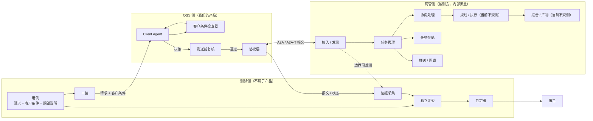
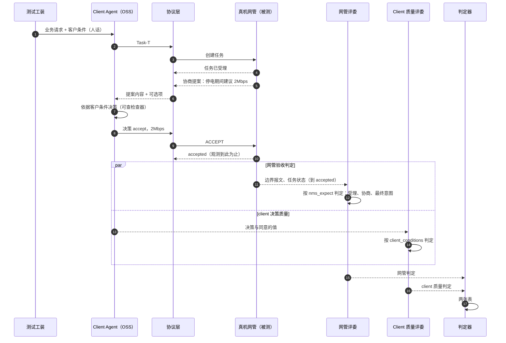
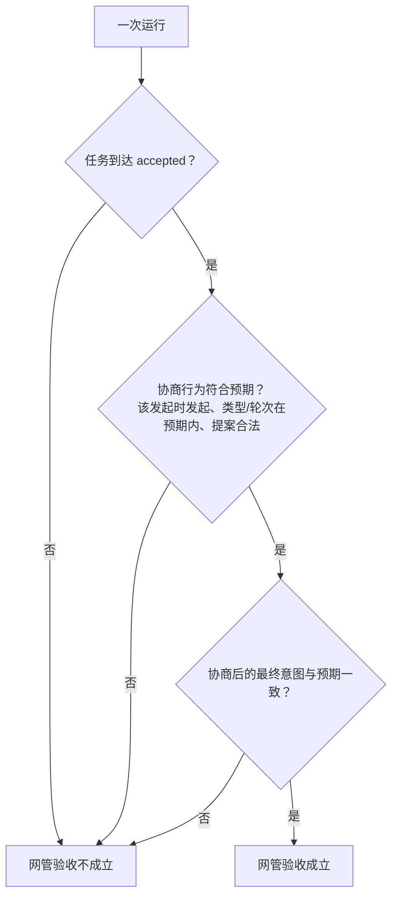
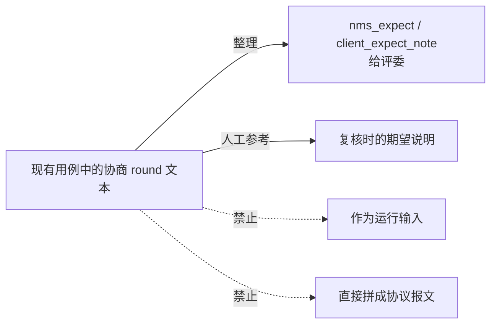
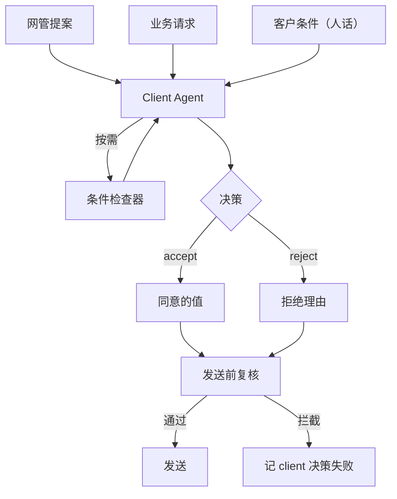
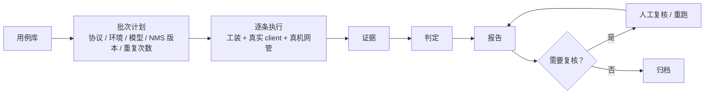
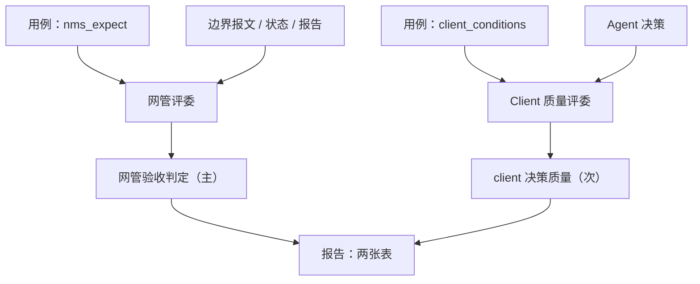
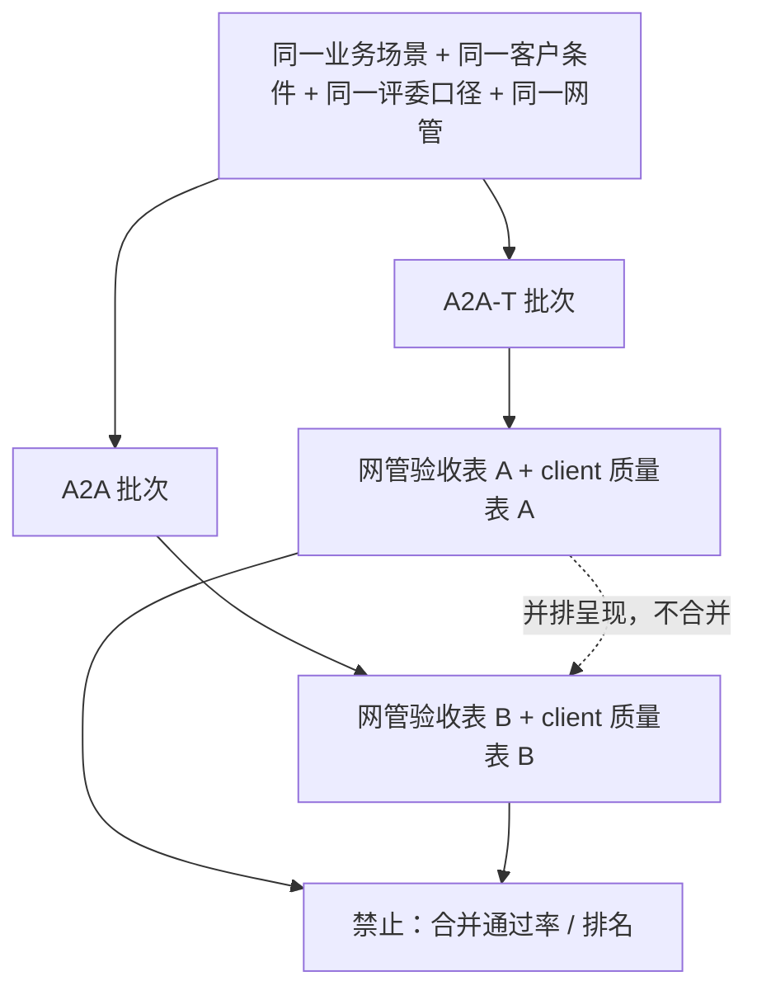

# A2A / A2A-T 自动化测试架构（评审稿）

日期：2026-11-19 ｜ 状态：待评审

**一句话**：被测方是即将上线的真机网管（大部分黑盒）；OSS 侧的 client agent 作为真实客户端驱动它；测试侧只给输入、采集证据、判定。主判定是网管验收，client 决策单独一张质量表。

**当前观测范围到任务 accepted 为止**：真机环境暂时测不到任务执行与完成，后面属于协议与 agent 的内容；本文不把执行、完成、报告计入验收。

---

## 1. 三侧边界



| 侧 | 包含 | 说明 |
|---|---|---|
| 测试侧 | 用例、工装、证据采集、判定器、独立评委 | 不属于产品，不被测 |
| OSS 侧 | client agent、协议层、客户条件检查器、发送前复核 | 我们的产品；既是测试驱动器，也单独评估决策质量 |
| 网管侧 | 接入/发现、任务管理、协商处理、规划/执行、任务存储、推送/回调、报告 | **被测方**；内部结构仅示意，测试不假设 |

**唯一可观察边界**：A2A / A2A-T 报文、任务状态、推送/回调、报告与产物。网管内部怎么决策、怎么执行，对测试不可见。

---

## 2. 一次真实测试怎么跑

以用例 26（停电期间保障速率 10Mbps → 网管提议 2Mbps）为例：



---

## 3. 主判定：网管验收

网管是唯一被测方。测试只看边界，判定到 **accepted** 为止，三项：



| 判定项 | 通过条件 | 失败示例 |
|---|---|---|
| 受理 | 任务到达 accepted（或平台等价状态），身份与用例一致 | 创建被拒、未到达 accepted、任务 id 错配 |
| 协商 | 该协商时发起；类型与轮次在预期内；提案是协议与业务上合法的替代方案 | 该协商却不协商；提案违反协议或业务约束（如负速率、窗口不覆盖停电） |
| 最终意图 | 协商结束时的最终意图（速率/窗口/站点）与用例预期一致 | 同意的速率错误、窗口未覆盖停电、站点被改动 |

**当前不纳入**：任务执行、任务完成、执行报告、业务效果——真机环境暂时观测不到。

**“该协商时发起”“最终意图是什么”怎么写**：用自然语言的 `nms_expect` 描述，不写规则语言（见 §4）。

---

## 4. 用例长什么样

一个用例 = 业务请求 + 网管期望 + 客户条件 + client 质量期望说明。全部是人话；判定到 accepted 为止。

下面三个例子改写自现有 OSP 用例，分别覆盖：**可行性协商（30）**、**按站点协商（29）**、**无协商（45）**。

### 4.1 例一：分段停电触发可行性协商（30）

```yaml
id: 30

request: |
  2 号 08:00-10:00 与 15:00-18:00 两段停电，影响 LNR_KPI_7745 和 NES_27A_321071，
  停电期间保障速率改为 10Mbps。

nms_expect: |
  受理任务；因分段停电时间较长，应当发起 feasibility 协商，
  提出一个可执行的替代速率（例如 2Mbps）；接受 client 的 accept 后到达 accepted。

client_conditions: |
  停电期间可以接受把速率降到 2Mbps；低于 2Mbps 不能接受。
  同意的窗口必须覆盖两段停电；站点不能改。

client_expect_note: |
  提案不低于 2Mbps 且覆盖两段停电时应当接受本轮提案值；
  低于 2Mbps 时应当拒绝，并说明该速率不可接受。

observed: |
  accepted；协商 1 轮；最终意图为停电期间 2Mbps。
```

### 4.2 例二：只对部分站点协商（29）

```yaml
id: 29

request: |
  2 号 08:00-18:00 停电影响 LNR_KPI_7745 和 NES_27A_321071；
  LNR_KPI_7745 的保障速率改为 10Mbps，NES_27A_321071 保持 2Mbps。

nms_expect: |
  受理任务；对 10Mbps 的站点发起 feasibility 协商，
  接受 client 的 accept 后到达 accepted；2Mbps 的站点不应被改动。

client_conditions: |
  两个站点在停电期间都可以接受降到 2Mbps；站点与时间窗口不能改。

client_expect_note: |
  提案把 LNR_KPI_7745 降到 2Mbps、NES_27A_321071 保持 2Mbps 时应当接受；
  提案改动站点或窗口时应当拒绝。

observed: |
  accepted；协商 1 轮；最终意图为两个站点停电期间均 2Mbps。
```

### 4.3 例三：无协商（45）

```yaml
id: 45

request: |
  在 A2ATestRegion 执行节能，分时段保障速率：
  00:00-07:00 2Mbps，07:00-18:00 10Mbps，18:00-24:00 2Mbps。

nms_expect: |
  受理任务，不发起协商，直接到达 accepted。

client_conditions: |
  请求本身已经完整，client 不需要让步。

client_expect_note: |
  本轮没有协商，client 不产生协商决策。

observed: |
  accepted；协商 0 轮。
```

| 字段 | 给谁 | 用途 |
|---|---|---|
| `request` | agent | 业务意图 |
| `client_conditions` | agent | 客户接受条件 |
| `nms_expect` | 网管评委 | 判断网管行为是否符合预期；两协议预期不同时按协议分别写，只写一份表示两者相同 |
| `client_expect_note` | client 质量评委 | 判断 client 决策是否合理 |
| `observed` | 报告读者 | 本次运行在边界上实际观测到的结果；不进入运行 |

`nms_expect` 与 `client_expect_note` 运行时都不展示给 agent。无协商用例（45）没有 client 决策质量行。

---

## 5. 旧的协商 round 怎么用

现有用例里的协商 round 文本**不再作为运行输入**：



---

## 6. client 决策质量（单独一张表）

client 不是被测方，但它是我们的产品，也是网管收到的输入来源；它的决策质量单独统计，不替代网管验收。



| 判定项 | 通过条件 |
|---|---|
| 动作 | accept / reject 与 `client_expect_note` 一致 |
| 值可追溯 | 同意的值出现在请求、提案或客户条件中 |
| 结构合法 | 协议层能产出合法内容 |
| 发送前复核 | 未被 L4 拦截 |

> client 决策失败**不等于**网管验收失败；两者分别记录，责任域分开。

---

## 7. 自动化怎么组织



判定分两路：



### 7.1 报告：网管验收表（主）

| 用例 | 协议 | 受理 | 协商 | 最终意图 | 判定 | 责任域 |
|---|---|---|---|---|---|---|
| 30 | A2A-T | 是 | feasibility ×1，提案 2Mbps | 停电期间 2Mbps | 成立 | — |
| 30 | A2A | 是 | 未发起协商 | — | 不成立：应协商未协商 | 网管 |
| 45 | A2A-T | 是 | 未协商 | 三段分时目标 | 成立 | — |

**责任域**：网管 / OSS 侧 / 测试侧 / 环境；“—”表示没有失败。

**不在这张表里**：任务执行、任务完成、执行报告、业务效果——当前观测不到。

### 7.2 报告：client 决策质量表（次）

| 用例 | 协议 | 本轮提案 | 期望（评委） | Agent 决策 | 动作 | 值 | 结构 | 复核 | 质量 |
|---|---|---|---|---|---|---|---|---|---|
| 26 | A2A-T | 2Mbps | accept 2Mbps | accept 2Mbps | ✓ | ✓ | ✓ | ✓ | 成立 |
| 26 | A2A-T | 1Mbps | reject | accept 1Mbps | ✗ | — | ✓ | 拦截 | 不成立 |

---

## 8. 中立性怎么体现



| 规则 | 做法 |
|---|---|
| 只给输入 | 工装只提供请求与客户条件，不提供期望 |
| 同一网管 | 两协议对同一个真机网管、同一版本 |
| 同一条件与评委 | 同一段人话条件、同一套评委口径 |
| 同一证据 | 边界报文、任务状态（到 accepted）、回执，同一套字段 |
| 并排报告 | 两协议各一套表；不合并、不排名 |

---

## 9. 组件归属

| 组件 | 属于 | 职责 |
|---|---|---|
| 用例库 | 测试侧 | 请求、网管期望、客户条件、质量期望说明 |
| 工装 | 测试侧 | 发起运行、提供输入、控制节奏 |
| 证据采集 | 测试侧 | 边界报文、任务状态（到 accepted）、推送 |
| 网管评委 | 测试侧 | 按 `nms_expect` 判定网管行为 |
| client 质量评委 | 测试侧 | 按 `client_conditions` 判定 client 决策 |
| Client Agent | OSS 侧 | 理解请求与条件，做出决策 |
| 条件检查器 | OSS 侧 | 回答提案或给定值是否可接受 |
| 发送前复核 | OSS 侧 | 拦截违规 accept |
| 协议层 | OSS 侧 | 渲染报文、盖章原语/轮次、收发 |
| 网管 | 被测方 | 受理、协商、存储、推送；执行与报告当前不观测 |

---

## 10. 与 A2A / A2A-T 的对应

| 边界上的协议行为 | 谁产生 | 网管验收看什么 |
|---|---|---|
| 创建任务、Task-T 元数据 | OSS 侧 | 网管是否受理 |
| 协商提案（PROPOSE） | 网管 | 类型、轮次、提案内容 |
| 协商接受/拒绝（ACCEPT/REJECT） | OSS 侧 | 网管是否接受该答复并到达 accepted |
| 任务状态（到 accepted） | 网管 | 是否在预期轮次后到达 accepted |
| 执行、完成、报告/产物 | 网管 | **当前不观测** |
| 推送/回调 | 网管 | 如与 accepted 相关则记录，否则不判 |

---

## 11. 评审决策点

> 以下为待评审项；“本文建议”不代表团队最终决策。

| # | 问题 | 选项 | 本文建议 | 状态 |
|---|---|---|---|---|
| D1 | 网管验收的粒度 | 只看 accepted / 逐边界检查（受理、协商、最终意图）/ 两者 | 逐边界检查，到 accepted 为止 | 待评审 |
| D2 | 网管期望怎么写 | 自然语言 `nms_expect` / 结构化条款 / 两者 | 自然语言，结构化仅作补充 | 待评审 |
| D3 | 提案内容是否要求“在客户可接受范围内” | 是 / 否，只要求协议与业务合法 | 否：客户底线是 OSS 侧私有信息，不能拿来判网管；客户是否接受由 client 质量表判定 | 待评审 |
| D4 | client 决策质量是否进入主报告 | 主表 / 附表 / 不进报告 | 附表，单独统计 | 待评审（按当前方向） |
| D5 | 条件检查器的查询范围 | 任意值 / 仅本轮提案 | 任意值，记录查询行为 | 待评审 |
| D6 | 发送前复核拦截算谁失败 | client / 网管 / 测试侧 / 不计 | client 失败 | 待评审 |
| D7 | 拒绝理由是否披露精确底线 | 允许 / 不允许 / 策略开关 | 策略开关，默认不披露 | 待定 |
| D8 | 网管评委与 client 评委是否同一套 | 分开 / 同一套 | 分开，口径独立 | 待评审 |
| D9 | 条件未覆盖的提案怎么判 | 评委先判 / 人工 / 失败 | 评委先判，分歧交人工 | 待评审 |
| D10 | 网管黑盒的观测范围 | 只边界报文 / 加日志/监控 / 加内部接口 | 只边界报文（黑盒），到 accepted 为止 | 待评审 |
| D11 | 执行与完成是否纳入验收 | 否（当前不可观测）/ 后续扩展 | 否，本阶段只到 accepted | 待评审 |
