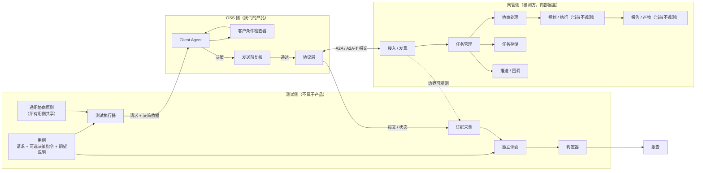
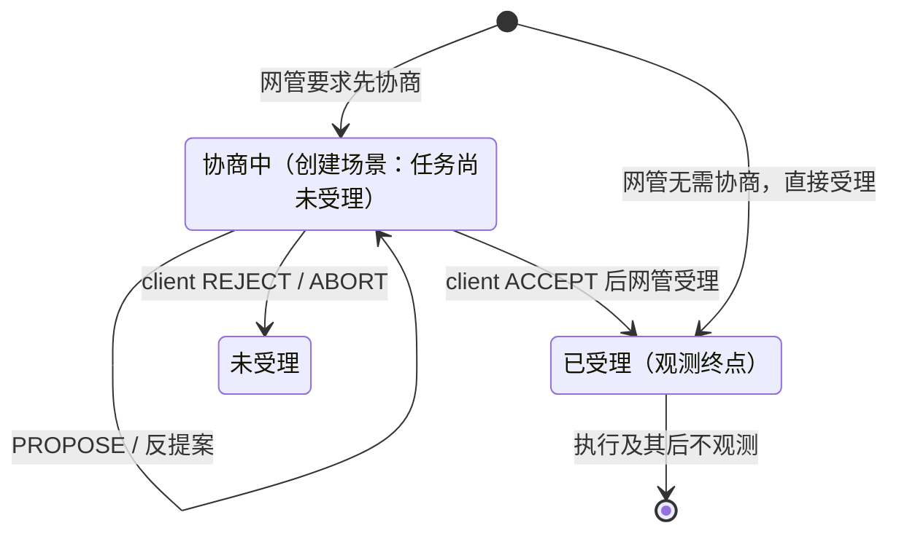
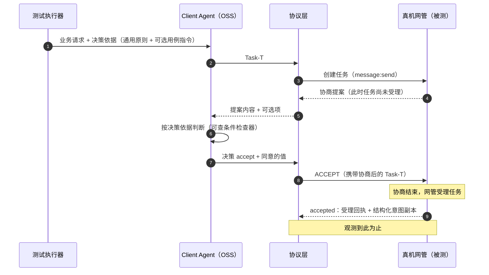
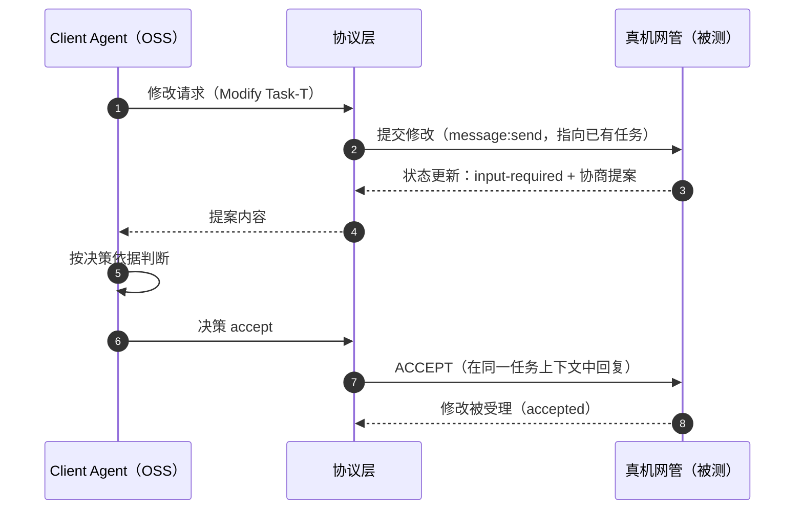
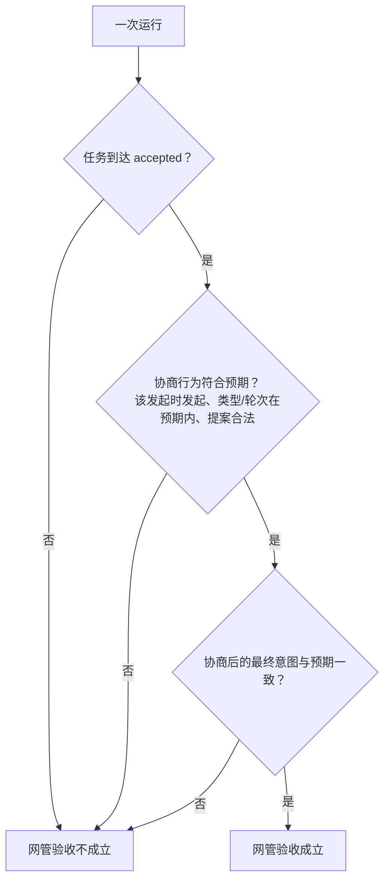
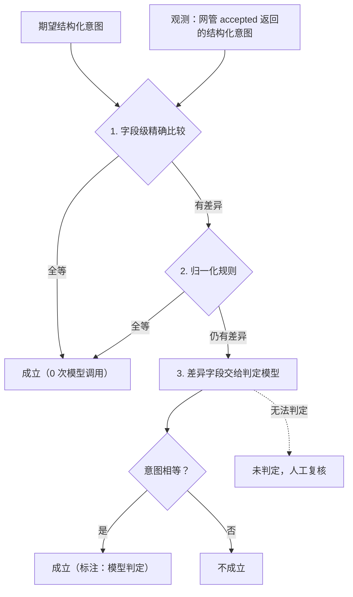
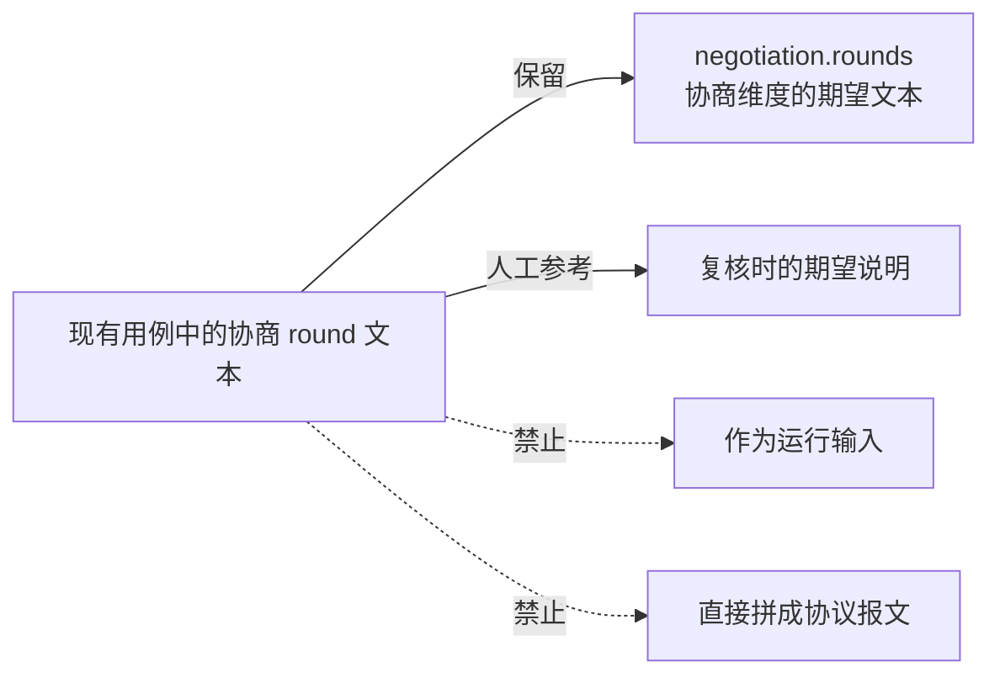
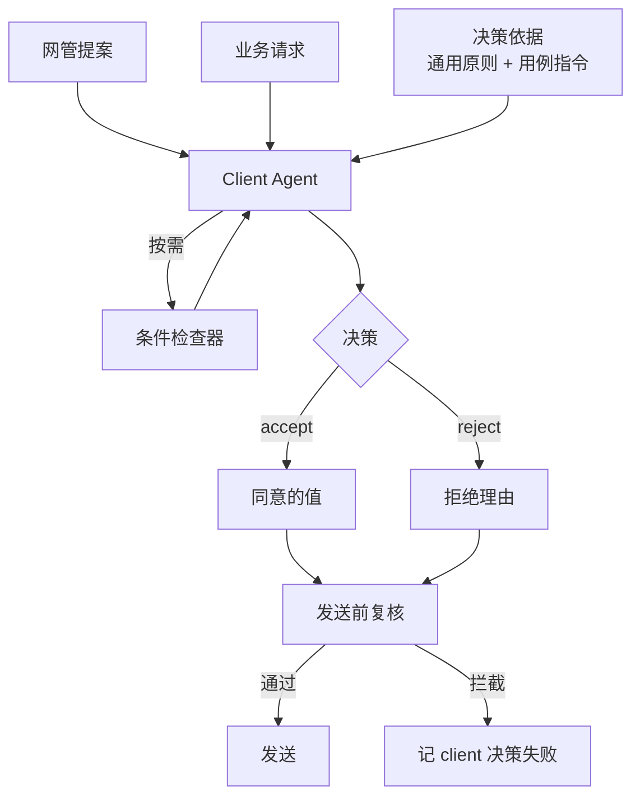
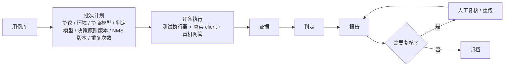
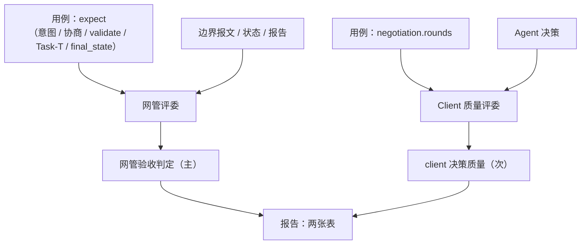

# A2A / A2A-T 自动化测试架构（评审稿）

日期：2026-11-19（更新 2026-11-23）｜ 状态：待评审

**一句话**：被测方是即将上线的真机网管（大部分黑盒）；OSS 侧的 client agent 作为真实客户端驱动它；测试侧只给输入、采集证据、判定。主判定是网管验收，client 决策单独一张质量表。

**当前观测范围到任务 accepted 为止**：accepted 是本文术语，指网管已明确受理、协商已结束的边界（定义见 §2.1）。真机环境暂时测不到任务执行与完成；本文不把执行、完成、报告计入验收。

---

## 1. 三侧边界



| 侧 | 包含 | 说明 |
|---|---|---|
| 测试侧 | 用例、通用协商原则、测试执行器、证据采集、判定器、独立评委 | 不属于产品，不被测 |
| OSS 侧 | client agent、协议层、客户条件检查器、发送前复核 | 我们的产品；既是测试驱动器，也单独评估决策质量 |
| 网管侧 | 接入/发现、任务管理、协商处理、规划/执行、任务存储、推送/回调、报告 | **被测方**；内部结构仅示意，测试不假设 |

**唯一可观察边界**：A2A / A2A-T 报文、任务状态、推送/回调、报告与产物。网管内部怎么决策、怎么执行，对测试不可见。

---

## 2. 一次真实测试怎么跑

### 2.1 accepted 是什么

**accepted 是本文的术语，不是 A2A 的任务状态名。** A2A 自己的任务状态是 submitted / working / input-required / completed / canceled / failed 这些；accepted 指“网管已经明确受理这次任务、协商已经结束”的边界时刻，是本文观测的终点。

判定 accepted 的依据（满足任一）：

| 依据 | 含义 |
|---|---|
| 任务状态越过 submitted | 进入 working 或更后的状态，说明网管确实接下了任务 |
| 受理响应带成功回执与结构化意图副本 | 状态仍是 submitted，但网管返回了成功回执和它对任务的结构化理解 |

只回 submitted、既没有回执也没有意图副本，记“等待受理”，**不算 accepted**——真机上出现过这种形态：回了 submitted，随后任务被取消。这正是要抓的网管问题。

为什么停在 accepted：真机目前只能稳定观测到受理这一点，执行、完成、报告都测不到（见 §3）。



### 2.2 创建任务：协商发生在受理之前

A2A-T 的创建流程里，协商是**前置**的：协商结束之前，任务还没有被受理。顺序是“先协商、后受理”，不是“先受理、后协商”。



无协商时没有提案与 ACCEPT 往返：创建任务后网管直接受理，client 不产生协商决策（用例 45）。

### 2.3 修改任务：任务在协商之前就已存在

修改的时间线与创建不同：任务在进入协商之前就已经存在、并且已经被受理过；网管的提案通常搭载在这个已有任务的状态更新上（例如 input-required）。



用例必须写明自己属于哪种时间线。把创建的时间线套到修改上，会得出“协商发生在受理之后”的错误结论。如果创建请求先收到 submitted、提案随后才通过推送到达，按实际观测记录时间线并单独归因，不要硬套创建流程。

---

## 3. 主判定：网管验收

网管是唯一被测方。判定直接复用现有 OSP 用例的断言维度，**不新增判定字段**：

| 现有维度 | 在主判定里的含义 | 真机批次 |
|---|---|---|
| `send` | 请求是否按用例预期发出 | 保留 |
| `final_state` | 任务是否到达预期状态 | 只判到 accepted；执行后的完成状态只记录（§2.1） |
| `negotiation` | 该协商时是否发起、类型与轮次是否在预期内、协商内容是否符合预期 | 保留 |
| `intent` | 最终结构化意图是否与 `expect.intent` 一致 | 保留；结构化优先（§3.1） |
| `validate` / `task_t` | 发送前校验与 Task-T 是否符合预期 | 保留 |
| `trace` | 证据链是否完整 | 保留 |

用例里的 `assert` 开关继续决定哪些维度参与判定，语义不变。下面对最关心的三项给出判定顺序：



| 判定项 | 现有维度 | 通过条件 | 失败示例 |
|---|---|---|---|
| 受理 | `send` + `final_state` | 任务到达 accepted（定义见 §2.1），身份与用例一致 | 创建被拒、只回 submitted 且无回执/意图副本、任务 id 错配 |
| 协商 | `negotiation` | 该协商时发起；类型与轮次在预期内；提案是协议与业务上合法的替代方案 | 该协商却不协商；提案违反协议或业务约束（如负速率、窗口不覆盖停电） |
| 最终意图 | `intent` | 协商结束时的最终意图（速率/窗口/站点）与 `expect.intent` 一致 | 同意的速率错误、窗口未覆盖停电、站点被改动 |

**当前不纳入**：任务执行、任务完成、执行报告、业务效果——真机环境暂时观测不到；对应 `final_state` 的执行后状态只记录。

**期望写在哪**：仍在现有 `expect` 与 `assert` 里，不新增字段；用例的协商期望文本继续放在 `negotiation.rounds`（见 §4）。

### 3.1 最终意图：结构化优先，模型兜底

**观测来源**：网管在 accepted 时返回的结构化意图副本。没有副本时记“无判定依据”，不回退到 client 的最终值。



**规则与模型的边界**：

| 交给规则（0 次模型调用） | 交给判定模型 |
|---|---|
| 速率单位、时间段格式、站点大小写/别名、段落顺序 | 需要上下文才能判断的语义等价 |
| 术语表里已有的映射（如 720p → 2Mbps） | 术语表没有覆盖的表达 |
| 空字段与“未指定”的等价性（按字段配置） | “停电期间”与显式窗口是否同一意图等 |

**模型角色分开配置**：

| 角色 | 计划模型 | 约束 |
|---|---|---|
| 协商交互 | qwen3.8 | client agent 做决策 |
| 意图判定 | deepseek-v4.1-flash | 独立 endpoint / key；只判差异字段；不可用时记“未判定”；不回退到协商模型 |

**调用控制**：

- 精确比较或归一化能判完的，不调用模型；
- 一次运行里所有剩余差异字段合并成一次判定调用；
- 按“字段 + 期望值 + 观测值 + 上下文摘要”的哈希缓存；
- 判定模型只接收字段名、期望值、观测值、业务请求与提案，不接收协议、实现或哪一侧的信息；
- 保留 prompt / response 证据，便于人工复核。

**暂不做**：判定结果抽样与一致率统计；先以结构化判定和差异字段判定跑通。

---

## 4. 用例长什么样

用例**沿用现有 OSP YAML**（`schema: osp-eval-case/v1`），字段和断言逻辑不变；引入 agent 决策只加一个可选字段。

### 4.1 保留什么，改什么

| 环节 | 处理 |
|---|---|
| `user_input`、`expect.intent`、`expect.protocols.*`、`assert`、`blocked_followup`、`baseline`、`runner`、`source` | **不变** |
| 意图抽取、Task-T、发送前校验、拦截后补充、发送、状态跟踪、证据采集 | **不变** |
| 断言维度（`intent` / `validate` / `task_t` / `send` / `negotiation` / `final_state` / `trace`） | **不变**；真机批次 `final_state` 只判到 accepted |
| 协商答复来源 | **改动**：从 `negotiation.rounds`（原 Q 列脚本）改为 agent 现场决策 |
| `negotiation.rounds` 字段 | **保留**，作用从“运行输入”改为“协商维度的期望文本” |
| 用例级决策指令 | **新增、可选**：`client_conditions` |

不新增 `nms_expect` / `client_expect_note` / `observed` 等字段：期望仍在 `expect`，判定仍在 `assert`。


### 4.2 决策依据分两层

agent 在协商时看到的客户侧输入分两层，避免每个用例重复写通用规则：

| 层 | 内容 | 作用范围 | 写在哪 |
|---|---|---|---|
| 通用协商原则 | 所有用例共享的默认行为，类似 system prompt | 所有用例 | 一份，全用例共用 |
| 用例级决策指令 | 本用例特有的接受条件或客户端已知事实，例如“停电期间可以接受到 2Mbps”“区域是 A2ATestRegion” | 仅该用例 | 可选；需要时才写 |

通用原则按协商类型给出默认做法，所有用例共用：

| 协商类型 | 默认做法 | 例子 |
|---|---|---|
| 信息协商 | 按协商请求列出的信息项补齐：缺区域补区域、缺站点补站点、缺速率补速率 | 服务端指出缺区域 → 回复用例里登记的区域 |
| 目标协商（意图协商） | 按协商请求指出的问题给出修正后的目标 | 服务端指出时间重叠 → 给出不重叠的时间窗口 |
| 可行性协商 | 按协商请求里的推荐方案回复 | 服务端推荐调整为 2Mbps → 回复 2Mbps |
| 复合场景 | 只回复本次协商请求覆盖的部分，请求没提到的问题不主动处理 | 同时存在时间重叠与可行性问题、服务端本次只发起可行性协商 → 只解决可行性 |

所有用例共同遵守：

- 协商请求没有提出问题时，按原请求执行，不主动让步；
- 区域、站点等实体只能来自请求或用例级指令，不编造；
- 信息协商缺的值，优先从请求里取；请求里没有时，由用例级指令提供；
- 目标协商产生的修正值（如消除时间重叠的窗口）要能说明修正依据；
- 用例级指令给出的边界优先：推荐方案或修正结果超出边界时拒绝，并说明原因；
- 没有用例级指令时，以上默认做法单独完成判断。

用例级指令只补充本用例特有的边界（速率底线、可让步的窗口等）或客户端已知的事实（如区域）。结构与值的安全性（不编造、结构合法）由发送前复核兜底。

下面三个例子仍取自现有 OSP 用例，分别覆盖：**可行性协商（30）**、**无协商（45）**、**复合场景（28）**。

### 4.3 例一：可行性协商（30）

```yaml
schema: osp-eval-case/v1
id: 30
operation: Create

user_input: |
  2 号 08:00-10:00 与 15:00-18:00 两段停电，影响 LNR_KPI_7745 和 NES_27A_321071，
  停电期间保障速率改为 10Mbps。

client_conditions: |        # 新增，可选
  停电期间可以接受把速率降到 2Mbps；低于 2Mbps 不能接受。
  同意的窗口必须覆盖两段停电；站点不能改。

expect:
  intent: { ... }           # 原有 11 键，不变
  protocols:
    a2a-t:
      validate: pass
      send: true
      task_t: "..."         # 原有：期望 Task-T 全文，不变
      negotiation:
        expected: true
        expected_rounds: 1
        kinds: [feasibility]
        rounds:             # 原有 Q 列：现在是期望文本，不再驱动运行
          - "Accept; reduce the throughput target to 2Mbps."
        messages: []
      final_state: task_completed   # 原有；真机批次只判到 accepted

assert:                     # 原有开关，不变
  intent: true
  a2a-t:
    validate: true
    task_t: true
    send: true
    negotiation: true
    final_state: true
```

### 4.4 例二：无协商（45）

```yaml
schema: osp-eval-case/v1
id: 45
operation: Create

user_input: |
  在 A2ATestRegion 执行节能，分时段保障速率：
  00:00-07:00 2Mbps，07:00-18:00 10Mbps，18:00-24:00 2Mbps。

# 不写 client_conditions：通用原则即可完成判断

expect:
  intent: { ... }
  protocols:
    a2a-t:
      validate: pass
      send: true
      task_t: "..."
      negotiation:
        expected: false
        expected_rounds: 0
        kinds: []
        rounds: []
      final_state: task_completed
```

### 4.5 例三：复合场景（28）

用例 28 同时存在时间重叠与可行性问题。现有用例的处理是：发送前校验判 `blocked`，由 `blocked_followup` 补一条不重叠的请求；这一段**保持不变**。如果网管在协商里先只提出可行性问题，client 只按本轮协商请求回答可行性，不主动处理时间重叠。

```yaml
schema: osp-eval-case/v1
id: 28
operation: Modify

user_input: |
  2 号 A2ATestRegion 的 LNR_KPI_7745 与 NES_27A_321071 在 08:00-18:00 停电；
  保障速率改为 08:00-12:00 10Mbps、11:00-18:00 5Mbps。

# 不写 client_conditions：通用原则即可

expect:
  intent: { ... }           # 原有：期望意图里时间已不重叠
  protocols:
    a2a-t:
      validate: blocked     # 原有：发送前校验拦截
      send: false
      task_t: "..."
      negotiation:
        expected: true
        expected_rounds: 1
        kinds: [feasibility]
        rounds:
          - "Accept; reduce the 5Mbps target to 2Mbps for the outage period."
      final_state: input_invalid

blocked_followup:           # 原有：拦截后补充不重叠的请求
  input: |
    ...
```

| 字段 | 给谁 | 用途 |
|---|---|---|
| `user_input` | agent | 业务请求原文 |
| `client_conditions` | agent | **可选**：本用例特有的接受条件或客户端已知事实；没有时只用通用协商原则 |
| `expect` | 判定器 | 原有：意图、validate、Task-T、协商、final_state |
| `assert` | 判定器 | 原有：哪些维度参与判定 |

`client_conditions` 是唯一新增字段；其余字段、`assert` 与判定逻辑保持现状。通用协商原则不写在用例里：按批次固定一份（见 §7）。

---

## 5. 协商 round 文本（Q 列）怎么用

现有用例里的协商 round 文本**不再作为运行输入**：



---

## 6. client 决策质量（单独一张表）

client 不是被测方，但它是我们的产品，也是网管收到的输入来源；它的决策质量单独统计，不替代网管验收。



| 判定项 | 通过条件 |
|---|---|
| 动作 | accept / reject 与 `negotiation.rounds`（原 Q 列）的期望答复一致 |
| 值可追溯 | 同意的值可追溯到请求、提案或决策依据；目标协商的修正值要能说明依据 |
| 结构合法 | 协议层能产出合法内容 |
| 发送前复核 | 未被 L4 拦截 |

> client 决策失败**不等于**网管验收失败；两者分别记录，责任域分开。期望来源是现有的 `negotiation.rounds`（原 Q 列）与可选的 `client_conditions`，不新增字段。

---

## 7. 自动化怎么组织



判定分两路：



### 7.1 报告：网管验收表（主）

| 用例 | 协议 | 受理 | 协商 | 最终意图 | 意图判定 | 判定 | 责任域 |
|---|---|---|---|---|---|---|---|
| 30 | A2A-T | 是 | feasibility ×1，提案 2Mbps | 停电期间 2Mbps | 结构化 | 成立 | — |
| 30 | A2A | 是 | 未发起协商 | — | — | 不成立：应协商未协商 | 网管 |
| 45 | A2A-T | 是 | 未协商 | 三段分时目标 | 结构化 | 成立 | — |

意图判定列取值：**结构化**（精确或归一化后全等）、**模型**（差异字段由判定模型判为意图相等）、**未判定**（无结构化副本或模型不可用，转人工）。

判定列直接来自现有 `assert` 维度；`意图判定` 只是 `intent` 维度的结构化/模型标注，不新增判定维度。

**责任域**：网管 / OSS 侧 / 测试侧 / 环境；“—”表示没有失败。

**不在这张表里**：任务执行、任务完成、执行报告、业务效果——当前观测不到。

### 7.2 报告：client 决策质量表（次）

| 用例 | 协议 | 本轮提案 | 期望（评委） | Agent 决策 | 动作 | 值 | 结构 | 复核 | 质量 |
|---|---|---|---|---|---|---|---|---|---|
| 26 | A2A-T | 2Mbps | accept 2Mbps | accept 2Mbps | ✓ | ✓ | ✓ | ✓ | 成立 |
| 26 | A2A-T | 1Mbps | reject | accept 1Mbps | ✗ | — | ✓ | 拦截 | 不成立 |

---

## 8. 中立性怎么体现


| 规则 | 做法 |
|---|---|
| 只给输入 | 测试执行器只提供请求与决策依据（通用原则 + 可选用例指令），不提供期望 |
| 同一网管 | 两协议对同一个真机网管、同一版本 |
| 同一决策依据与评委 | 同一版通用原则、同一段用例指令、同一套评委口径 |
| 同一证据 | 边界报文、任务状态（到 accepted）、回执，同一套字段 |
| 并排报告 | 两协议各一套表；不合并、不排名 |

---

## 9. 组件归属

| 组件 | 属于 | 职责 |
|---|---|---|
| 用例库 | 测试侧 | `user_input`、可选的 `client_conditions`、`expect`、`assert` |
| 通用协商原则 | 测试侧 | 所有用例共享的默认决策规则；按批次固定一个版本 |
| 测试执行器 | 测试侧 | 按用例发起一次运行、提供输入、控制节奏（即“跑用例的程序”） |
| 证据采集 | 测试侧 | 边界报文、任务状态（到 accepted）、推送 |
| 网管评委 | 测试侧 | 按现有 `expect`（意图、协商、validate、Task-T、final_state）判定网管行为 |
| client 质量评委 | 测试侧 | 按 `negotiation.rounds`（原 Q 列）判定 client 决策，参考 `client_conditions` |
| 意图判定模型 | 测试侧配置 | 只在结构化与归一化后仍有差异时，判断差异字段是否意图相等 |
| Client Agent | OSS 侧 | 理解请求与决策依据，做出决策 |
| 条件检查器 | OSS 侧 | 回答提案或给定值是否可接受 |
| 发送前复核 | OSS 侧 | 拦截违规 accept |
| 协议层 | OSS 侧 | 渲染报文、盖章原语/轮次、收发 |
| 网管 | 被测方 | 受理、协商、存储、推送；执行与报告当前不观测 |

---

## 10. 与 A2A / A2A-T 的对应

| 边界上的协议行为 | 谁产生 | 网管验收看什么 |
|---|---|---|
| 创建任务、Task-T 元数据 | OSS 侧 | 网管是否受理 |
| 协商提案（PROPOSE） | 网管 | 类型、轮次、提案内容 |
| 协商接受/拒绝（ACCEPT/REJECT） | OSS 侧 | 网管是否接受该答复并到达 accepted |
| 任务状态（到 accepted） | 网管 | 是否在预期轮次后到达 accepted |
| 执行、完成、报告/产物 | 网管 | **当前不观测** |
| 推送/回调 | 网管 | 如与 accepted 相关则记录，否则不判 |

---

## 11. 评审决策点

> 以下为待评审项；“本文建议”不代表团队最终决策。

| # | 问题 | 选项 | 本文建议 | 状态 |
|---|---|---|---|---|
| D1 | 网管验收的粒度 | 只看 accepted / 逐边界检查（受理、协商、最终意图）/ 两者 | 复用现有断言维度逐项判定；真机批次只到 accepted | 已对齐（2026-11-23） |
| D2 | 网管期望怎么写 | 自然语言 `nms_expect` / 结构化条款 / 两者 | 沿用现有 `expect`（意图、validate、Task-T、协商、final_state），不新增 `nms_expect` | 已对齐（2026-11-23） |
| D3 | 提案内容是否要求“在客户可接受范围内” | 是 / 否，只要求协议与业务合法 | 否：客户底线是 OSS 侧私有信息，不能拿来判网管；客户是否接受由 client 质量表判定 | 待评审 |
| D4 | client 决策质量是否进入主报告 | 主表 / 附表 / 不进报告 | 附表，单独统计 | 待评审（按当前方向） |
| D5 | 条件检查器的查询范围 | 任意值 / 仅本轮提案 | 任意值，记录查询行为 | 待评审 |
| D6 | 发送前复核拦截算谁失败 | client / 网管 / 测试侧 / 不计 | client 失败 | 待评审 |
| D7 | 拒绝理由是否披露精确底线 | 允许 / 不允许 / 策略开关 | 策略开关，默认不披露 | 待定 |
| D8 | 网管评委与 client 评委是否同一套 | 分开 / 同一套 | 分开，口径独立 | 待评审 |
| D9 | 条件未覆盖的提案怎么判 | 评委先判 / 人工 / 失败 | 评委先判，分歧交人工 | 待评审 |
| D10 | 网管黑盒的观测范围 | 只边界报文 / 加日志/监控 / 加内部接口 | 只边界报文（黑盒），到 accepted 为止 | 已对齐（2026-11-23） |
| D11 | 执行与完成是否纳入验收 | 否（当前不可观测）/ 后续扩展 | 否，本阶段只到 accepted；`final_state` 执行后只记录 | 已对齐（2026-11-23） |
| D12 | 最终意图的观测来源 | client 最终值 / 网管结构化副本 / 优先网管副本 | 网管在 accepted 返回的结构化意图副本；无副本记“无判定依据” | 已对齐（2026-11-19） |
| D13 | 判定模型的触发范围 | 任一差异 / 归一化后剩余差异 | 归一化后剩余差异，精确与归一化命中时不调用模型 | 已对齐（2026-11-19） |
| D14 | 判定模型配置 | 复用协商模型 / 独立角色 | 独立角色：qwen3.8 协商、deepseek-v4.1-flash 判定；独立 endpoint/key，不回退 | 已对齐（2026-11-19） |
| D15 | 判定结果抽样与一致率 | 现在做 / 后续再做 | 暂不做，先跑通结构化判定与差异字段判定 | 已对齐（2026-11-19） |
| D16 | 客户决策指令是否分层 | 每个用例写全 / 通用原则 + 可选用例指令 | 分两层：通用协商原则全用例共享，用例级指令可选 | 已对齐（2026-11-23） |
